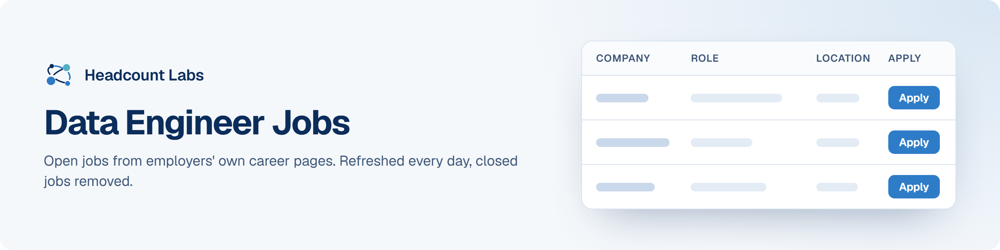

# Data Engineer Jobs

Data engineering, analytics engineering and data platform jobs at US employers.

**400 open jobs** · 95 new since the last update · 95 removed because they closed or left the employer's board · updated October 22, 2026 at 5:53 AM EDT

This list is built and refreshed every day by [Headcount Labs](https://headcountlabs.com/?utm_source=github&utm_medium=job-list&utm_campaign=data-engineer-jobs), which reads jobs straight from employers' own career pages and job boards. Every job here was still listed on its source board when we last read that board, within the past 3 days, and was posted in the past 30 days. Copies of the same job are merged into one row, and jobs that close are removed at the next update.

Want this data in your own app or agent? Use the [Headcount Labs jobs API](https://headcountlabs.com/docs/?utm_source=github&utm_medium=job-list&utm_campaign=data-engineer-jobs) (free tier), the [MCP server](https://headcountlabs.com/mcp/?utm_source=github&utm_medium=job-list&utm_campaign=data-engineer-jobs) for Claude, ChatGPT and other AI assistants, or the [open dataset](https://huggingface.co/datasets/HeadcountLabs/job-postings) on Hugging Face ([example queries](https://github.com/HeadcountLabs/job-postings)).

**Full dataset.** A bigger, one-off snapshot dated 2026-10-19 (all matching jobs, not only the open jobs below) is on Hugging Face: [Tech and software jobs](https://huggingface.co/datasets/HeadcountLabs/tech-jobs). It loads with `datasets.load_dataset` and is licensed CC BY 4.0.

**Jump to:** [Posted in the last 7 days (179)](#posted-in-the-last-7-days) · [Posted 8 to 30 days ago (221)](#posted-8-to-30-days-ago)

**Columns.** *Apply* opens the original posting on the employer's site. *Details* opens the job on Headcount Labs, with every posting we found for it. *Remote* shows what the employer states; a dash means the posting doesn't say. *Pay* is the range the employer published.

## Posted in the last 7 days

| Company | Role | Location | Remote | Pay | Posted | Apply | Details |
| --- | --- | --- | --- | --- | --- | :---: | :---: |
| **Warner Bros. Discovery** | Senior Staff Data Engineer (Advertising Technology - AWS experience required) | 

2 locations
United States Atlanta, GA
 | Hybrid | $144k–$268k/yr | Oct 21 |  | <a href="https://headcountlabs.com/catalog/jobs/e045a2f3-a503-4082-a7f9-d793a0d89b89?utm_source=github&utm_medium=job-list&utm_campaign=data-engineer-jobs">via Headcount Labs</a> |
| **The Huntington National Bank** | Data Engineer Lead | Columbus, OH | On-site | — | Oct 21 |  | <a href="https://headcountlabs.com/catalog/jobs/000b070e-e2aa-4275-8a86-e5c2f30bcf2d?utm_source=github&utm_medium=job-list&utm_campaign=data-engineer-jobs">via Headcount Labs</a> |
| **The Coca-Cola Company** | Senior Data Engineer - Streaming | Atlanta, GA | — | $152k–$178k/yr | Oct 21 |  | <a href="https://headcountlabs.com/catalog/jobs/c2efdaf9-edf3-4873-bfed-c6c2af78360e?utm_source=github&utm_medium=job-list&utm_campaign=data-engineer-jobs">via Headcount Labs</a> |
| **RxSense** | Senior Data Engineer | United States | Remote | $145k–$165k/yr | Oct 21 |  | <a href="https://headcountlabs.com/catalog/jobs/351a1ee8-afec-4af6-bf17-6e8d312e5e23?utm_source=github&utm_medium=job-list&utm_campaign=data-engineer-jobs">via Headcount Labs</a> |
| **Riverside Research Institute** | Enterprise Data Engineer | Dayton, OH | — | $130k–$150k/yr | Oct 21 |  | <a href="https://headcountlabs.com/catalog/jobs/d33e7bb9-92bb-498d-aa61-2a6ddb157893?utm_source=github&utm_medium=job-list&utm_campaign=data-engineer-jobs">via Headcount Labs</a> |
| **Realtor.com** | Data Engineer, Sr | Austin, TX | — | — | Oct 21 |  | <a href="https://headcountlabs.com/catalog/jobs/3344e641-2507-42f7-af2b-aa44a5adde37?utm_source=github&utm_medium=job-list&utm_campaign=data-engineer-jobs">via Headcount Labs</a> |
| **Proactive Technology Management** | Senior Full-Stack BI Architect / Fabric Data Engineer | Ferndale, MI | Hybrid | — | Oct 21 |  | <a href="https://headcountlabs.com/catalog/jobs/673db432-39bd-4d70-9220-7f264123ef71?utm_source=github&utm_medium=job-list&utm_campaign=data-engineer-jobs">via Headcount Labs</a> |
| **PRECISE SOFTWARE SOLUTIONS INCORPORATED** | AI/ML Data Engineer | Washington, DC | Hybrid | — | Oct 21 |  | <a href="https://headcountlabs.com/catalog/jobs/2b2d6eaa-382c-4940-b1d6-069cbd79cca4?utm_source=github&utm_medium=job-list&utm_campaign=data-engineer-jobs">via Headcount Labs</a> |
| **Pax8, Inc** | Senior Data Engineer II - Data Platforms | United States | Remote | $175k–$225k/yr | Oct 21 |  | <a href="https://headcountlabs.com/catalog/jobs/679bb882-308d-452f-967a-4f939fb74a7e?utm_source=github&utm_medium=job-list&utm_campaign=data-engineer-jobs">via Headcount Labs</a> |
| **Lewis Energy Group** | Data Engineer II | San Antonio, TX | — | — | Oct 21 |  | <a href="https://headcountlabs.com/catalog/jobs/71e985ba-91a8-4be1-bc43-f0f7ede07168?utm_source=github&utm_medium=job-list&utm_campaign=data-engineer-jobs">via Headcount Labs</a> |
| **K Health** | Data Engineer | New York, NY | Hybrid | $150k–$175k/yr | Oct 21 |  | <a href="https://headcountlabs.com/catalog/jobs/2e815752-6350-43c9-ac5c-71b60a72cd60?utm_source=github&utm_medium=job-list&utm_campaign=data-engineer-jobs">via Headcount Labs</a> |
| **Jobgether** | Snowflake Data Engineer | United States | Remote | $46–$56/hr | Oct 21 |  | <a href="https://headcountlabs.com/catalog/jobs/d0f066c2-2a96-42f5-a641-00a207e8a47a?utm_source=github&utm_medium=job-list&utm_campaign=data-engineer-jobs">via Headcount Labs</a> |
| **Jobgether** | Cybersecurity Data Engineer | United States | Remote | $40–$50/hr | Oct 21 |  | <a href="https://headcountlabs.com/catalog/jobs/60b5e731-60ab-4636-8611-8d5547f36b70?utm_source=github&utm_medium=job-list&utm_campaign=data-engineer-jobs">via Headcount Labs</a> |
| **Jobgether** | AI Data Engineer | United States | Remote | $67–$77/hr | Oct 21 |  | <a href="https://headcountlabs.com/catalog/jobs/6a142be2-2a8c-4295-914f-4fb8790a21cd?utm_source=github&utm_medium=job-list&utm_campaign=data-engineer-jobs">via Headcount Labs</a> |
| **itD Tech** | Data Engineer III (6352) | Menlo Park, CA | On-site | $65–$70/hr | Oct 21 |  | <a href="https://headcountlabs.com/catalog/jobs/ea38f5d7-ddce-4f26-b5d0-03f7fd9799bc?utm_source=github&utm_medium=job-list&utm_campaign=data-engineer-jobs">via Headcount Labs</a> |
| **Integrity Technology** | Software Data Engineer Mid-Level | Laurel, MD | — | $140k–$195k/yr | Oct 21 |  | <a href="https://headcountlabs.com/catalog/jobs/702bd376-24d1-43dd-870c-aa33ec678430?utm_source=github&utm_medium=job-list&utm_campaign=data-engineer-jobs">via Headcount Labs</a> |
| **Humana Inc.** | Senior Data Engineer | United States | Remote | $118k–$162k/yr | Oct 21 |  | <a href="https://headcountlabs.com/catalog/jobs/448f54c9-af6b-4b40-99c6-7ec4d1d91d41?utm_source=github&utm_medium=job-list&utm_campaign=data-engineer-jobs">via Headcount Labs</a> |
| **Grubhub Holdings Inc.** | Staff Data Engineer | United States | — | $208k–$225k/yr | Oct 21 |  | <a href="https://headcountlabs.com/catalog/jobs/f023bad0-571a-480e-98b5-0928e5645319?utm_source=github&utm_medium=job-list&utm_campaign=data-engineer-jobs">via Headcount Labs</a> |
| **Gallatin** | Senior Data Engineer (Data Platform) | 

4 locations
El Segundo, CA Washington, DC San Francisco, CA Austin, TX
 | On-site | $80k–$120k/yr | Oct 21 |  | <a href="https://headcountlabs.com/catalog/jobs/e49e8f33-bc63-4c71-824e-ec10f028c005?utm_source=github&utm_medium=job-list&utm_campaign=data-engineer-jobs">via Headcount Labs</a> |
| **First American** | Senior Data Engineer (Onsite) | Fort Mill, SC | On-site | $118k–$157k/yr | Oct 21 |  | <a href="https://headcountlabs.com/catalog/jobs/6ddfa93f-2013-4ad2-ba0c-39a5a49185ea?utm_source=github&utm_medium=job-list&utm_campaign=data-engineer-jobs">via Headcount Labs</a> |
| **DriveTime Sales and Finance Company, LLC** | Senior Data Engineer | 

2 locations
Tempe, AZ United States
 | Remote | — | Oct 21 |  | <a href="https://headcountlabs.com/catalog/jobs/f73149cc-3bf7-4659-9d68-19202ec9f962?utm_source=github&utm_medium=job-list&utm_campaign=data-engineer-jobs">via Headcount Labs</a> |
| **ConnectOne Bank** | Senior Data Engineer | Englewood Cliffs, NJ | — | $160k–$180k/yr | Oct 21 |  | <a href="https://headcountlabs.com/catalog/jobs/2d5f2163-21ef-44a7-af65-29e0fb51d41f?utm_source=github&utm_medium=job-list&utm_campaign=data-engineer-jobs">via Headcount Labs</a> |
| **CommunityCare** | Business Intelligence - Data Engineer 133-2016 | Tulsa, OK | On-site | — | Oct 21 |  | <a href="https://headcountlabs.com/catalog/jobs/d249e56b-cccf-4f64-93a1-88564c5be43a?utm_source=github&utm_medium=job-list&utm_campaign=data-engineer-jobs">via Headcount Labs</a> |
| **Casper Sleep** | Data Engineer | Richmond, VA | Hybrid | $115k–$130k/yr | Oct 21 |  | <a href="https://headcountlabs.com/catalog/jobs/639190ba-e978-42c4-9ef9-c4e4fd5a4140?utm_source=github&utm_medium=job-list&utm_campaign=data-engineer-jobs">via Headcount Labs</a> |
| **Bright Vision Technologies** | ML Data Engineer | Wesley Chapel, FL | Remote | $100k–$150k/yr | Oct 21 |  | <a href="https://headcountlabs.com/catalog/jobs/c1c42282-249b-4a0f-a416-f9fe45364d29?utm_source=github&utm_medium=job-list&utm_campaign=data-engineer-jobs">via Headcount Labs</a> |
| **Bright Vision Technologies** | AI Data Engineer | 

2 locations
Piscataway, NJ Schaumburg, IL
 | Remote | $100k–$150k/yr | Oct 21 |  | <a href="https://headcountlabs.com/catalog/jobs/7477a215-efb4-4ee7-a01b-c4d842407a16?utm_source=github&utm_medium=job-list&utm_campaign=data-engineer-jobs">via Headcount Labs</a> |
| **Bright Vision Technologies** | Senior Data Engineer – Hadoop | Overland Park, KS | Remote | $145k–$165k/yr | Oct 21 |  | <a href="https://headcountlabs.com/catalog/jobs/1895826a-43c0-4d81-b2ad-e2a024aed645?utm_source=github&utm_medium=job-list&utm_campaign=data-engineer-jobs">via Headcount Labs</a> |
| **APEX Fintech Services LLC** | Data engineer | Austin, TX | — | — | Oct 21 |  | <a href="https://headcountlabs.com/catalog/jobs/9b154394-8ca5-439c-91ab-6d16feeeb340?utm_source=github&utm_medium=job-list&utm_campaign=data-engineer-jobs">via Headcount Labs</a> |
| **Alter Domus** | Data Engineer | Chicago | — | $88k–$145k/yr | Oct 21 |  | <a href="https://headcountlabs.com/catalog/jobs/b9f635f2-506e-4881-8c8d-45d03676baae?utm_source=github&utm_medium=job-list&utm_campaign=data-engineer-jobs">via Headcount Labs</a> |
| **AFMIC American Family Mutual Insurance Company, S.I.** | Summer 2027 Intern - Data Engineer | United States | Hybrid | — | Oct 21 |  | <a href="https://headcountlabs.com/catalog/jobs/10135d4d-a256-4e4a-8d63-3f3bdf60a4e3?utm_source=github&utm_medium=job-list&utm_campaign=data-engineer-jobs">via Headcount Labs</a> |
| **95-2566122 First American Title Insurance Co** | Senior Data Engineer (Onsite) | Fort Mill, SC | On-site | $122k–$131k/yr | Oct 21 |  | <a href="https://headcountlabs.com/catalog/jobs/54b4c39d-d780-46ce-ba82-97161c6271aa?utm_source=github&utm_medium=job-list&utm_campaign=data-engineer-jobs">via Headcount Labs</a> |
| **West 4th Strategy** | Data Engineer (Remote) | Arlington, VA | Remote | $125k–$135k/yr | Oct 20 |  | <a href="https://headcountlabs.com/catalog/jobs/2dbe9f8c-3e70-47ee-9367-40a6a7c43126?utm_source=github&utm_medium=job-list&utm_campaign=data-engineer-jobs">via Headcount Labs</a> |
| **Vericast** | Senior Data Engineer | San Antonio, TX | Remote | $130k–$150k/yr | Oct 20 |  | <a href="https://headcountlabs.com/catalog/jobs/675de478-61c1-4e5c-a9a2-ed8c49db26f9?utm_source=github&utm_medium=job-list&utm_campaign=data-engineer-jobs">via Headcount Labs</a> |
| **Vantage Risk Companies** | AVP, Data Engineer | 

8 locations
New York, NY Chicago, IL Norwalk, CT Atlanta, GA West Hartford, CT Boston, MA Washington, DC United States
 | Hybrid | $175k–$210k/yr | Oct 20 |  | <a href="https://headcountlabs.com/catalog/jobs/86299f74-dd8a-4094-8db9-17d9fb84b07f?utm_source=github&utm_medium=job-list&utm_campaign=data-engineer-jobs">via Headcount Labs</a> |
| **Univision Communications, Inc** | Principal Data Engineer | 

2 locations
Miami, FL Los Angeles, CA
 | — | — | Oct 20 |  | <a href="https://headcountlabs.com/catalog/jobs/3588f8fc-ae62-479c-815b-f75b44f932da?utm_source=github&utm_medium=job-list&utm_campaign=data-engineer-jobs">via Headcount Labs</a> |
| **Univision Communications, Inc** | Senior Data Engineer | 

2 locations
Miami, FL Los Angeles, CA
 | — | — | Oct 20 |  | <a href="https://headcountlabs.com/catalog/jobs/52a1e7bb-ae7a-4cbb-a060-1de73bce71ee?utm_source=github&utm_medium=job-list&utm_campaign=data-engineer-jobs">via Headcount Labs</a> |
| **TrueScripts Management Services** | Data Engineer | Washington, IN | Remote | — | Oct 20 |  | <a href="https://headcountlabs.com/catalog/jobs/ddf21276-2c27-4b14-aadc-4648f5907e82?utm_source=github&utm_medium=job-list&utm_campaign=data-engineer-jobs">via Headcount Labs</a> |
| **Trucordia** | Data Engineer | Lindon, UT | Hybrid | — | Oct 20 |  | <a href="https://headcountlabs.com/catalog/jobs/436ef72b-6cc2-4e0f-b6d8-a893c72f20a0?utm_source=github&utm_medium=job-list&utm_campaign=data-engineer-jobs">via Headcount Labs</a> |
| **TOMORROW HIRE** | Data Engineer - Active TS/SCI with CI Polygraph (CIP) | McLean, VA | On-site | — | Oct 20 |  | <a href="https://headcountlabs.com/catalog/jobs/a4f2b638-ef08-450c-803e-a5f833e62968?utm_source=github&utm_medium=job-list&utm_campaign=data-engineer-jobs">via Headcount Labs</a> |
| **TEXAS MUNICIPAL RETIREMENT SYSTEM** | Data Engineer (SR) | Austin, TX | — | $130k–$170k/yr | Oct 20 |  | <a href="https://headcountlabs.com/catalog/jobs/96fe9c30-bf5e-43ab-9761-09145c8290ea?utm_source=github&utm_medium=job-list&utm_campaign=data-engineer-jobs">via Headcount Labs</a> |
| **tastytrade** | Data Engineer | Chicago, IL | — | $130k–$150k/yr | Oct 20 |  | <a href="https://headcountlabs.com/catalog/jobs/cd53eaa5-8e09-4f53-b319-e55430d5f4d3?utm_source=github&utm_medium=job-list&utm_campaign=data-engineer-jobs">via Headcount Labs</a> |
| **tastylive** | Data Engineer | Chicago, IL | — | $130k–$150k/yr | Oct 20 |  | <a href="https://headcountlabs.com/catalog/jobs/2406c0e6-1bd3-45cc-8574-70b5bf0fae0f?utm_source=github&utm_medium=job-list&utm_campaign=data-engineer-jobs">via Headcount Labs</a> |
| **Schwab** | AI/ML Ops and Data Engineer | 

3 locations
Southlake, TX Austin, TX Phoenix, AZ
 | — | $135k–$195k/yr | Oct 20 |  | <a href="https://headcountlabs.com/catalog/jobs/9f184f69-f20e-4ce0-bfc8-4a9ac7d9c624?utm_source=github&utm_medium=job-list&utm_campaign=data-engineer-jobs">via Headcount Labs</a> |
| **Schwab** | Machine Learning Ops Data Engineer | 

3 locations
Southlake, TX Austin, TX Phoenix, AZ
 | — | $102k–$185k/yr | Oct 20 |  | <a href="https://headcountlabs.com/catalog/jobs/0525ff0f-a046-441b-88da-f04fe6d88603?utm_source=github&utm_medium=job-list&utm_campaign=data-engineer-jobs">via Headcount Labs</a> |
| **Rentschler Biopharma Inc.** | IT Data Engineer | Milford, MA | — | $105k–$125k/yr | Oct 20 |  | <a href="https://headcountlabs.com/catalog/jobs/3e4f0371-85d7-45fe-928b-e72c151ccdfa?utm_source=github&utm_medium=job-list&utm_campaign=data-engineer-jobs">via Headcount Labs</a> |
| **RELX Inc. Company** | Sr. Data Engineer | North Carolina | Remote | $95k–$159k/yr | Oct 20 |  | <a href="https://headcountlabs.com/catalog/jobs/dd424e82-ac1a-4182-931f-854d870c7c88?utm_source=github&utm_medium=job-list&utm_campaign=data-engineer-jobs">via Headcount Labs</a> |
| **Qventus** | Senior Data Engineer | United States | Remote | $130k–$150k/yr | Oct 20 |  | <a href="https://headcountlabs.com/catalog/jobs/86f430bd-5b97-4453-a0a1-01c6a326036f?utm_source=github&utm_medium=job-list&utm_campaign=data-engineer-jobs">via Headcount Labs</a> |
| **PrePass** | Senior Data Engineer | Phoenix, AZ | Hybrid | — | Oct 20 |  | <a href="https://headcountlabs.com/catalog/jobs/adbacf2e-3c74-495c-94ec-b0321e02281a?utm_source=github&utm_medium=job-list&utm_campaign=data-engineer-jobs">via Headcount Labs</a> |
| **Preferred Travel Group** | Data Engineer III | United States | — | $120k–$150k/yr | Oct 20 |  | <a href="https://headcountlabs.com/catalog/jobs/4a1c78a5-53f7-4403-a575-0ca53fdbceb7?utm_source=github&utm_medium=job-list&utm_campaign=data-engineer-jobs">via Headcount Labs</a> |
| **Penn Interactive** | Senior Data Engineer | United States | Remote | $130k–$175k/yr | Oct 20 |  | <a href="https://headcountlabs.com/catalog/jobs/fad651c7-029b-4975-b9ed-7596240399a1?utm_source=github&utm_medium=job-list&utm_campaign=data-engineer-jobs">via Headcount Labs</a> |
| **Pekin Insurance** | Data Engineer I | Pekin, IL | Hybrid | $73k–$98k/yr | Oct 20 |  | <a href="https://headcountlabs.com/catalog/jobs/4a3ec69b-ca10-4a56-87fe-5c53d5b0f329?utm_source=github&utm_medium=job-list&utm_campaign=data-engineer-jobs">via Headcount Labs</a> |
| **Nex** | Senior Business Data Engineer | United States | Remote | $140k–$170k/yr | Oct 20 |  | <a href="https://headcountlabs.com/catalog/jobs/7131d964-81d3-4f47-9bdd-3d47fe6a6c5b?utm_source=github&utm_medium=job-list&utm_campaign=data-engineer-jobs">via Headcount Labs</a> |
| **Moser Consulting** | AWS/Databricks Cloud Data Engineer | Indianapolis, IN | On-site | $85k–$125k/yr | Oct 20 |  | <a href="https://headcountlabs.com/catalog/jobs/a0238e3f-f568-4fc7-bf97-c3d91c0ffc93?utm_source=github&utm_medium=job-list&utm_campaign=data-engineer-jobs">via Headcount Labs</a> |
| **Montefiore** | Data Engineer - Research Informatics (JR229580) | Yonkers, NY | — | $128k–$160k/yr | Oct 20 |  | <a href="https://headcountlabs.com/catalog/jobs/2a2d8d47-4e06-4b5f-9f7c-cbedd25134e3?utm_source=github&utm_medium=job-list&utm_campaign=data-engineer-jobs">via Headcount Labs</a> |
| **Jobgether** | Senior Data Engineer | United States | Remote | — | Oct 20 |  | <a href="https://headcountlabs.com/catalog/jobs/cff3b131-6021-47fd-af4c-822da5668d31?utm_source=github&utm_medium=job-list&utm_campaign=data-engineer-jobs">via Headcount Labs</a> |
| **Job Listings** | Data Engineer 1 | WALLER, TX | — | — | Oct 20 |  | <a href="https://headcountlabs.com/catalog/jobs/e8988ec3-37f3-45a4-9453-5749507fa2e1?utm_source=github&utm_medium=job-list&utm_campaign=data-engineer-jobs">via Headcount Labs</a> |
| **ISI Enterprises** | Data Engineer (AI &amp; Automation) | Reston, VA | Remote | $130k–$150k/yr | Oct 20 |  | <a href="https://headcountlabs.com/catalog/jobs/28e00195-b25a-4968-a7d7-9a86434a2102?utm_source=github&utm_medium=job-list&utm_campaign=data-engineer-jobs">via Headcount Labs</a> |
| **Infinite Computer Solutions** | Data Engineer | Georgia | — | — | Oct 20 |  | <a href="https://headcountlabs.com/catalog/jobs/71ad8c46-520f-4c51-b5c8-7b953b1aeddd?utm_source=github&utm_medium=job-list&utm_campaign=data-engineer-jobs">via Headcount Labs</a> |
| **FanDuel** | Data Engineer | Atlanta, GA | Hybrid | $116k–$152k/yr | Oct 20 |  | <a href="https://headcountlabs.com/catalog/jobs/743c195d-2c0e-42d3-9a55-ca1efdc2d6a6?utm_source=github&utm_medium=job-list&utm_campaign=data-engineer-jobs">via Headcount Labs</a> |
| **E&amp;M Technologies, Inc.** | Data Engineer | Alexandria, VA | — | — | Oct 20 |  | <a href="https://headcountlabs.com/catalog/jobs/6881238f-b521-4137-9737-5c37a0ecd150?utm_source=github&utm_medium=job-list&utm_campaign=data-engineer-jobs">via Headcount Labs</a> |
| **CoStar Realty Information, Inc.** | Senior Data Engineer - Apartments.com | Irvine | — | $128k–$190k/yr | Oct 20 |  | <a href="https://headcountlabs.com/catalog/jobs/5282a0ff-484c-4f54-926b-d4d3ac9c3af5?utm_source=github&utm_medium=job-list&utm_campaign=data-engineer-jobs">via Headcount Labs</a> |
| **Clera** | Founding Data Engineer (Pricing/Comps) | New York, NY | Remote | — | Oct 20 |  | <a href="https://headcountlabs.com/catalog/jobs/4aaa9316-4455-4985-9087-9cff7a579316?utm_source=github&utm_medium=job-list&utm_campaign=data-engineer-jobs">via Headcount Labs</a> |
| **Cityblock Health, Inc.** | Staff Data Engineer | United States | Remote | $153k–$210k/yr | Oct 20 |  | <a href="https://headcountlabs.com/catalog/jobs/0e91e030-a83d-44ae-886e-c45b2282b96f?utm_source=github&utm_medium=job-list&utm_campaign=data-engineer-jobs">via Headcount Labs</a> |
| **Charles Schwab Inc.** | AI/ML Ops and Data Engineer | 

3 locations
Southlake, TX Austin, TX Phoenix, AZ
 | — | $135k–$195k/yr | Oct 20 |  | <a href="https://headcountlabs.com/catalog/jobs/4e202d19-aba6-4e52-bc22-964d277ebd3a?utm_source=github&utm_medium=job-list&utm_campaign=data-engineer-jobs">via Headcount Labs</a> |
| **Charles Schwab Inc.** | Machine Learning Ops Data Engineer | 

3 locations
Southlake, TX Austin, TX Phoenix, AZ
 | — | $102k–$185k/yr | Oct 20 |  | <a href="https://headcountlabs.com/catalog/jobs/0b8e1dc3-3ab3-4865-8f62-d8797efb5678?utm_source=github&utm_medium=job-list&utm_campaign=data-engineer-jobs">via Headcount Labs</a> |
| **BuzzClan LLC** | Sr. Data Engineer – Power Automate RPA | Dallas, TX | — | — | Oct 20 |  | <a href="https://headcountlabs.com/catalog/jobs/6fb2b6c3-ae6d-4090-beeb-6df1bfaa2f54?utm_source=github&utm_medium=job-list&utm_campaign=data-engineer-jobs">via Headcount Labs</a> |
| **Bright Vision Technologies** | SAP Data Engineer | Overland Park, KS | Remote | $130k–$150k/yr | Oct 20 |  | <a href="https://headcountlabs.com/catalog/jobs/984e718b-bfa0-4daf-b06d-7b2779d0a60e?utm_source=github&utm_medium=job-list&utm_campaign=data-engineer-jobs">via Headcount Labs</a> |
| **Bright Vision Technologies** | Machine Learning Data Engineer | San Diego (Mira Mesa / 4S Ranch / Carmel Valley), CA | Remote | $80k–$100k/yr | Oct 20 |  | <a href="https://headcountlabs.com/catalog/jobs/593a9643-77cd-4593-9e09-ed883ad00a1a?utm_source=github&utm_medium=job-list&utm_campaign=data-engineer-jobs">via Headcount Labs</a> |
| **Axos Bank** | JBATA - Data Engineer | San Diego, CA | On-site | — | Oct 20 |  | <a href="https://headcountlabs.com/catalog/jobs/a450cece-630b-4b4f-8bbc-6ecc3313c222?utm_source=github&utm_medium=job-list&utm_campaign=data-engineer-jobs">via Headcount Labs</a> |
| **. Crane Worldwide Logistics .** | Data Engineer I, Data Products | Houston, TX | Remote | — | Oct 20 |  | <a href="https://headcountlabs.com/catalog/jobs/b2110a6c-ab65-4eaa-a383-13cd3c11efd3?utm_source=github&utm_medium=job-list&utm_campaign=data-engineer-jobs">via Headcount Labs</a> |
| **Zifo** | Sr. Data Engineer | Raleigh, NC | On-site | — | Oct 19 |  | <a href="https://headcountlabs.com/catalog/jobs/87a25a15-631d-4200-b5e3-ecd6ab57f337?utm_source=github&utm_medium=job-list&utm_campaign=data-engineer-jobs">via Headcount Labs</a> |
| **West Monroe** | Senior Data Engineer | 

8 locations
New York, NY Chicago Dallas Los Angeles Minneapolis San Francisco Seattle Washington, D.C.
 | — | $126k–$148k/yr | Oct 19 |  | <a href="https://headcountlabs.com/catalog/jobs/f016c91a-c3e8-415e-9fa5-e1307b230ff7?utm_source=github&utm_medium=job-list&utm_campaign=data-engineer-jobs">via Headcount Labs</a> |
| **Wealth.com** | Sr Data Engineer | New York, NY | Hybrid | $190k–$210k/yr | Oct 19 |  | <a href="https://headcountlabs.com/catalog/jobs/6fd284da-7bc5-44bf-97c7-b06b3c85fc38?utm_source=github&utm_medium=job-list&utm_campaign=data-engineer-jobs">via Headcount Labs</a> |
| **US: Mastercard Technologies, LLC** | Lead Data Engineer | 

2 locations
Arlington, VA Arlington
 | Hybrid | $161k–$266k/yr | Oct 19 |  | <a href="https://headcountlabs.com/catalog/jobs/262f5821-75ee-447f-a0bf-0ddd28c484a1?utm_source=github&utm_medium=job-list&utm_campaign=data-engineer-jobs">via Headcount Labs</a> |
| **UnitedHealth Group** | Senior Data Engineer | 

5 locations
Eden Prairie, MN Minneapolis, MN Irvine, CA Plymouth, MN Chicago, IL
 | — | $92k–$164k/yr | Oct 19 |  | <a href="https://headcountlabs.com/catalog/jobs/e606b0c3-9e05-4aee-93c7-2b41e7d827ca?utm_source=github&utm_medium=job-list&utm_campaign=data-engineer-jobs">via Headcount Labs</a> |
| **UnitedHealth Group** | Senior Data Engineer - Remote | Eden Prairie, MN | Remote | $92k–$164k/yr | Oct 19 |  | <a href="https://headcountlabs.com/catalog/jobs/038a25d3-8ffd-4364-bd0c-f9c7037681fb?utm_source=github&utm_medium=job-list&utm_campaign=data-engineer-jobs">via Headcount Labs</a> |
| **UnitedHealth Group** | Data Engineer - Office-Based in Minnesota | Eden Prairie, MN | — | $73k–$130k/yr | Oct 19 |  | <a href="https://headcountlabs.com/catalog/jobs/3cc021fb-a1fe-4420-9199-ba80b1bfbe5f?utm_source=github&utm_medium=job-list&utm_campaign=data-engineer-jobs">via Headcount Labs</a> |
| **Travelers Indemnity Co** | Data Engineer I (AWS, Python, GenAI) | 

2 locations
Hartford, CT Saint Paul, MN
 | Hybrid | $109k–$180k/yr | Oct 19 |  | <a href="https://headcountlabs.com/catalog/jobs/7e1c11b3-6782-42f2-bdd3-0f566aafbfd8?utm_source=github&utm_medium=job-list&utm_campaign=data-engineer-jobs">via Headcount Labs</a> |
| **Trading Technologies** | Data Engineer | New York, NY | Hybrid | $94k–$115k/yr | Oct 19 |  | <a href="https://headcountlabs.com/catalog/jobs/5610dfce-bb8a-401d-b0b9-9dbf38be3c55?utm_source=github&utm_medium=job-list&utm_campaign=data-engineer-jobs">via Headcount Labs</a> |
| **TheStaffed** | Senior Data Engineer (GenAI / AWS) | Los Angeles, CA | — | — | Oct 19 |  | <a href="https://headcountlabs.com/catalog/jobs/3fcf75f8-88df-46a3-8e8a-757bc494bebc?utm_source=github&utm_medium=job-list&utm_campaign=data-engineer-jobs">via Headcount Labs</a> |
| **TelevisaUnivision Management Co.** | Principal Data Engineer | 

2 locations
Miami, FL Los Angeles, CA
 | — | — | Oct 19 |  | <a href="https://headcountlabs.com/catalog/jobs/89ca1dc7-c936-43fa-938d-c5b8c8e95e89?utm_source=github&utm_medium=job-list&utm_campaign=data-engineer-jobs">via Headcount Labs</a> |
| **TelevisaUnivision Management Co.** | Senior Data Engineer | 

2 locations
Miami, FL Los Angeles, CA
 | — | — | Oct 19 |  | <a href="https://headcountlabs.com/catalog/jobs/879d265e-347d-4074-9fcb-7df8335a1614?utm_source=github&utm_medium=job-list&utm_campaign=data-engineer-jobs">via Headcount Labs</a> |
| **StorageMart &#124; MMS** | Data Engineer II | Columbia, MO | On-site | $100k–$120k/yr | Oct 19 |  | <a href="https://headcountlabs.com/catalog/jobs/1516461d-de55-49e8-a40f-744a498a9573?utm_source=github&utm_medium=job-list&utm_campaign=data-engineer-jobs">via Headcount Labs</a> |
| **State Farm** | Lead Data Engineer (AWS) | 

4 locations
Tempe, AZ Bloomington, IL Richardson, TX Dunwoody, GA
 | — | — | Oct 19 |  | <a href="https://headcountlabs.com/catalog/jobs/8e9f336b-d47e-4898-b164-1259bbea75d2?utm_source=github&utm_medium=job-list&utm_campaign=data-engineer-jobs">via Headcount Labs</a> |
| **Southern Company** | Data Engineer – Azure Databricks and Cloud Data Solutions (Safety) | Birmingham, AL | On-site | — | Oct 19 |  | <a href="https://headcountlabs.com/catalog/jobs/da11d067-c681-484f-a6b8-ae997d335276?utm_source=github&utm_medium=job-list&utm_campaign=data-engineer-jobs">via Headcount Labs</a> |
| **Southern Company** | Data Engineer – Azure Databricks and Cloud Data Solutions | Birmingham, AL | — | — | Oct 19 |  | <a href="https://headcountlabs.com/catalog/jobs/75b2b393-85d8-4d45-a148-72bbd4338bfc?utm_source=github&utm_medium=job-list&utm_campaign=data-engineer-jobs">via Headcount Labs</a> |
| **SHEIN** | Senior Data Engineer I | San Diego, CA | — | $123k–$178k/yr | Oct 19 |  | <a href="https://headcountlabs.com/catalog/jobs/b0741285-b987-4eaa-bdf5-4ff721b2001b?utm_source=github&utm_medium=job-list&utm_campaign=data-engineer-jobs">via Headcount Labs</a> |
| **Securian Financial Group** | Data Engineer (Hybrid) | Securian | Hybrid | $72k–$134k/yr | Oct 19 |  | <a href="https://headcountlabs.com/catalog/jobs/da67157f-59fe-4d9f-9d2d-a9c3ce2d552b?utm_source=github&utm_medium=job-list&utm_campaign=data-engineer-jobs">via Headcount Labs</a> |
| **SchoolsFirst Federal Credit Union** | Lead Data Engineer - Snowflake | 

2 locations
Tustin, CA Sacramento, CA
 | Hybrid | $130k–$214k/yr | Oct 19 |  | <a href="https://headcountlabs.com/catalog/jobs/00f678d0-130d-4162-b224-04a3afb1843a?utm_source=github&utm_medium=job-list&utm_campaign=data-engineer-jobs">via Headcount Labs</a> |
| **REDICA Systems** | Senior Data Engineer | Pleasanton, CA | Remote | — | Oct 19 |  | <a href="https://headcountlabs.com/catalog/jobs/8ceeaa28-39ce-4f0e-aa31-903d1e06a296?utm_source=github&utm_medium=job-list&utm_campaign=data-engineer-jobs">via Headcount Labs</a> |
| **Pivotal Solutions, Inc.** | DevOps/Data Engineer | Fargo, ND | — | — | Oct 19 |  | <a href="https://headcountlabs.com/catalog/jobs/965e77b7-8225-44b3-9b20-efe554f7a70e?utm_source=github&utm_medium=job-list&utm_campaign=data-engineer-jobs">via Headcount Labs</a> |
| **Pinehurst Surgical Clinic PA** | Data Engineer [On-site - Pinehurst, NC] | Pinehurst, NC | On-site | — | Oct 19 |  | <a href="https://headcountlabs.com/catalog/jobs/a5d6b2fb-afc5-453e-be5a-4474747a09b9?utm_source=github&utm_medium=job-list&utm_campaign=data-engineer-jobs">via Headcount Labs</a> |
| **Pharming Group N.V.** | Data Engineer | Warren, NJ | Hybrid | $115k–$155k/yr | Oct 19 |  | <a href="https://headcountlabs.com/catalog/jobs/a418a7de-9ada-4a47-b62f-ba41d6bb9cc4?utm_source=github&utm_medium=job-list&utm_campaign=data-engineer-jobs">via Headcount Labs</a> |
| **Netflix, Inc.** | Data Engineer (L5) | Los Gatos, CA | Remote | $380k–$610k/yr | Oct 19 |  | <a href="https://headcountlabs.com/catalog/jobs/816c15f0-1098-4e64-8e71-86fa960d81cd?utm_source=github&utm_medium=job-list&utm_campaign=data-engineer-jobs">via Headcount Labs</a> |
| **Moxie** | Staff Data Engineer | United States | Remote | $162k–$209k/yr | Oct 19 |  | <a href="https://headcountlabs.com/catalog/jobs/1dc13f85-5140-48b4-a694-cdb16755016c?utm_source=github&utm_medium=job-list&utm_campaign=data-engineer-jobs">via Headcount Labs</a> |
| **Montefiore Health System, Inc.** | Data Engineer - Research Informatics | United States | — | $128k–$160k/yr | Oct 19 |  | <a href="https://headcountlabs.com/catalog/jobs/57ed934c-edf9-473a-9a28-2a4dd7f91d8e?utm_source=github&utm_medium=job-list&utm_campaign=data-engineer-jobs">via Headcount Labs</a> |
| **MD Anderson** | Data Engineer - Enterprise Data Engineering &amp; Analytics | Houston, TX | Remote | $106k–$160k/yr | Oct 19 |  | <a href="https://headcountlabs.com/catalog/jobs/64746e2d-adf0-4991-8acf-e55c98d806e0?utm_source=github&utm_medium=job-list&utm_campaign=data-engineer-jobs">via Headcount Labs</a> |
| **LMI** | Staff Data Engineer, Foundry &amp; Ontology – Clearance Required | Fort Bragg, NC | — | $160k–$180k/yr | Oct 19 |  | <a href="https://headcountlabs.com/catalog/jobs/af702ee8-f242-4432-a7d0-9341d9d3d436?utm_source=github&utm_medium=job-list&utm_campaign=data-engineer-jobs">via Headcount Labs</a> |
| **LLNL** | Data Engineer | Livermore, CA | Hybrid | $146k–$186k/yr | Oct 19 |  | <a href="https://headcountlabs.com/catalog/jobs/dbb0b8cc-b8a1-478a-9344-660b7588849d?utm_source=github&utm_medium=job-list&utm_campaign=data-engineer-jobs">via Headcount Labs</a> |
| **Jobgether** | Mid-Level Data Engineer, Databricks | United States | Remote | $100k–$140k/yr | Oct 19 |  | <a href="https://headcountlabs.com/catalog/jobs/97d19355-0ed9-4968-842f-8b4cd77c8bf7?utm_source=github&utm_medium=job-list&utm_campaign=data-engineer-jobs">via Headcount Labs</a> |
| **Hartford Fire Ins. Co** | Data Engineer - Google Cloud Platform | 

4 locations
Charlotte, NC Chicago, IL Columbus, OH Hartford, CT
 | Hybrid | $101k–$151k/yr | Oct 19 |  | <a href="https://headcountlabs.com/catalog/jobs/b22b4ae5-6405-44fa-a793-80bcae5a56e7?utm_source=github&utm_medium=job-list&utm_campaign=data-engineer-jobs">via Headcount Labs</a> |
| **Gainesville Regional Utilities** | Data Engineer | Gainesville, FL | — | — | Oct 19 |  | <a href="https://headcountlabs.com/catalog/jobs/01198fd6-fe55-4879-b928-ff3dddb9863a?utm_source=github&utm_medium=job-list&utm_campaign=data-engineer-jobs">via Headcount Labs</a> |
| **Freddie Mac** | Senior Data Engineer | Dallas, TX | — | $116k–$174k/yr | Oct 19 |  | <a href="https://headcountlabs.com/catalog/jobs/95b818a8-da67-49fb-97f9-9bf2b49ffdbe?utm_source=github&utm_medium=job-list&utm_campaign=data-engineer-jobs">via Headcount Labs</a> |
| **FlightSafety International** | Data Engineer Internship - Summer 2027 | Columbus, OH | On-site | — | Oct 19 |  | <a href="https://headcountlabs.com/catalog/jobs/56afc5f4-4ceb-4a90-9ce0-b8847aa41afe?utm_source=github&utm_medium=job-list&utm_campaign=data-engineer-jobs">via Headcount Labs</a> |
| **Firehouse Subs** | Analyst, Data Engineer, Firehouse Subs | Jacksonville, FL | — | — | Oct 19 |  | <a href="https://headcountlabs.com/catalog/jobs/b1ff6e52-3274-425b-ab06-1c5a9f01bd0e?utm_source=github&utm_medium=job-list&utm_campaign=data-engineer-jobs">via Headcount Labs</a> |
| **ECHELON SERVICES LLC** | Data Engineer | Washington, DC | — | $150k–$200k/yr | Oct 19 |  | <a href="https://headcountlabs.com/catalog/jobs/81b31859-b06e-4527-90bf-1ad592585dbd?utm_source=github&utm_medium=job-list&utm_campaign=data-engineer-jobs">via Headcount Labs</a> |
| **Dow Jones &amp; Company, Inc.** | Staff Data Engineer | United States | — | — | Oct 19 |  | <a href="https://headcountlabs.com/catalog/jobs/d2db3e37-8f90-43bc-9d5b-dad05255f89f?utm_source=github&utm_medium=job-list&utm_campaign=data-engineer-jobs">via Headcount Labs</a> |
| **Dow Jones** | Staff Data Engineer | NEW YORK, NY | — | — | Oct 19 |  | <a href="https://headcountlabs.com/catalog/jobs/54d23189-c3a9-47c4-9129-8433a3fbb53c?utm_source=github&utm_medium=job-list&utm_campaign=data-engineer-jobs">via Headcount Labs</a> |
| **Definitive Healthcare, US** | Data Engineer | Framingham, MA | Remote | $93k–$141k/yr | Oct 19 |  | <a href="https://headcountlabs.com/catalog/jobs/48ab541d-4c38-4349-b17b-ec663cb7d374?utm_source=github&utm_medium=job-list&utm_campaign=data-engineer-jobs">via Headcount Labs</a> |
| **Core Specialty Insurance Services, Inc.** | Senior Data Engineer | Cincinnati, OH | Hybrid | — | Oct 19 |  | <a href="https://headcountlabs.com/catalog/jobs/39e8d033-bbd5-47d1-aa8e-3ec3b4c2daf1?utm_source=github&utm_medium=job-list&utm_campaign=data-engineer-jobs">via Headcount Labs</a> |
| **Computer Task Group, Inc** | Data Engineer (Snowflake &amp; dbt) | San Antonio, TX | — | — | Oct 19 |  | <a href="https://headcountlabs.com/catalog/jobs/ad553699-164e-44fc-892d-aebd2b6a8d7e?utm_source=github&utm_medium=job-list&utm_campaign=data-engineer-jobs">via Headcount Labs</a> |
| **CommunityCare** | Business Intelligence - Data Engineer 133-2021 | Tulsa, OK | On-site | — | Oct 19 |  | <a href="https://headcountlabs.com/catalog/jobs/e4dd6948-f596-4526-b643-9e25f4772835?utm_source=github&utm_medium=job-list&utm_campaign=data-engineer-jobs">via Headcount Labs</a> |
| **Classlink Inc** | Agentic Data Engineer, IC2 | United States | Remote | — | Oct 19 |  | <a href="https://headcountlabs.com/catalog/jobs/ab77bf19-9797-419f-892c-ed518b13f5b8?utm_source=github&utm_medium=job-list&utm_campaign=data-engineer-jobs">via Headcount Labs</a> |
| **Citi** | Data Engineer | 

5 locations
Jersey City, NJ Tampa, FL New York, NY Irving, TX United States
 | Hybrid | $142k–$213k/yr | Oct 19 |  | <a href="https://headcountlabs.com/catalog/jobs/c932d433-dbf9-4430-bcf4-0f64a1bbd530?utm_source=github&utm_medium=job-list&utm_campaign=data-engineer-jobs">via Headcount Labs</a> |
| **Bright Vision Technologies** | Real-Time Data Engineer | Overland Park, KS | Remote | $135k–$160k/yr | Oct 19 |  | <a href="https://headcountlabs.com/catalog/jobs/f8c967b7-c8f2-4242-994f-8de0c44f5164?utm_source=github&utm_medium=job-list&utm_campaign=data-engineer-jobs">via Headcount Labs</a> |
| **Bright Vision Technologies** | Big Data Engineer | San Diego (Mira Mesa / 4S Ranch / Carmel Valley), CA | Remote | $90k–$110k/yr | Oct 19 |  | <a href="https://headcountlabs.com/catalog/jobs/4402355b-64d5-4541-a2fd-a662813393c9?utm_source=github&utm_medium=job-list&utm_campaign=data-engineer-jobs">via Headcount Labs</a> |
| **Booz Allen Hamilton_United States** | Data Engineer | 

9 locations
McLean, VA Fort Belvoir, VA Stafford, VA Camp Lejeune, NC Arlington, VA San Diego, CA Norfolk, VA O'Fallon, IL Offutt AFB, NE
 | — | $62k–$141k/yr | Oct 19 |  | <a href="https://headcountlabs.com/catalog/jobs/034c9b3a-4521-4906-92d2-e4effa6e19f6?utm_source=github&utm_medium=job-list&utm_campaign=data-engineer-jobs">via Headcount Labs</a> |
| **Booz Allen Hamilton_United States** | Data Engineer and Data Pipeline Specialist | Lexington, MA | — | $62k–$141k/yr | Oct 19 |  | <a href="https://headcountlabs.com/catalog/jobs/1017ab26-e60b-40f9-97b5-f4d5cb2def53?utm_source=github&utm_medium=job-list&utm_campaign=data-engineer-jobs">via Headcount Labs</a> |
| **Booz Allen Hamilton_United States** | RAG Data Engineer | 

2 locations
Annapolis Junction, MD Fort Meade, MD
 | — | $62k–$141k/yr | Oct 19 |  | <a href="https://headcountlabs.com/catalog/jobs/f94129ad-aef6-47ea-8d1f-3d03ba1e11d9?utm_source=github&utm_medium=job-list&utm_campaign=data-engineer-jobs">via Headcount Labs</a> |
| **Betis Group, Inc.** | VDH Cloud Data Engineer (Richmond) | Richmond, VA | — | $70–$74/hr | Oct 19 |  | <a href="https://headcountlabs.com/catalog/jobs/2cbafd94-ef08-44bd-9b76-8d391b1c0434?utm_source=github&utm_medium=job-list&utm_campaign=data-engineer-jobs">via Headcount Labs</a> |
| **B10 Wells Fargo Bank, N. A.** | CIB Finance Markets Data Engineer - Executive Director | 

3 locations
CHARLOTTE, NC SAN FRANCISCO, CA NEW YORK, NY
 | Hybrid | $139k–$260k/yr | Oct 19 |  | <a href="https://headcountlabs.com/catalog/jobs/fa9d6ccf-fe3e-4c19-b9c0-1ae530e40fd6?utm_source=github&utm_medium=job-list&utm_campaign=data-engineer-jobs">via Headcount Labs</a> |
| **ASRC Federal** | Data Engineer | Oklahoma City, OK | On-site | — | Oct 19 |  | <a href="https://headcountlabs.com/catalog/jobs/611311a1-f5a6-4587-b09c-3d7d35d5ce16?utm_source=github&utm_medium=job-list&utm_campaign=data-engineer-jobs">via Headcount Labs</a> |
| **Ardent Principles, Inc.** | Data Engineer | McLean, VA | On-site | $130k–$260k/yr | Oct 19 |  | <a href="https://headcountlabs.com/catalog/jobs/4231fb7b-f559-4ece-bfee-b34394f1d88e?utm_source=github&utm_medium=job-list&utm_campaign=data-engineer-jobs">via Headcount Labs</a> |
| **aKube Inc** | Senior Databricks Data Engineer - 1659 | Draper, UT | — | $130k–$140k/yr | Oct 19 |  | <a href="https://headcountlabs.com/catalog/jobs/0b3f420b-72dd-4afa-90ea-a848a31b4f6b?utm_source=github&utm_medium=job-list&utm_campaign=data-engineer-jobs">via Headcount Labs</a> |
| **3Core Systems , Inc** | Azure Data Engineer with Fabric | Deerfield Beach, FL | — | — | Oct 19 |  | <a href="https://headcountlabs.com/catalog/jobs/7ca11416-56e9-4887-8bab-56de9a50ea2b?utm_source=github&utm_medium=job-list&utm_campaign=data-engineer-jobs">via Headcount Labs</a> |
| **Teacher Retirement System of Texas (TRS)** | Data Engineer (Intermediate OR Senior) | Austin, TX | — | $98k–$123k/yr | Oct 18 |  | <a href="https://headcountlabs.com/catalog/jobs/50ea8b0f-eac8-464a-8725-410b9bb182cc?utm_source=github&utm_medium=job-list&utm_campaign=data-engineer-jobs">via Headcount Labs</a> |
| **Shield AI** | Data Engineer, Finance (R6329) | San Diego, CA | On-site | $97k–$140k/yr | Oct 18 |  | <a href="https://headcountlabs.com/catalog/jobs/cdb530fa-3ca3-4989-acae-c09a1724fbfd?utm_source=github&utm_medium=job-list&utm_campaign=data-engineer-jobs">via Headcount Labs</a> |
| **Grainger Businesses** | Senior Data Engineer | CHICAGO, IL | — | $113k–$188k/yr | Oct 18 |  | <a href="https://headcountlabs.com/catalog/jobs/01a08d85-9d14-453d-941a-843e9189c9f6?utm_source=github&utm_medium=job-list&utm_campaign=data-engineer-jobs">via Headcount Labs</a> |
| **UMB Bank** | Sr. Data Engineer | Kansas City, MO | Hybrid | $118k–$173k/yr | Oct 17 |  | <a href="https://headcountlabs.com/catalog/jobs/8f917025-da5e-40a2-b0cc-f5f376c9d63f?utm_source=github&utm_medium=job-list&utm_campaign=data-engineer-jobs">via Headcount Labs</a> |
| **ZoomInfo Technologies LLC** | Principal Data Engineer | United States | Remote | $172k–$270k/yr | Oct 16 |  | <a href="https://headcountlabs.com/catalog/jobs/f2ecd46a-8333-4ee2-8fe8-d23bc52ad993?utm_source=github&utm_medium=job-list&utm_campaign=data-engineer-jobs">via Headcount Labs</a> |
| **University of Tennessee** | Data Engineer | Knoxville, TN | Hybrid | — | Oct 16 |  | <a href="https://headcountlabs.com/catalog/jobs/a6f462a5-7b57-4939-9bc2-ba60e14cd01d?utm_source=github&utm_medium=job-list&utm_campaign=data-engineer-jobs">via Headcount Labs</a> |
| **Travelers Indemnity Co** | Data Engineer I (Databricks, AWS, Python) | 

3 locations
Hartford, CT Hunt Valley, MD Saint Paul, MN
 | Hybrid | $109k–$180k/yr | Oct 16 |  | <a href="https://headcountlabs.com/catalog/jobs/4fbd75db-8f1e-4931-a63a-de24b914a1cb?utm_source=github&utm_medium=job-list&utm_campaign=data-engineer-jobs">via Headcount Labs</a> |
| **Stack Overflow** | Data Engineer | United States | Remote | — | Oct 16 |  | <a href="https://headcountlabs.com/catalog/jobs/b54f7a10-11f2-4872-8928-1359d1aa0239?utm_source=github&utm_medium=job-list&utm_campaign=data-engineer-jobs">via Headcount Labs</a> |
| **Schwab** | Senior Data Engineer - Cloud Data Platform | 

2 locations
Austin, TX Southlake, TX
 | — | $140k–$170k/yr | Oct 16 |  | <a href="https://headcountlabs.com/catalog/jobs/352a793d-bbcb-4437-8f2d-0e253ed4ded7?utm_source=github&utm_medium=job-list&utm_campaign=data-engineer-jobs">via Headcount Labs</a> |
| **Prolaio** | Sr. Data Engineer | Chicago, IL | — | $150k/yr | Oct 16 |  | <a href="https://headcountlabs.com/catalog/jobs/aede7b64-a178-4f52-a5a5-1f8015e542ee?utm_source=github&utm_medium=job-list&utm_campaign=data-engineer-jobs">via Headcount Labs</a> |
| **Planet** | Senior Data Engineer, GMS Data Team | Arlington, VA | Hybrid | $143k–$178k/yr | Oct 16 |  | <a href="https://headcountlabs.com/catalog/jobs/77277b24-7f4b-40f1-8d26-a9c937f712b1?utm_source=github&utm_medium=job-list&utm_campaign=data-engineer-jobs">via Headcount Labs</a> |
| **Monaco** | Data Engineer | San Francisco, CA | On-site | $200k–$400k/yr | Oct 16 |  | <a href="https://headcountlabs.com/catalog/jobs/d2ab32f9-1e22-4134-a646-d38042acc4c7?utm_source=github&utm_medium=job-list&utm_campaign=data-engineer-jobs">via Headcount Labs</a> |
| **MGT Insurance** | Senior Data Engineer | Denver, CO | Hybrid | — | Oct 16 |  | <a href="https://headcountlabs.com/catalog/jobs/e3f6b6e9-69de-42e2-9582-1cbc694897a8?utm_source=github&utm_medium=job-list&utm_campaign=data-engineer-jobs">via Headcount Labs</a> |
| **Marco Technologies LLC** | Master Data Engineer | United States | Remote | $81k–$125k/yr | Oct 16 |  | <a href="https://headcountlabs.com/catalog/jobs/5e577f3b-93bb-4a1a-8f95-54e693bbca4b?utm_source=github&utm_medium=job-list&utm_campaign=data-engineer-jobs">via Headcount Labs</a> |
| **Legence** | Data Engineer | Minneapolis, MN | Remote | $105k–$120k/yr | Oct 16 |  | <a href="https://headcountlabs.com/catalog/jobs/bcb74bcd-15b1-491d-a8a8-ef236dbb64c0?utm_source=github&utm_medium=job-list&utm_campaign=data-engineer-jobs">via Headcount Labs</a> |
| **Jobgether** | Data Engineer-Marketing Technology | United States | Remote | — | Oct 16 |  | <a href="https://headcountlabs.com/catalog/jobs/ccc59a56-21bf-4e27-a178-1726ebbb32ad?utm_source=github&utm_medium=job-list&utm_campaign=data-engineer-jobs">via Headcount Labs</a> |
| **Fantom Corporation** | Senior Data Engineer | Chantilly, VA | Hybrid | — | Oct 16 |  | <a href="https://headcountlabs.com/catalog/jobs/16671d8f-92eb-41fb-a9ec-0ba957b3d8d7?utm_source=github&utm_medium=job-list&utm_campaign=data-engineer-jobs">via Headcount Labs</a> |
| **E-Infosol LLC** | Data Engineer | 

3 locations
Washington, DC Vienna, VA Chantilly, VA
 | — | $155k–$165k/yr | Oct 16 |  | <a href="https://headcountlabs.com/catalog/jobs/ff6d60ad-54ff-4307-b217-c19658c7225c?utm_source=github&utm_medium=job-list&utm_campaign=data-engineer-jobs">via Headcount Labs</a> |
| **CIBC Bank USA** | Databricks Data Engineer, Risk Technology | Chicago, IL | — | $120k–$160k/yr | Oct 16 |  | <a href="https://headcountlabs.com/catalog/jobs/af6373dd-4d0e-429a-88cf-950883dcd9a6?utm_source=github&utm_medium=job-list&utm_campaign=data-engineer-jobs">via Headcount Labs</a> |
| **Chick-fil-A, Inc.** | Sr. Lead Data Engineer | Atlanta, GA | — | — | Oct 16 |  | <a href="https://headcountlabs.com/catalog/jobs/62e668b4-91af-4a7a-9a89-2773ea228031?utm_source=github&utm_medium=job-list&utm_campaign=data-engineer-jobs">via Headcount Labs</a> |
| **Careers at KKR** | Associate, Data Engineer | New York, NY | — | $145k–$165k/yr | Oct 16 |  | <a href="https://headcountlabs.com/catalog/jobs/992dcd3e-0f80-4c15-b3fe-b9170af9be63?utm_source=github&utm_medium=job-list&utm_campaign=data-engineer-jobs">via Headcount Labs</a> |
| **Booz Allen Hamilton_United States** | Software Data Engineer | Honolulu, HI | — | $78k–$176k/yr | Oct 16 |  | <a href="https://headcountlabs.com/catalog/jobs/f39edffb-6e4f-46a0-9808-6efb65404dfb?utm_source=github&utm_medium=job-list&utm_campaign=data-engineer-jobs">via Headcount Labs</a> |
| **Atlas Air** | Data Engineer | 

2 locations
Erlanger, KY Miami, FL
 | — | $74k–$100k/yr | Oct 16 |  | <a href="https://headcountlabs.com/catalog/jobs/cc71859a-1ad3-4725-b458-1aa197e2edf1?utm_source=github&utm_medium=job-list&utm_campaign=data-engineer-jobs">via Headcount Labs</a> |
| **Amerihealth Caritas** | Azure Data Engineer Senior | United States | — | — | Oct 16 |  | <a href="https://headcountlabs.com/catalog/jobs/4b1b45e4-200b-4f01-bbd9-84e3a0f4b820?utm_source=github&utm_medium=job-list&utm_campaign=data-engineer-jobs">via Headcount Labs</a> |
| **Airbnb** | Staff Data Engineer, Tech Foundations | San Francisco, CA | — | — | Oct 16 |  | <a href="https://headcountlabs.com/catalog/jobs/fe4b4138-13ae-48d1-b201-ab402b75254b?utm_source=github&utm_medium=job-list&utm_campaign=data-engineer-jobs">via Headcount Labs</a> |
| **94-1687665 Bank of America, National Association** | Software Engineer III - Backend/Data Engineer | Charlotte | — | — | Oct 16 |  | <a href="https://headcountlabs.com/catalog/jobs/2eb5b4a2-5d5a-46a1-b347-347ef148828b?utm_source=github&utm_medium=job-list&utm_campaign=data-engineer-jobs">via Headcount Labs</a> |
| **Viz.ai** | Clinical Data Engineer | United States | Remote | $129k–$145k/yr | Oct 15 |  | <a href="https://headcountlabs.com/catalog/jobs/434d2a18-e4ed-45d7-b999-49c5f42c1a85?utm_source=github&utm_medium=job-list&utm_campaign=data-engineer-jobs">via Headcount Labs</a> |
| **US Tech Solutions** | Data Engineer IV- #26-25842 | Charlotte, NC | — | $105–$113/hr | Oct 15 |  | <a href="https://headcountlabs.com/catalog/jobs/c786da05-fa9d-4633-a9da-16bcb1e940b5?utm_source=github&utm_medium=job-list&utm_campaign=data-engineer-jobs">via Headcount Labs</a> |
| **US Tech Solutions** | Senior Data Engineer- #26-25912 | Lake Buena Vista, FL | — | $75–$80/hr | Oct 15 |  | <a href="https://headcountlabs.com/catalog/jobs/94e0a63d-a15f-4af6-ace9-a0c02b720fc9?utm_source=github&utm_medium=job-list&utm_campaign=data-engineer-jobs">via Headcount Labs</a> |
| **Tempus AI, Inc.** | Senior Data Engineer | 

5 locations
Chicago Aliso Viejo Boston New York City Redwood City
 | — | $125k–$180k/yr | Oct 15 |  | <a href="https://headcountlabs.com/catalog/jobs/d70cdff8-d772-4851-b264-82f46f403fdf?utm_source=github&utm_medium=job-list&utm_campaign=data-engineer-jobs">via Headcount Labs</a> |
| **Spoiler Alert** | Senior Data Engineer | United States | Remote | $140k–$175k/yr | Oct 15 |  | <a href="https://headcountlabs.com/catalog/jobs/56e6ecdb-d20d-440f-a6ac-faebe73ad433?utm_source=github&utm_medium=job-list&utm_campaign=data-engineer-jobs">via Headcount Labs</a> |
| **Peraton** | Senior Software Data Engineer | Laurel, MD | — | $176k–$282k/yr | Oct 15 |  | <a href="https://headcountlabs.com/catalog/jobs/bfc7134c-fd6d-4ad7-b1c7-7a9b1c8bfe08?utm_source=github&utm_medium=job-list&utm_campaign=data-engineer-jobs">via Headcount Labs</a> |
| **PACCAR** | Purchasing Data Engineer | Bellevue, WA | — | $90k–$142k/yr | Oct 15 |  | <a href="https://headcountlabs.com/catalog/jobs/92408476-bcfa-4ca7-80a7-9ba9570baff2?utm_source=github&utm_medium=job-list&utm_campaign=data-engineer-jobs">via Headcount Labs</a> |
| **Mudflap** | Staff Data Engineer, Tech Lead | Palo Alto, CA | Hybrid | $257k–$285k/yr | Oct 15 |  | <a href="https://headcountlabs.com/catalog/jobs/a23bedd3-4f5b-4fc5-b3a8-20b81b8969e0?utm_source=github&utm_medium=job-list&utm_campaign=data-engineer-jobs">via Headcount Labs</a> |
| **McDonald** | Data Engineer III | 

2 locations
Chicago, IL United States
 | — | — | Oct 15 |  | <a href="https://headcountlabs.com/catalog/jobs/4e1145a4-b675-4754-80f4-6ccfcf19b94e?utm_source=github&utm_medium=job-list&utm_campaign=data-engineer-jobs">via Headcount Labs</a> |
| **Mayo Clinic** | Senior Data Engineer - API Platform Engineer - CDH | Rochester, MN | Remote | $141k–$205k/yr | Oct 15 |  | <a href="https://headcountlabs.com/catalog/jobs/afd56201-4f17-4400-b865-8caa6fb0d6f2?utm_source=github&utm_medium=job-list&utm_campaign=data-engineer-jobs">via Headcount Labs</a> |
| **Mayo Clinic** | Data Engineer - API Platform Engineer - CDH | Rochester, MN | Remote | $102k–$143k/yr | Oct 15 |  | <a href="https://headcountlabs.com/catalog/jobs/546655f5-808e-455e-948a-ab521cf29832?utm_source=github&utm_medium=job-list&utm_campaign=data-engineer-jobs">via Headcount Labs</a> |
| **Mayo Career Site US** | Senior Data Engineer - API Platform Engineer - CDH | Rochester, MN | — | $141k–$205k/yr | Oct 15 |  | <a href="https://headcountlabs.com/catalog/jobs/17dcce2a-a3ca-4787-b466-ae6a52b45bbd?utm_source=github&utm_medium=job-list&utm_campaign=data-engineer-jobs">via Headcount Labs</a> |
| **Mayo Career Site US** | Data Engineer - API Platform Engineer - CDH | Rochester, MN | — | $102k–$143k/yr | Oct 15 |  | <a href="https://headcountlabs.com/catalog/jobs/fc86dcbd-78ec-4876-a2a5-29a88af141c2?utm_source=github&utm_medium=job-list&utm_campaign=data-engineer-jobs">via Headcount Labs</a> |
| **Mastercard** | Data Engineer II | 

3 locations
O'Fallon, MO O Fallon, MO O Fallon
 | Hybrid | $92k–$147k/yr | Oct 15 |  | <a href="https://headcountlabs.com/catalog/jobs/c1726724-b369-4e99-800d-8a60023ff124?utm_source=github&utm_medium=job-list&utm_campaign=data-engineer-jobs">via Headcount Labs</a> |
| **Jobgether** | Founding Data Engineer (Pricing/Comps) | United States | Remote | $160k–$220k/yr | Oct 15 |  | <a href="https://headcountlabs.com/catalog/jobs/f586fc77-5380-4faf-82d0-b2bf1b9f7f9f?utm_source=github&utm_medium=job-list&utm_campaign=data-engineer-jobs">via Headcount Labs</a> |
| **Infinite Computer Solutions** | Data Engineer/Architect | Washington | — | — | Oct 15 |  | <a href="https://headcountlabs.com/catalog/jobs/baae623f-baad-454a-b571-f009c8b04fae?utm_source=github&utm_medium=job-list&utm_campaign=data-engineer-jobs">via Headcount Labs</a> |
| **Horizon3** | Federal Senior Data Engineer | United States | Remote | — | Oct 15 |  | <a href="https://headcountlabs.com/catalog/jobs/cf7342ab-9919-4387-8dce-fa87ec654467?utm_source=github&utm_medium=job-list&utm_campaign=data-engineer-jobs">via Headcount Labs</a> |
| **Garner Health** | Data Engineer II | New York City, NY | Hybrid | $138k–$160k/yr | Oct 15 |  | <a href="https://headcountlabs.com/catalog/jobs/080f737a-3798-4c4e-bff8-354173151de7?utm_source=github&utm_medium=job-list&utm_campaign=data-engineer-jobs">via Headcount Labs</a> |
| **GameChanger** | Staff Data Engineer | GameChanger | Remote | $170k–$185k/yr | Oct 15 |  | <a href="https://headcountlabs.com/catalog/jobs/5e29a31e-d6d7-4d81-9ea9-ec16b1afe1ad?utm_source=github&utm_medium=job-list&utm_campaign=data-engineer-jobs">via Headcount Labs</a> |
| **Foxit** | Data Engineer-Marketing Technology | Alpharetta, GA | Remote | — | Oct 15 |  | <a href="https://headcountlabs.com/catalog/jobs/ed1ac2e9-9b00-449d-be40-c6658ab88771?utm_source=github&utm_medium=job-list&utm_campaign=data-engineer-jobs">via Headcount Labs</a> |
| **Crux** | Data Engineer | United States | Remote | — | Oct 15 |  | <a href="https://headcountlabs.com/catalog/jobs/5baebb34-dad8-43e6-9528-4ceb06e81574?utm_source=github&utm_medium=job-list&utm_campaign=data-engineer-jobs">via Headcount Labs</a> |
| **City of New York** | Data Engineer | New York City, NY | — | $120k–$180k/yr | Oct 15 |  | <a href="https://headcountlabs.com/catalog/jobs/6b26a65e-c97b-4666-b43f-2372e2a6d528?utm_source=github&utm_medium=job-list&utm_campaign=data-engineer-jobs">via Headcount Labs</a> |
| **Chenega Corporation** | Data Engineer | 

2 locations
Redstone Arsenal, AL Georgia
 | Remote | $95k/yr | Oct 15 |  | <a href="https://headcountlabs.com/catalog/jobs/5117a67f-ab36-44a6-a744-6db422cd7bf7?utm_source=github&utm_medium=job-list&utm_campaign=data-engineer-jobs">via Headcount Labs</a> |
| **Booz Allen Hamilton_United States** | Data Engineer, Lead | McLean, VA | — | $78k–$176k/yr | Oct 15 |  | <a href="https://headcountlabs.com/catalog/jobs/7039c093-fc10-44eb-a10c-8b36ffe38216?utm_source=github&utm_medium=job-list&utm_campaign=data-engineer-jobs">via Headcount Labs</a> |
| **B10 Wells Fargo Bank, N. A.** | Lead Data Engineer | CONCORD, CA | Hybrid | $143k–$224k/yr | Oct 15 |  | <a href="https://headcountlabs.com/catalog/jobs/7b50a4a7-6eae-4229-82c7-ae2d8b4d64d5?utm_source=github&utm_medium=job-list&utm_campaign=data-engineer-jobs">via Headcount Labs</a> |
| **B10 Wells Fargo Bank, N. A.** | Senior Data Engineer | CONCORD, CA | Hybrid | $120k–$196k/yr | Oct 15 |  | <a href="https://headcountlabs.com/catalog/jobs/6c156d1a-36f5-41f1-be4b-5f44c8686dd4?utm_source=github&utm_medium=job-list&utm_campaign=data-engineer-jobs">via Headcount Labs</a> |
| **Aptean** | Data Engineer | Alpharetta, GA | — | — | Oct 15 |  | <a href="https://headcountlabs.com/catalog/jobs/8ccf04e2-5b94-418e-be93-970e7f8a9cac?utm_source=github&utm_medium=job-list&utm_campaign=data-engineer-jobs">via Headcount Labs</a> |
| **ALTEN Technology USA** | Data Engineer | Dallas, TX | Remote | $130k–$150k/yr | Oct 15 |  | <a href="https://headcountlabs.com/catalog/jobs/533bee2d-5b82-469f-be6c-d15324922d09?utm_source=github&utm_medium=job-list&utm_campaign=data-engineer-jobs">via Headcount Labs</a> |

## Posted 8 to 30 days ago

| Company | Role | Location | Remote | Pay | Posted | Apply | Details |
| --- | --- | --- | --- | --- | --- | :---: | :---: |
| **UnitedHealth Group** | Principal Data Engineer - Remote | Schaumburg, IL | Remote | $113k–$193k/yr | Oct 14 |  | <a href="https://headcountlabs.com/catalog/jobs/fff67c8d-0598-4247-9767-b18b78248cd9?utm_source=github&utm_medium=job-list&utm_campaign=data-engineer-jobs">via Headcount Labs</a> |
| **The Farmer's Dog** | Data Engineer 2 | New York, NY | On-site | $130k–$145k/yr | Oct 14 |  | <a href="https://headcountlabs.com/catalog/jobs/cebc6335-d68a-4fb8-8ebb-7fd5425dea10?utm_source=github&utm_medium=job-list&utm_campaign=data-engineer-jobs">via Headcount Labs</a> |
| **Steampunk** | Data Engineer - Databricks | McLean, VA | — | $110k–$160k/yr | Oct 14 |  | <a href="https://headcountlabs.com/catalog/jobs/3cf7327d-b013-48ac-a0d8-7dfe0f8bf239?utm_source=github&utm_medium=job-list&utm_campaign=data-engineer-jobs">via Headcount Labs</a> |
| **SonderMind** | Sr. Staff Data Engineer | 

13 locations
Denver, CO Dallas, TX Salt Lake City, UT Raleigh, NC Columbus, OH Seattle, WA Trenton, NJ Boston, MA Portland, OR Philadelphia, PA Austin, TX New York City, NY +1 more
 | Remote | — | Oct 14 |  | <a href="https://headcountlabs.com/catalog/jobs/cb863fe9-cfcb-4d2c-ba8a-3482397b25aa?utm_source=github&utm_medium=job-list&utm_campaign=data-engineer-jobs">via Headcount Labs</a> |
| **PACCAR** | Data Engineer | Renton, WA | — | $90k–$141k/yr | Oct 14 |  | <a href="https://headcountlabs.com/catalog/jobs/0f9afd68-6918-485f-bb9a-f8bddde3333d?utm_source=github&utm_medium=job-list&utm_campaign=data-engineer-jobs">via Headcount Labs</a> |
| **Nucor Corporation** | Senior Data Engineer | Waterloo, IN | — | — | Oct 14 |  | <a href="https://headcountlabs.com/catalog/jobs/90b6e94a-058a-4680-876e-a36bd8c57561?utm_source=github&utm_medium=job-list&utm_campaign=data-engineer-jobs">via Headcount Labs</a> |
| **Mesh** | Senior Data Engineer | San Francisco, CA, New York, NY | — | $180k–$200k/yr | Oct 14 |  | <a href="https://headcountlabs.com/catalog/jobs/cdac1f45-a1c0-4e3f-9778-ecd5f0d974ec?utm_source=github&utm_medium=job-list&utm_campaign=data-engineer-jobs">via Headcount Labs</a> |
| **MeridianLink** | Sr Data Engineer | United States | Remote | $95k–$135k/yr | Oct 14 |  | <a href="https://headcountlabs.com/catalog/jobs/aba7d0c7-e8ed-453c-8071-14776ea5ae9e?utm_source=github&utm_medium=job-list&utm_campaign=data-engineer-jobs">via Headcount Labs</a> |
| **Mayo Clinic** | Principal Data Engineer | Rochester, MN | Remote | $148k–$215k/yr | Oct 14 |  | <a href="https://headcountlabs.com/catalog/jobs/09b06bf2-f2da-4072-9d60-76964452a99f?utm_source=github&utm_medium=job-list&utm_campaign=data-engineer-jobs">via Headcount Labs</a> |
| **Kin Insurance** | Senior Data Engineer | United States | Remote | $132k–$153k/yr | Oct 14 |  | <a href="https://headcountlabs.com/catalog/jobs/ee36dd5a-03aa-4d27-a067-6c81ee60f124?utm_source=github&utm_medium=job-list&utm_campaign=data-engineer-jobs">via Headcount Labs</a> |
| **Fanatics Collectibles** | Data Engineer | Sunnyvale, TX | — | $162k–$182k/yr | Oct 14 |  | <a href="https://headcountlabs.com/catalog/jobs/621bbbba-bc47-47d4-8f0c-1de554881e4a?utm_source=github&utm_medium=job-list&utm_campaign=data-engineer-jobs">via Headcount Labs</a> |
| **Disney Entertainment &amp; Sports LLC** | Sr Data Engineer | 

4 locations
Seattle, WA Glendale, CA Santa Monica, CA San Francisco, CA
 | Hybrid | $158k–$212k/yr | Oct 14 |  | <a href="https://headcountlabs.com/catalog/jobs/6d47f4f4-11ac-45e3-85b3-4045397f399b?utm_source=github&utm_medium=job-list&utm_campaign=data-engineer-jobs">via Headcount Labs</a> |
| **D.A. Davidson** | Data Engineer | Western States or Midwest | Remote | $74k–$118k/yr | Oct 14 |  | <a href="https://headcountlabs.com/catalog/jobs/d98af85e-452e-414f-bd93-30b984b2f220?utm_source=github&utm_medium=job-list&utm_campaign=data-engineer-jobs">via Headcount Labs</a> |
| **Comcast** | Data Engineer 3 - Reston, VA - Freewheel | 

2 locations
Chicago, IL Reston, VA
 | — | $104k–$155k/yr | Oct 14 |  | <a href="https://headcountlabs.com/catalog/jobs/34be32e2-f1b4-42c8-af41-b946d211735c?utm_source=github&utm_medium=job-list&utm_campaign=data-engineer-jobs">via Headcount Labs</a> |
| **Comcast** | Sr. Data Engineer - Freewheel | 

2 locations
New York, NY Reston, VA
 | — | $148k–$222k/yr | Oct 14 |  | <a href="https://headcountlabs.com/catalog/jobs/024a593f-3cf9-4d13-a4cf-39b5edf91372?utm_source=github&utm_medium=job-list&utm_campaign=data-engineer-jobs">via Headcount Labs</a> |
| **Booz Allen Hamilton_United States** | Data Engineer, Mid | 

3 locations
McLean, VA Chantilly, VA Alexandria, VA
 | — | $62k–$141k/yr | Oct 14 |  | <a href="https://headcountlabs.com/catalog/jobs/83aa6c56-9228-4318-ba75-3848bf3ecdcb?utm_source=github&utm_medium=job-list&utm_campaign=data-engineer-jobs">via Headcount Labs</a> |
| **Booz Allen Hamilton_United States** | SQL Data Engineer | 

2 locations
Bethesda, MD McLean, VA
 | — | $78k–$176k/yr | Oct 14 |  | <a href="https://headcountlabs.com/catalog/jobs/ce98d73a-858d-4790-92d8-ede5244be289?utm_source=github&utm_medium=job-list&utm_campaign=data-engineer-jobs">via Headcount Labs</a> |
| **Booz Allen Hamilton_United States** | Databricks Data Engineer, Lead | 

2 locations
Bethesda, MD Charleston, SC
 | — | $78k–$176k/yr | Oct 14 |  | <a href="https://headcountlabs.com/catalog/jobs/66579cab-a5a1-46ae-b2ab-06d9ce03d640?utm_source=github&utm_medium=job-list&utm_campaign=data-engineer-jobs">via Headcount Labs</a> |
| **Astrana Health, Inc.** | Lead - Data Engineer | Monterey Park, CA | Remote | — | Oct 14 |  | <a href="https://headcountlabs.com/catalog/jobs/793fcacf-c94e-4868-878e-1bb7fee61d49?utm_source=github&utm_medium=job-list&utm_campaign=data-engineer-jobs">via Headcount Labs</a> |
| **1P284 THE CARLYLE GROUP EMPLOYEE CO., LLC** | Data Engineer | New York, NY | Hybrid | $150k–$200k/yr | Oct 14 |  | <a href="https://headcountlabs.com/catalog/jobs/d86b4d40-df0e-436d-8665-b67b86acbd0e?utm_source=github&utm_medium=job-list&utm_campaign=data-engineer-jobs">via Headcount Labs</a> |
| **Zip Co Limited** | Senior Data Engineer | United States | — | $134k–$175k/yr | Oct 13 |  | <a href="https://headcountlabs.com/catalog/jobs/ed5713f7-54eb-4c26-8295-983d2931cece?utm_source=github&utm_medium=job-list&utm_campaign=data-engineer-jobs">via Headcount Labs</a> |
| **Yoh** | Senior Azure Data Engineer | Plano, TX | Hybrid | $105k–$150k/yr | Oct 13 |  | <a href="https://headcountlabs.com/catalog/jobs/44cbe9de-a9bb-47bd-bdb4-70d8c5363ae7?utm_source=github&utm_medium=job-list&utm_campaign=data-engineer-jobs">via Headcount Labs</a> |
| **Yale University** | Lead Clinical Data Engineer | 

2 locations
New Haven, CT United States
 | Remote | $90k–$166k/yr | Oct 13 |  | <a href="https://headcountlabs.com/catalog/jobs/4e6bf6ad-71ef-4bf3-8f8a-231969c3d581?utm_source=github&utm_medium=job-list&utm_campaign=data-engineer-jobs">via Headcount Labs</a> |
| **Woolpert** | Jr. Data Engineer / Analyst | United States | Remote | $75k–$94k/yr | Oct 13 |  | <a href="https://headcountlabs.com/catalog/jobs/873c13e6-2241-42ba-b363-f3ae2558d8a8?utm_source=github&utm_medium=job-list&utm_campaign=data-engineer-jobs">via Headcount Labs</a> |
| **V4C.ai** | Data Engineer-Onshore | United States | Remote | — | Oct 13 |  | <a href="https://headcountlabs.com/catalog/jobs/333ca360-06ec-41bb-877e-7bf01cfd898e?utm_source=github&utm_medium=job-list&utm_campaign=data-engineer-jobs">via Headcount Labs</a> |
| **UnitedHealth Group** | Sr Data Engineer | 

2 locations
Eden Prairie, MN Brentwood, TN
 | Remote | $92k–$164k/yr | Oct 13 |  | <a href="https://headcountlabs.com/catalog/jobs/98682236-2e59-4366-9bd1-bff3f4f96772?utm_source=github&utm_medium=job-list&utm_campaign=data-engineer-jobs">via Headcount Labs</a> |
| **United States - Genesys Cloud Services, Inc.** | Senior Data Engineer, Finance | 

4 locations
North Carolina, USA Indiana Massachusetts North Carolina
 | Remote | $162k–$284k/yr | Oct 13 |  | <a href="https://headcountlabs.com/catalog/jobs/1be73fe6-31c8-4b83-ab55-c6d0739592d8?utm_source=github&utm_medium=job-list&utm_campaign=data-engineer-jobs">via Headcount Labs</a> |
| **Trilogy Federal** | Data Engineer | Arlington, VA | Remote | $110k–$120k/yr | Oct 13 |  | <a href="https://headcountlabs.com/catalog/jobs/34230725-5cd6-4979-8dfe-0d69bd647a2f?utm_source=github&utm_medium=job-list&utm_campaign=data-engineer-jobs">via Headcount Labs</a> |
| **TetraScience** | Senior Scientific Data Engineer | 

2 locations
Boston, MA New York, NY
 | Hybrid | — | Oct 13 |  | <a href="https://headcountlabs.com/catalog/jobs/bd72c654-ae4c-44c0-af78-e901b4604680?utm_source=github&utm_medium=job-list&utm_campaign=data-engineer-jobs">via Headcount Labs</a> |
| **SpyCloud** | Data Engineer II | Austin, TX | — | $104k–$135k/yr | Oct 13 |  | <a href="https://headcountlabs.com/catalog/jobs/d73ddbbd-4db6-4d77-b404-954ef3776bff?utm_source=github&utm_medium=job-list&utm_campaign=data-engineer-jobs">via Headcount Labs</a> |
| **Schwab** | ETL Developer - Data Engineer | Southlake, TX | — | $100k–$125k/yr | Oct 13 |  | <a href="https://headcountlabs.com/catalog/jobs/c58fb8d4-c3bd-450d-81cb-154a889e8d0b?utm_source=github&utm_medium=job-list&utm_campaign=data-engineer-jobs">via Headcount Labs</a> |
| **SB Simmons Bank** | Data Engineer I | Little Rock, AR | — | — | Oct 13 |  | <a href="https://headcountlabs.com/catalog/jobs/8b6b1e5e-7856-4b3d-8b6e-656cc5433c56?utm_source=github&utm_medium=job-list&utm_campaign=data-engineer-jobs">via Headcount Labs</a> |
| **San José State University Research Foundation** | Data Engineer | United States | Hybrid | $77k–$85k/yr | Oct 13 |  | <a href="https://headcountlabs.com/catalog/jobs/3c9bed8e-c112-4a1f-955b-c5cc46887c05?utm_source=github&utm_medium=job-list&utm_campaign=data-engineer-jobs">via Headcount Labs</a> |
| **Remitly Canada Operations, Inc.** | Senior Data Engineer | Arlington Virginia | Hybrid | $180k–$225k/yr | Oct 13 |  | <a href="https://headcountlabs.com/catalog/jobs/5649ea78-fa13-4f8b-927b-8d45d1602eb3?utm_source=github&utm_medium=job-list&utm_campaign=data-engineer-jobs">via Headcount Labs</a> |
| **Redwood Materials** | Senior Battery Data Engineer | San Francisco, CA | On-site | $172k–$198k/yr | Oct 13 |  | <a href="https://headcountlabs.com/catalog/jobs/e358d30e-ecad-422f-a7a3-e67cf2f7af4b?utm_source=github&utm_medium=job-list&utm_campaign=data-engineer-jobs">via Headcount Labs</a> |
| **Providence** | Senior Data Engineer IS - Remote | Richland, WA | Remote | $61.31–$104.39/hr | Oct 13 |  | <a href="https://headcountlabs.com/catalog/jobs/81af7f81-d140-4d74-922a-75349e1e1387?utm_source=github&utm_medium=job-list&utm_campaign=data-engineer-jobs">via Headcount Labs</a> |
| **Lewer Agency Inc** | Data Engineer | Overland Park, KS | — | $90k–$100k/yr | Oct 13 |  | <a href="https://headcountlabs.com/catalog/jobs/21fcdf06-966b-4227-b2fb-2816b8c014bf?utm_source=github&utm_medium=job-list&utm_campaign=data-engineer-jobs">via Headcount Labs</a> |
| **Ignite Digital** | Data Engineer - Mid-Level | United States | Remote | — | Oct 13 |  | <a href="https://headcountlabs.com/catalog/jobs/4c4930c6-1735-4213-89b1-cd4359a59833?utm_source=github&utm_medium=job-list&utm_campaign=data-engineer-jobs">via Headcount Labs</a> |
| **First Citizens Bank** | Data Engineer I - Data Platform | 

4 locations
Phoenix, AZ Arizona North Carolina Austin, TX
 | Remote | — | Oct 13 |  | <a href="https://headcountlabs.com/catalog/jobs/c7f071a0-3472-4ca4-941e-29a516501b96?utm_source=github&utm_medium=job-list&utm_campaign=data-engineer-jobs">via Headcount Labs</a> |
| **ExactCare Pharmacy, LLC** | Data Engineer | United States | Remote | — | Oct 13 |  | <a href="https://headcountlabs.com/catalog/jobs/d13744c8-8099-4b8c-9fc6-89f3b350a93c?utm_source=github&utm_medium=job-list&utm_campaign=data-engineer-jobs">via Headcount Labs</a> |
| **Alchemy** | Senior Data Engineer | 

2 locations
New York, NY San Francisco, CA
 | Hybrid | $205k–$230k/yr | Oct 13 |  | <a href="https://headcountlabs.com/catalog/jobs/da83d7b2-d50d-4f40-bd1b-ea73a9087b11?utm_source=github&utm_medium=job-list&utm_campaign=data-engineer-jobs">via Headcount Labs</a> |
| **Xometry** | Senior Data Engineer | 

2 locations
Waltham, MA North Bethesda, MD
 | Hybrid | $119k–$155k/yr | Oct 12 |  | <a href="https://headcountlabs.com/catalog/jobs/1943b162-d499-4e1a-a979-83014584f93c?utm_source=github&utm_medium=job-list&utm_campaign=data-engineer-jobs">via Headcount Labs</a> |
| **Travelers Indemnity Co** | Data Engineer I (AWS, Python, SQL) | 

2 locations
Hartford, CT Saint Paul, MN
 | Hybrid | $109k–$180k/yr | Oct 12 |  | <a href="https://headcountlabs.com/catalog/jobs/dd25857f-8e97-4a04-b407-d2304301216d?utm_source=github&utm_medium=job-list&utm_campaign=data-engineer-jobs">via Headcount Labs</a> |
| **Systems Planning and Analysis** | Senior Data Engineer (Offutt AFB) | Offutt Air Force Base, NE | — | — | Oct 12 |  | <a href="https://headcountlabs.com/catalog/jobs/889d278e-83c2-459a-b528-ed3a159cee47?utm_source=github&utm_medium=job-list&utm_campaign=data-engineer-jobs">via Headcount Labs</a> |
| **Sony Pictures Television, Inc** | Data Engineer II - Insights, Strategy &amp; Analytics | Culver City, CA | Hybrid | $120k–$160k/yr | Oct 12 |  | <a href="https://headcountlabs.com/catalog/jobs/e1ab0fcf-5f68-4e08-8162-5643db3210d8?utm_source=github&utm_medium=job-list&utm_campaign=data-engineer-jobs">via Headcount Labs</a> |
| **Rad AI** | Senior Data Engineer | 

2 locations
San Francisco, CA United States
 | On-site | $145k–$200k/yr | Oct 12 |  | <a href="https://headcountlabs.com/catalog/jobs/74f143a3-c77b-4b72-b9f2-03c16dfdc7c3?utm_source=github&utm_medium=job-list&utm_campaign=data-engineer-jobs">via Headcount Labs</a> |
| **Fidelity Technology Group, LLC** | Principal Data Engineer | 

2 locations
Westlake, TX Durham, NC
 | — | — | Oct 12 |  | <a href="https://headcountlabs.com/catalog/jobs/51a57ecb-e06e-462f-9760-594da4b37443?utm_source=github&utm_medium=job-list&utm_campaign=data-engineer-jobs">via Headcount Labs</a> |
| **Expedia, Inc.** | Data Engineer III - Click Stream Data Products | United States | — | $146k–$204k/yr | Oct 12 |  | <a href="https://headcountlabs.com/catalog/jobs/cdb8caf3-b1e1-411c-8047-f1c462e43d9b?utm_source=github&utm_medium=job-list&utm_campaign=data-engineer-jobs">via Headcount Labs</a> |
| **CodaMetrix** | Senior Data Engineer | Boston, MA | Hybrid | $130k–$170k/yr | Oct 12 |  | <a href="https://headcountlabs.com/catalog/jobs/2adaf7a2-dd10-4473-86c6-147924cb596a?utm_source=github&utm_medium=job-list&utm_campaign=data-engineer-jobs">via Headcount Labs</a> |
| **Bitful Consulting** | Senior Data Engineer | 

5 locations
Pittsburgh, PA Tampa, FL Wadsworth, OH Florida Pennsylvania
 | Remote | — | Oct 12 |  | <a href="https://headcountlabs.com/catalog/jobs/cdaa229b-aa77-4db5-8105-e03239c21146?utm_source=github&utm_medium=job-list&utm_campaign=data-engineer-jobs">via Headcount Labs</a> |
| **Base-2 Solutions, LLC** | Data Engineer | 

2 locations
Miami, FL Doral, FL
 | — | — | Oct 12 |  | <a href="https://headcountlabs.com/catalog/jobs/d2e99ef7-2131-4869-9b9d-5112f83e1bcc?utm_source=github&utm_medium=job-list&utm_campaign=data-engineer-jobs">via Headcount Labs</a> |
| **Base-2 Solutions, LLC** | Full-Stack Data Engineer | 

2 locations
Doral, FL Miami, FL
 | — | — | Oct 12 |  | <a href="https://headcountlabs.com/catalog/jobs/89b58cd3-1763-48e8-91c0-b8e60a1c044a?utm_source=github&utm_medium=job-list&utm_campaign=data-engineer-jobs">via Headcount Labs</a> |
| **Anthropic** | Data Engineer, Billing &amp; Payments | San Francisco, CA &#124; New York City, NY | — | $320k–$405k/yr | Oct 12 |  | <a href="https://headcountlabs.com/catalog/jobs/14078ad7-47da-4019-8246-5a22813a6825?utm_source=github&utm_medium=job-list&utm_campaign=data-engineer-jobs">via Headcount Labs</a> |
| **Hartford HealthCare** | Principal Data Engineer / ITS Operational Analytics | 

2 locations
Farmington, CT Newington-Curtis, CT
 | — | — | Oct 11 |  | <a href="https://headcountlabs.com/catalog/jobs/61adaa9d-46c3-4345-808d-30f32385995b?utm_source=github&utm_medium=job-list&utm_campaign=data-engineer-jobs">via Headcount Labs</a> |
| **Publicis Groupe Holdings B.V** | Senior, Data Engineer | Chicago, IL | — | $146k–$182k/yr | Oct 10 |  | <a href="https://headcountlabs.com/catalog/jobs/339b1ce3-c53b-48f9-9e75-0768c05cfaf8?utm_source=github&utm_medium=job-list&utm_campaign=data-engineer-jobs">via Headcount Labs</a> |
| **Tiger Analytics Inc.** | Senior Data Engineer | Dallas, TX | Remote | — | Oct 9 |  | <a href="https://headcountlabs.com/catalog/jobs/b70e8522-97ad-4de0-8535-eec74d4422e3?utm_source=github&utm_medium=job-list&utm_campaign=data-engineer-jobs">via Headcount Labs</a> |
| **T. Rowe Price** | Sr. AI Data Engineer/Architect | Baltimore, MD | — | $121k–$206k/yr | Oct 9 |  | <a href="https://headcountlabs.com/catalog/jobs/1b91368a-7cf5-4ab1-bea8-f843b5a3f5eb?utm_source=github&utm_medium=job-list&utm_campaign=data-engineer-jobs">via Headcount Labs</a> |
| **SAP Taulia** | AI Data Engineer | United States | — | $165k–$185k/yr | Oct 9 |  | <a href="https://headcountlabs.com/catalog/jobs/8c411862-0c33-4c7d-9aa4-faf02dcd162d?utm_source=github&utm_medium=job-list&utm_campaign=data-engineer-jobs">via Headcount Labs</a> |
| **Prolaio** | Data Engineer in Test | Chicago, IL | — | $134k/yr | Oct 9 |  | <a href="https://headcountlabs.com/catalog/jobs/7f288885-5c3b-46ce-a1df-38fb88725dd5?utm_source=github&utm_medium=job-list&utm_campaign=data-engineer-jobs">via Headcount Labs</a> |
| **PlayStation Global** | Data Engineer | United States, Austin, TX | — | — | Oct 9 |  | <a href="https://headcountlabs.com/catalog/jobs/aa794a96-6c4c-4914-88be-acfb616f1b69?utm_source=github&utm_medium=job-list&utm_campaign=data-engineer-jobs">via Headcount Labs</a> |
| **NAC Inc** | Data Engineer | Los Angeles, CA | — | $125k–$150k/yr | Oct 9 |  | <a href="https://headcountlabs.com/catalog/jobs/47f115ef-f39e-4a8f-af24-d23972052ce5?utm_source=github&utm_medium=job-list&utm_campaign=data-engineer-jobs">via Headcount Labs</a> |
| **Ignite Digital** | Sr. Data Engineer | United States | Remote | — | Oct 9 |  | <a href="https://headcountlabs.com/catalog/jobs/f5e5a057-b489-4b5b-9ab6-c41fb2a905db?utm_source=github&utm_medium=job-list&utm_campaign=data-engineer-jobs">via Headcount Labs</a> |
| **Hartford Fire Ins. Co** | Staff Data Engineer - Hybrid | 

4 locations
Hartford, CT Charlotte, NC Chicago, IL Columbus, OH
 | Hybrid | $126k–$189k/yr | Oct 9 |  | <a href="https://headcountlabs.com/catalog/jobs/6acbbb1e-0335-4c5c-9843-0be14f262658?utm_source=github&utm_medium=job-list&utm_campaign=data-engineer-jobs">via Headcount Labs</a> |
| **Grindr** | Senior Data Engineer, Analytics | 

3 locations
Chicago, IL San Francisco, CA Palo Alto, CA
 | Hybrid | $128k–$170k/yr | Oct 9 |  | <a href="https://headcountlabs.com/catalog/jobs/ae5941e1-f953-451b-aa9a-1fc519e74ab6?utm_source=github&utm_medium=job-list&utm_campaign=data-engineer-jobs">via Headcount Labs</a> |
| **Gen Digital Inc.** | Senior Data Engineer - Data Platform &amp; Martech Engineering | USA - New York, NY | Hybrid | $165k–$187k/yr | Oct 9 |  | <a href="https://headcountlabs.com/catalog/jobs/a7e34264-c257-4001-9119-8b66100e12a5?utm_source=github&utm_medium=job-list&utm_campaign=data-engineer-jobs">via Headcount Labs</a> |
| **Florence Healthcare - US** | Sr. Data Engineer | Atlanta, GA | — | — | Oct 9 |  | <a href="https://headcountlabs.com/catalog/jobs/83e75d0f-50f3-417a-8f34-7e32307861f2?utm_source=github&utm_medium=job-list&utm_campaign=data-engineer-jobs">via Headcount Labs</a> |
| **Disney Entertainment Operations LLC** | Software Data Engineer | Burbank, CA | On-site | $108k–$146k/yr | Oct 9 |  | <a href="https://headcountlabs.com/catalog/jobs/763b9086-f61c-4989-a760-3dba3278e190?utm_source=github&utm_medium=job-list&utm_campaign=data-engineer-jobs">via Headcount Labs</a> |
| **Circle Logistics** | Entry Level Data Engineer | Fort Wayne, IN | — | — | Oct 9 |  | <a href="https://headcountlabs.com/catalog/jobs/48ffe680-ed97-4a12-b4bf-ac37f280161a?utm_source=github&utm_medium=job-list&utm_campaign=data-engineer-jobs">via Headcount Labs</a> |
| **BitGo** | Senior Data Engineer | 

3 locations
Palo Alto, CA Toronto New York
 | — | — | Oct 9 |  | <a href="https://headcountlabs.com/catalog/jobs/cf92edf9-5f5a-4e27-a890-77520464126e?utm_source=github&utm_medium=job-list&utm_campaign=data-engineer-jobs">via Headcount Labs</a> |
| **Associated Electric Cooperative Inc.** | Data Engineer | Springfield, MO | — | — | Oct 9 |  | <a href="https://headcountlabs.com/catalog/jobs/352d73d7-e5e0-4e26-8f56-3f406f92086b?utm_source=github&utm_medium=job-list&utm_campaign=data-engineer-jobs">via Headcount Labs</a> |
| **Anthropic** | Data Engineer, Product | San Francisco, CA &#124; New York City, NY &#124; Seattle, WA | — | $320k–$405k/yr | Oct 9 |  | <a href="https://headcountlabs.com/catalog/jobs/4cc9e1e0-f92b-4d6f-8609-13812d5d4bf4?utm_source=github&utm_medium=job-list&utm_campaign=data-engineer-jobs">via Headcount Labs</a> |
| **Ampacity, LLC.** | Lead Data Engineer | Atlanta, GA | — | $120k–$130k/yr | Oct 9 |  | <a href="https://headcountlabs.com/catalog/jobs/18da2bba-9bfd-4439-9a92-164c55740d75?utm_source=github&utm_medium=job-list&utm_campaign=data-engineer-jobs">via Headcount Labs</a> |
| **Abacus Insights** | Forward Deployed Data Engineer | United States | — | — | Oct 9 |  | <a href="https://headcountlabs.com/catalog/jobs/728a432b-b59d-40b5-84e8-32b8b31f943f?utm_source=github&utm_medium=job-list&utm_campaign=data-engineer-jobs">via Headcount Labs</a> |
| **A-dec, Inc. (USA)** | Data Engineer | Oregon | On-site | — | Oct 9 |  | <a href="https://headcountlabs.com/catalog/jobs/ec87363d-0db8-4539-8c8c-0719abd7f784?utm_source=github&utm_medium=job-list&utm_campaign=data-engineer-jobs">via Headcount Labs</a> |
| **Walker &amp; Dunlop, LLC** | Lead Data Engineer | United States | Remote | — | Oct 8 |  | <a href="https://headcountlabs.com/catalog/jobs/73d94e21-0c72-4cc8-ab49-ca1b4a6b0951?utm_source=github&utm_medium=job-list&utm_campaign=data-engineer-jobs">via Headcount Labs</a> |
| **UniFirst** | Senior Data Engineer | Wilmington, MA | Hybrid | $109k–$152k/yr | Oct 8 |  | <a href="https://headcountlabs.com/catalog/jobs/0bb82800-74f1-4291-b876-07cf01b525ce?utm_source=github&utm_medium=job-list&utm_campaign=data-engineer-jobs">via Headcount Labs</a> |
| **Stellarus** | Data Engineer, Principal | 

24 locations
Oakland, CA WA OH MO CA Long Beach, CA AZ CO FL GA MD MN +12 more
 | On-site | $149k–$223k/yr | Oct 8 |  | <a href="https://headcountlabs.com/catalog/jobs/b72f62a3-d97b-449c-bb16-75b857f45b15?utm_source=github&utm_medium=job-list&utm_campaign=data-engineer-jobs">via Headcount Labs</a> |
| **Stellarus** | Data Engineer, Senior | 

26 locations
Oakland, CA WA RI OH MO CA Long Beach, CA AZ CO FL GA MD +14 more
 | On-site | $103k–$154k/yr | Oct 8 |  | <a href="https://headcountlabs.com/catalog/jobs/6da3661f-a040-4212-a957-29113c42d0d0?utm_source=github&utm_medium=job-list&utm_campaign=data-engineer-jobs">via Headcount Labs</a> |
| **Staritas** | Data Engineer | United States | Remote | $120k–$130k/yr | Oct 8 |  | <a href="https://headcountlabs.com/catalog/jobs/0a738cfe-f55e-46f0-8ffa-dbee71434ff7?utm_source=github&utm_medium=job-list&utm_campaign=data-engineer-jobs">via Headcount Labs</a> |
| **stanleyreid** | Data Engineer- up to $220K - FS Poly | McLean, VA | — | $220k/yr | Oct 8 |  | <a href="https://headcountlabs.com/catalog/jobs/443064ae-ae6b-4c06-8a62-bf675b4d5cfd?utm_source=github&utm_medium=job-list&utm_campaign=data-engineer-jobs">via Headcount Labs</a> |
| **Prologis Management LLC** | Senior Semantic Data Engineer | 

10 locations
San Francisco, CA Atlanta, GA Chicago, IL Columbus, OH Dallas, TX Denver, CO Nashville, TN New York, NY Phoenix, AZ Seattle, WA
 | — | $104k–$144k/yr | Oct 8 |  | <a href="https://headcountlabs.com/catalog/jobs/9d3d5749-24db-4dd6-af06-8ac585bb14ee?utm_source=github&utm_medium=job-list&utm_campaign=data-engineer-jobs">via Headcount Labs</a> |
| **MDaudit** | Data Engineer, Onboarding | United States | Remote | $125k–$135k/yr | Oct 8 |  | <a href="https://headcountlabs.com/catalog/jobs/9d73de71-9f91-43b5-8416-56c9cfd20217?utm_source=github&utm_medium=job-list&utm_campaign=data-engineer-jobs">via Headcount Labs</a> |
| **Mayo Clinic** | Data Engineer | Rochester, MN | Remote | $102k–$143k/yr | Oct 8 |  | <a href="https://headcountlabs.com/catalog/jobs/9e05678b-28b4-44da-9bad-7111a6f54ff6?utm_source=github&utm_medium=job-list&utm_campaign=data-engineer-jobs">via Headcount Labs</a> |
| **Firework** | Sr./Staff Data Engineer | San Mateo, CA | Hybrid | $160k–$180k/yr | Oct 8 |  | <a href="https://headcountlabs.com/catalog/jobs/cce82668-4fa0-4226-9424-bb65c2b98561?utm_source=github&utm_medium=job-list&utm_campaign=data-engineer-jobs">via Headcount Labs</a> |
| **CRG** | Senior Data Engineer - IoT | Fort Mill, SC | — | — | Oct 8 |  | <a href="https://headcountlabs.com/catalog/jobs/9af628b2-f6a7-4edf-afcb-99e7f12e1abe?utm_source=github&utm_medium=job-list&utm_campaign=data-engineer-jobs">via Headcount Labs</a> |
| **Chicory** | Senior Data Engineer | United States | Remote | $160k–$185k/yr | Oct 8 |  | <a href="https://headcountlabs.com/catalog/jobs/eec7bd0d-57e2-43a0-bc82-36361b3e8a41?utm_source=github&utm_medium=job-list&utm_campaign=data-engineer-jobs">via Headcount Labs</a> |
| **Block** | Senior Data Engineer, Product | Bay Area, CA | — | $198k–$297k/yr | Oct 8 |  | <a href="https://headcountlabs.com/catalog/jobs/b6fafc14-88c3-496f-ab54-caa6abf5da2c?utm_source=github&utm_medium=job-list&utm_campaign=data-engineer-jobs">via Headcount Labs</a> |
| **Axonius** | Principal Data Engineer | United States | Remote | $171k–$190k/yr | Oct 8 |  | <a href="https://headcountlabs.com/catalog/jobs/01810406-9caa-4007-a568-8c6ca6ae2a60?utm_source=github&utm_medium=job-list&utm_campaign=data-engineer-jobs">via Headcount Labs</a> |
| **Airwallex** | Senior Data Engineer (San Francisco) | US - San Francisco | Hybrid | $160k–$260k/yr | Oct 8 |  | <a href="https://headcountlabs.com/catalog/jobs/1f13fe20-9d82-4765-b54f-c34bd86c9526?utm_source=github&utm_medium=job-list&utm_campaign=data-engineer-jobs">via Headcount Labs</a> |
| **Airwallex** | Senior Data Engineer (Seattle) | US - Seattle | Hybrid | $140k–$240k/yr | Oct 8 |  | <a href="https://headcountlabs.com/catalog/jobs/1f33f65b-90a7-4b75-8f43-88f22aade4b1?utm_source=github&utm_medium=job-list&utm_campaign=data-engineer-jobs">via Headcount Labs</a> |
| **66degrees** | Associate Data Engineer, Gradient Specialist | Chicago, IL | — | $70k–$75k/yr | Oct 8 |  | <a href="https://headcountlabs.com/catalog/jobs/c8fbabbd-e357-4f54-9742-6d8f70fac1ee?utm_source=github&utm_medium=job-list&utm_campaign=data-engineer-jobs">via Headcount Labs</a> |
| **Vizcom** | Data Engineer, Machine Learning | San Francisco, CA | Hybrid | — | Oct 7 |  | <a href="https://headcountlabs.com/catalog/jobs/2f1e7f88-460a-47d5-ad14-1988d8fa6ba5?utm_source=github&utm_medium=job-list&utm_campaign=data-engineer-jobs">via Headcount Labs</a> |
| **UM01 University of Maryland College Park (UMCP)** | Software and Data Engineer | United States | — | $113k–$136k/yr | Oct 7 |  | <a href="https://headcountlabs.com/catalog/jobs/c6ec7851-c136-476a-a97a-ad1895b89bda?utm_source=github&utm_medium=job-list&utm_campaign=data-engineer-jobs">via Headcount Labs</a> |
| **U.S. Venture, Inc.** | Senior Data Engineer - IGEN | 

2 locations
Appleton, WI 222 W College Ave
 | — | — | Oct 7 |  | <a href="https://headcountlabs.com/catalog/jobs/988e5243-2848-43b0-a0ee-a76573985948?utm_source=github&utm_medium=job-list&utm_campaign=data-engineer-jobs">via Headcount Labs</a> |
| **Travelers Indemnity Co** | Data Engineer I - Cloud Data Modernization - AWS, Databricks, DBT, SQL, AI | 

2 locations
Hartford, CT Saint Paul, MN
 | Hybrid | $109k–$180k/yr | Oct 7 |  | <a href="https://headcountlabs.com/catalog/jobs/a00dfe42-903d-4084-b5d0-ce404ba13981?utm_source=github&utm_medium=job-list&utm_campaign=data-engineer-jobs">via Headcount Labs</a> |
| **The Huntington National Bank** | Data Engineer Sr – Home Lending Data Delivery - Columbus, OH | Columbus, OH | On-site | — | Oct 7 |  | <a href="https://headcountlabs.com/catalog/jobs/1578b733-9e7a-4186-9939-6e8095a44289?utm_source=github&utm_medium=job-list&utm_campaign=data-engineer-jobs">via Headcount Labs</a> |
| **Systems Planning and Analysis** | Data Engineer | United States | Remote | $76k/yr | Oct 7 |  | <a href="https://headcountlabs.com/catalog/jobs/452f4cde-1603-438d-98ce-ac592ef4d833?utm_source=github&utm_medium=job-list&utm_campaign=data-engineer-jobs">via Headcount Labs</a> |
| **Sony Engagement Platform Services, LLC** | Senior Data Engineer | San Diego | — | $180k–$205k/yr | Oct 7 |  | <a href="https://headcountlabs.com/catalog/jobs/2cd26bf5-bf6a-4146-959b-e36a7b47382e?utm_source=github&utm_medium=job-list&utm_campaign=data-engineer-jobs">via Headcount Labs</a> |
| **SMX** | Data Engineer (5626) | United States | — | $96k–$159k/yr | Oct 7 |  | <a href="https://headcountlabs.com/catalog/jobs/8a89fcba-3ab6-43d8-a103-8571ef4c5e77?utm_source=github&utm_medium=job-list&utm_campaign=data-engineer-jobs">via Headcount Labs</a> |
| **SMBC** | VP, Data Engineer | Charlotte, NC | — | $158k–$205k/yr | Oct 7 |  | <a href="https://headcountlabs.com/catalog/jobs/6f8017d9-7296-4d7f-a71a-933cb06fe0b9?utm_source=github&utm_medium=job-list&utm_campaign=data-engineer-jobs">via Headcount Labs</a> |
| **Peraton** | Enterprise Infrastructure Software Data Engineer | Laurel, MD | — | $176k–$282k/yr | Oct 7 |  | <a href="https://headcountlabs.com/catalog/jobs/1f95577c-a95a-4fc9-a58e-087eb2a0b4a7?utm_source=github&utm_medium=job-list&utm_campaign=data-engineer-jobs">via Headcount Labs</a> |
| **Palantir Technologies** | Data Engineer - Talent Acquisition Operations | New York, NY | Hybrid | $100k–$145k/yr | Oct 7 |  | <a href="https://headcountlabs.com/catalog/jobs/1e83519b-7103-42d5-b964-429f100ba62d?utm_source=github&utm_medium=job-list&utm_campaign=data-engineer-jobs">via Headcount Labs</a> |
| **OpenDataJobs** | Senior Data Engineer (SQL) | Washington, DC | Hybrid | — | Oct 7 |  | <a href="https://headcountlabs.com/catalog/jobs/4177ef81-b295-4250-ac97-3debc7067a92?utm_source=github&utm_medium=job-list&utm_campaign=data-engineer-jobs">via Headcount Labs</a> |
| **OpenDataJobs** | Junior Data Engineer (SQL) | Washington, DC | Hybrid | — | Oct 7 |  | <a href="https://headcountlabs.com/catalog/jobs/5d423bac-4bbd-43a5-8af4-63fd1807d8f0?utm_source=github&utm_medium=job-list&utm_campaign=data-engineer-jobs">via Headcount Labs</a> |
| **New York Blood Center Inc** | Senior Data Engineer | Rye, NY | — | $135k–$150k/yr | Oct 7 |  | <a href="https://headcountlabs.com/catalog/jobs/719ed915-25e2-4a2d-8403-d484119cfb57?utm_source=github&utm_medium=job-list&utm_campaign=data-engineer-jobs">via Headcount Labs</a> |
| **Interactive Brokers** | Senior Data Engineer, Telemetry &amp; Analytics Tooling | 

2 locations
Greenwich, CT New York, NY
 | On-site | — | Oct 7 |  | <a href="https://headcountlabs.com/catalog/jobs/93aec604-9467-4a5e-8835-2cefa4dfa394?utm_source=github&utm_medium=job-list&utm_campaign=data-engineer-jobs">via Headcount Labs</a> |
| **Huntington** | Data Engineer Sr – Home Lending Data Delivery - Columbus, OH | Columbus, OH | Remote | — | Oct 7 |  | <a href="https://headcountlabs.com/catalog/jobs/6cbee61f-27c2-4ea3-8b4a-d63f6cc754d3?utm_source=github&utm_medium=job-list&utm_campaign=data-engineer-jobs">via Headcount Labs</a> |
| **HL002 Hamilton Lane Advisors, LLC** | Senior Data Engineer | Conshohocken, PA | Remote | — | Oct 7 |  | <a href="https://headcountlabs.com/catalog/jobs/17d8a6a3-0c62-435c-9a1a-81d3f10eff3d?utm_source=github&utm_medium=job-list&utm_campaign=data-engineer-jobs">via Headcount Labs</a> |
| **GOC International LLC** | Data Engineer Specialist - Ads Campaign Operations - Gamma (Hybrid) (For Pooling) | 

2 locations
Svq Chi
 | Hybrid | $110k–$135k/yr | Oct 7 |  | <a href="https://headcountlabs.com/catalog/jobs/f58cbe66-77cd-4b8f-ab4d-4ffb13a141ef?utm_source=github&utm_medium=job-list&utm_campaign=data-engineer-jobs">via Headcount Labs</a> |
| **Formlabs** | Data Engineer | Somerville, MA | — | $80k–$125k/yr | Oct 7 |  | <a href="https://headcountlabs.com/catalog/jobs/8d35de87-2616-4ccd-b3de-2877498f1542?utm_source=github&utm_medium=job-list&utm_campaign=data-engineer-jobs">via Headcount Labs</a> |
| **Formlabs** | Senior Data Engineer | Somerville, MA | — | $125k–$160k/yr | Oct 7 |  | <a href="https://headcountlabs.com/catalog/jobs/b5227aa5-c87a-4e41-a6f9-ed2e74d99f53?utm_source=github&utm_medium=job-list&utm_campaign=data-engineer-jobs">via Headcount Labs</a> |
| **First Citizens Bank** | Senior Data Engineer - Data Platform | 

5 locations
Raleigh, NC North Carolina Austin, TX Arizona Florida
 | Remote | — | Oct 7 |  | <a href="https://headcountlabs.com/catalog/jobs/82771d9d-06f5-429c-ac39-218ec22b5da8?utm_source=github&utm_medium=job-list&utm_campaign=data-engineer-jobs">via Headcount Labs</a> |
| **Credence** | Senior Data Engineer | 

4 locations
Boston, MA McLean, VA Warner Robins, GA Wright-Patterson Air Force Base, OH
 | On-site | — | Oct 7 |  | <a href="https://headcountlabs.com/catalog/jobs/248df080-c083-4310-bf48-53fcfbbdbfd9?utm_source=github&utm_medium=job-list&utm_campaign=data-engineer-jobs">via Headcount Labs</a> |
| **Black Cape** | Talented Data Engineer (Knowledge Graph Specialist) | Bethesda, MD | On-site | — | Oct 7 |  | <a href="https://headcountlabs.com/catalog/jobs/b929827a-64de-4af0-aa4f-399bf28af63a?utm_source=github&utm_medium=job-list&utm_campaign=data-engineer-jobs">via Headcount Labs</a> |
| **Black Cape** | Dynamic Data Engineer | Pentagon, VA | On-site | — | Oct 7 |  | <a href="https://headcountlabs.com/catalog/jobs/7ba76c1a-d636-4b4c-b87f-e8df6ac1be48?utm_source=github&utm_medium=job-list&utm_campaign=data-engineer-jobs">via Headcount Labs</a> |
| **Atlas Technologies Inc** | Observability Data Engineer | North Charleston, SC | — | — | Oct 7 |  | <a href="https://headcountlabs.com/catalog/jobs/0de2089f-834c-42a5-ae5e-600c4adcbbe7?utm_source=github&utm_medium=job-list&utm_campaign=data-engineer-jobs">via Headcount Labs</a> |
| **Archer Daniels Midland** | Sr. Data Engineer | Erlanger, KY | — | — | Oct 7 |  | <a href="https://headcountlabs.com/catalog/jobs/3a808fb2-d937-4fd7-8e77-76b3202a7bbb?utm_source=github&utm_medium=job-list&utm_campaign=data-engineer-jobs">via Headcount Labs</a> |
| **Accenture Federal Services** | AI and Data Engineer | Tampa, FL | — | $89k–$170k/yr | Oct 7 |  | <a href="https://headcountlabs.com/catalog/jobs/1284b726-41b2-4460-ab27-5d254764ca95?utm_source=github&utm_medium=job-list&utm_campaign=data-engineer-jobs">via Headcount Labs</a> |
| **AbbVie** | Principal Data Engineer, AI Enablement | North Chicago, IL | Hybrid | $124k–$236k/yr | Oct 7 |  | <a href="https://headcountlabs.com/catalog/jobs/4d6b263f-1335-42d2-82c3-18953d2684a8?utm_source=github&utm_medium=job-list&utm_campaign=data-engineer-jobs">via Headcount Labs</a> |
| **27Global** | Data Engineer II | Leawood, KS | — | — | Oct 7 |  | <a href="https://headcountlabs.com/catalog/jobs/ef715c1d-26d1-44b5-9702-90263ff8aa61?utm_source=github&utm_medium=job-list&utm_campaign=data-engineer-jobs">via Headcount Labs</a> |
| **. Crane Worldwide Logistics .** | Data Engineer II, Data Products | Houston, TX | Remote | — | Oct 7 |  | <a href="https://headcountlabs.com/catalog/jobs/03098e50-b4d8-46ad-abb9-39309547b1c2?utm_source=github&utm_medium=job-list&utm_campaign=data-engineer-jobs">via Headcount Labs</a> |
| **Worth AI** | Data Engineer (Platform) | Orlando, FL | Hybrid | — | Oct 6 |  | <a href="https://headcountlabs.com/catalog/jobs/162619f7-775e-461a-858c-b8fc26d51bbe?utm_source=github&utm_medium=job-list&utm_campaign=data-engineer-jobs">via Headcount Labs</a> |
| **World Emblem Internatio** | Sr. Data Engineer | 

3 locations
Houston, TX Norcross, GA Hollywood, FL
 | — | $150k/yr | Oct 6 |  | <a href="https://headcountlabs.com/catalog/jobs/c519dd21-e158-4d61-adc8-f60a211b3933?utm_source=github&utm_medium=job-list&utm_campaign=data-engineer-jobs">via Headcount Labs</a> |
| **Woolpert** | Onsite GEOMAP Data Engineer | San Antonio, TX | On-site | $87k–$109k/yr | Oct 6 |  | <a href="https://headcountlabs.com/catalog/jobs/bb508e62-0e92-4df0-9059-ea70b93e2411?utm_source=github&utm_medium=job-list&utm_campaign=data-engineer-jobs">via Headcount Labs</a> |
| **TRC Talent Solutions** | Data Engineer Experienced | Phoenix, AZ | — | $62.90–$63.15/hr | Oct 6 |  | <a href="https://headcountlabs.com/catalog/jobs/3c735935-89d5-4aae-85cb-5ab1cf153fe6?utm_source=github&utm_medium=job-list&utm_campaign=data-engineer-jobs">via Headcount Labs</a> |
| **SoHo Dragon** | Sr Data Engineer | New York, NY | Hybrid | $150k/yr | Oct 6 |  | <a href="https://headcountlabs.com/catalog/jobs/3baa6a96-74dc-4ac8-8ecf-f77613ccba50?utm_source=github&utm_medium=job-list&utm_campaign=data-engineer-jobs">via Headcount Labs</a> |
| **Silverthorne Advisory Group LLC** | Senior Financial Data Engineer | Crystal City, VA | — | $130k–$138k/yr | Oct 6 |  | <a href="https://headcountlabs.com/catalog/jobs/3a19b9c0-aaf5-4669-bebe-f208f93f9a90?utm_source=github&utm_medium=job-list&utm_campaign=data-engineer-jobs">via Headcount Labs</a> |
| **Peraton** | SITEC - Data Engineer - Camp H.M. Smith, HI | Camp H.M. Smith, HI | — | $112k–$179k/yr | Oct 6 |  | <a href="https://headcountlabs.com/catalog/jobs/aa13ab1d-18a8-4f07-9d64-3a972d52a7f6?utm_source=github&utm_medium=job-list&utm_campaign=data-engineer-jobs">via Headcount Labs</a> |
| **Orion Innovation** | Data Engineer | Lawrence Township, NJ | — | — | Oct 6 |  | <a href="https://headcountlabs.com/catalog/jobs/1a17903d-53bb-4d6e-93e7-348a65ed1926?utm_source=github&utm_medium=job-list&utm_campaign=data-engineer-jobs">via Headcount Labs</a> |
| **OpenAI** | Data Engineer, Core Experimentation | Seattle, WA | Hybrid | $347k–$385k/yr | Oct 6 |  | <a href="https://headcountlabs.com/catalog/jobs/c0fbe8e6-751e-4e74-bae3-c3b83fd3dd55?utm_source=github&utm_medium=job-list&utm_campaign=data-engineer-jobs">via Headcount Labs</a> |
| **New Balance Athletics, Inc.** | Principal Data Engineer | United States | Hybrid | $138k–$208k/yr | Oct 6 |  | <a href="https://headcountlabs.com/catalog/jobs/064e8b2c-e74f-4207-b3e6-b7f70e8d30cb?utm_source=github&utm_medium=job-list&utm_campaign=data-engineer-jobs">via Headcount Labs</a> |
| **mPulse** | Data Engineer II | United States | Remote | — | Oct 6 |  | <a href="https://headcountlabs.com/catalog/jobs/53469a3c-c6e7-4d3b-bc7d-ac78b62a2c7e?utm_source=github&utm_medium=job-list&utm_campaign=data-engineer-jobs">via Headcount Labs</a> |
| **Leading Path Consulting** | Data Engineer (Python, NiFi) - TS/SCI Poly | Chantilly, VA | On-site | — | Oct 6 |  | <a href="https://headcountlabs.com/catalog/jobs/2f7fe86f-8f10-494b-a112-b58b9e1927bd?utm_source=github&utm_medium=job-list&utm_campaign=data-engineer-jobs">via Headcount Labs</a> |
| **Lazard** | Data Engineer | 

2 locations
New York New York, NY
 | Hybrid | $170k–$200k/yr | Oct 6 |  | <a href="https://headcountlabs.com/catalog/jobs/e2bb325a-5ede-4f14-863a-e1eb9a1a8cd8?utm_source=github&utm_medium=job-list&utm_campaign=data-engineer-jobs">via Headcount Labs</a> |
| **Jennmar** | Data Engineer | Pittsburgh, PA | — | — | Oct 6 |  | <a href="https://headcountlabs.com/catalog/jobs/c4b10f4c-bc43-489b-b7fc-7a379523e5c2?utm_source=github&utm_medium=job-list&utm_campaign=data-engineer-jobs">via Headcount Labs</a> |
| **Franklin Templeton** | Data Engineer | 

2 locations
Baltimore, MD Stamford, CT
 | — | $128k–$166k/yr | Oct 6 |  | <a href="https://headcountlabs.com/catalog/jobs/04743555-da6e-4ef8-ae81-3b2f731e2456?utm_source=github&utm_medium=job-list&utm_campaign=data-engineer-jobs">via Headcount Labs</a> |
| **Frank Calandra Jennmar Services** | Data Engineer | Pittsburgh, PA | — | — | Oct 6 |  | <a href="https://headcountlabs.com/catalog/jobs/51c17b80-8b24-4ae2-9eaa-7bef456863eb?utm_source=github&utm_medium=job-list&utm_campaign=data-engineer-jobs">via Headcount Labs</a> |
| **Ford Motor Company** | Full Stack Data Engineer | Dearborn, MI | Hybrid | $147k–$193k/yr | Oct 6 |  | <a href="https://headcountlabs.com/catalog/jobs/d974e9fd-c543-45fb-be40-b840c5c2d516?utm_source=github&utm_medium=job-list&utm_campaign=data-engineer-jobs">via Headcount Labs</a> |
| **First Citizens Bank** | Lead Data Engineer | 

5 locations
Raleigh, NC North Carolina Arizona Florida Austin, TX
 | Remote | $129k–$168k/yr | Oct 6 |  | <a href="https://headcountlabs.com/catalog/jobs/a5156a8c-3ae8-40b1-a6df-562c3dec3bc9?utm_source=github&utm_medium=job-list&utm_campaign=data-engineer-jobs">via Headcount Labs</a> |
| **First Citizens Bank** | Lead Data Engineer - Data Platform | 

2 locations
Raleigh, NC North Carolina
 | Remote | $129k–$168k/yr | Oct 6 |  | <a href="https://headcountlabs.com/catalog/jobs/6d259369-29ab-4e0d-8674-af674f1e58a2?utm_source=github&utm_medium=job-list&utm_campaign=data-engineer-jobs">via Headcount Labs</a> |
| **Elastic** | Lead Data Engineer | United States | — | $113k–$179k/yr | Oct 6 |  | <a href="https://headcountlabs.com/catalog/jobs/701a2e8b-eb53-4fe0-9095-ca133698af7b?utm_source=github&utm_medium=job-list&utm_campaign=data-engineer-jobs">via Headcount Labs</a> |
| **E2B** | Senior Data Engineer | San Francisco, CA | On-site | $200k–$250k/yr | Oct 6 |  | <a href="https://headcountlabs.com/catalog/jobs/abc5f736-6343-45c5-930e-c57167e4fe76?utm_source=github&utm_medium=job-list&utm_campaign=data-engineer-jobs">via Headcount Labs</a> |
| **CSC Leasing Co.** | Data Engineer | Richmond, VA | — | — | Oct 6 |  | <a href="https://headcountlabs.com/catalog/jobs/aa57f89c-c801-4f28-8e12-6c2bdbd2548f?utm_source=github&utm_medium=job-list&utm_campaign=data-engineer-jobs">via Headcount Labs</a> |
| **Boeing** | Senior Data Engineer | Hazelwood, MO | On-site | $143k–$193k/yr | Oct 6 |  | <a href="https://headcountlabs.com/catalog/jobs/1cdf806c-7aab-4297-a920-e91db8a3fb19?utm_source=github&utm_medium=job-list&utm_campaign=data-engineer-jobs">via Headcount Labs</a> |
| **Binti** | Data Engineer | 

2 locations
Binti HQ Satellite Office - Seattle, WA
 | Hybrid | $200k–$300k/yr | Oct 6 |  | <a href="https://headcountlabs.com/catalog/jobs/02a04bae-8ccb-4a21-9276-c8e7d306a199?utm_source=github&utm_medium=job-list&utm_campaign=data-engineer-jobs">via Headcount Labs</a> |
| **Accenture Federal Services** | Data Engineer | 

4 locations
Washington, DC Fort Belvoir, VA Columbia, MD San Antonio, TX
 | — | $103k–$196k/yr | Oct 6 |  | <a href="https://headcountlabs.com/catalog/jobs/f3be80c0-a338-46bf-9576-6732f1fe8d85?utm_source=github&utm_medium=job-list&utm_campaign=data-engineer-jobs">via Headcount Labs</a> |
| **Tyson Shared Services, Inc.** | Lead IT Data Engineer -Onsite | 

2 locations
Springdale, AR Tyson Emma - Springdale, AR
 | On-site | — | Oct 5 |  | <a href="https://headcountlabs.com/catalog/jobs/c71224d2-5b0d-4886-aa65-9d7e230a3db8?utm_source=github&utm_medium=job-list&utm_campaign=data-engineer-jobs">via Headcount Labs</a> |
| **Steampunk** | Senior Data Engineer - Databricks | McLean, VA | — | $140k–$180k/yr | Oct 5 |  | <a href="https://headcountlabs.com/catalog/jobs/e81fc72c-fe4d-44ad-97e1-cb6cbe5787de?utm_source=github&utm_medium=job-list&utm_campaign=data-engineer-jobs">via Headcount Labs</a> |
| **Samsara** | Data Engineer | United States | Remote | — | Oct 5 |  | <a href="https://headcountlabs.com/catalog/jobs/bcccd67f-cea1-4ae9-83b0-ded783beac82?utm_source=github&utm_medium=job-list&utm_campaign=data-engineer-jobs">via Headcount Labs</a> |
| **Salesforce, Inc.** | Data Engineer (SMTS / LMTS) - MDM | 

4 locations
San Francisco, CA Indianapolis, IN New York Seattle, WA
 | — | $148k–$260k/yr | Oct 5 |  | <a href="https://headcountlabs.com/catalog/jobs/8e961478-9e12-4f4b-9f41-2ccedbc351ec?utm_source=github&utm_medium=job-list&utm_campaign=data-engineer-jobs">via Headcount Labs</a> |
| **Riot Games** | Staff AI &amp; Data Engineer, HR Systems | Los Angeles | — | — | Oct 5 |  | <a href="https://headcountlabs.com/catalog/jobs/d7bc22b3-e205-4871-a5a8-ee7e3c47821b?utm_source=github&utm_medium=job-list&utm_campaign=data-engineer-jobs">via Headcount Labs</a> |
| **Reducto** | Founding Data Engineer | San Francisco, CA | On-site | — | Oct 5 |  | <a href="https://headcountlabs.com/catalog/jobs/2ca134e9-1c0a-42a8-b665-58d1ce49cfb4?utm_source=github&utm_medium=job-list&utm_campaign=data-engineer-jobs">via Headcount Labs</a> |
| **Publicis Groupe Holdings B.V** | Senior Big Data Engineer | Westminster, CO | — | $89k–$165k/yr | Oct 5 |  | <a href="https://headcountlabs.com/catalog/jobs/45c51c0a-3d25-4a5f-8edc-7be798abeee9?utm_source=github&utm_medium=job-list&utm_campaign=data-engineer-jobs">via Headcount Labs</a> |
| **Path Robotics** | Data Engineer | Columbus, OH | — | — | Oct 5 |  | <a href="https://headcountlabs.com/catalog/jobs/2402d7b5-ae28-4d9d-9c6c-8bc7a69c059e?utm_source=github&utm_medium=job-list&utm_campaign=data-engineer-jobs">via Headcount Labs</a> |
| **Nimble Gravity** | Senior Data Engineer | LATAM | Remote | — | Oct 5 |  | <a href="https://headcountlabs.com/catalog/jobs/a147e938-0dd5-481d-8acb-5c5257e2aff0?utm_source=github&utm_medium=job-list&utm_campaign=data-engineer-jobs">via Headcount Labs</a> |
| **Lucasfilm Ent Co Ltd, LLC Payroll Svc** | Staff Data Engineer (Audio/ML) - Skywalker Sound | Nicasio, CA | Hybrid | $173k–$232k/yr | Oct 5 |  | <a href="https://headcountlabs.com/catalog/jobs/63e9813c-88e1-4049-b45c-bf4a8f874e55?utm_source=github&utm_medium=job-list&utm_campaign=data-engineer-jobs">via Headcount Labs</a> |
| **Interstates** | Data Engineer | 

2 locations
Sioux Center, IA Cincinnati, OH
 | — | — | Oct 5 |  | <a href="https://headcountlabs.com/catalog/jobs/b9899291-8f37-48c6-85b3-2d6bedbbdd2f?utm_source=github&utm_medium=job-list&utm_campaign=data-engineer-jobs">via Headcount Labs</a> |
| **Hyperbolic Labs** | Senior Data Engineer | San Francisco, CA | Hybrid | — | Oct 5 |  | <a href="https://headcountlabs.com/catalog/jobs/0b98ea07-4896-4941-b95c-81066fc6f2df?utm_source=github&utm_medium=job-list&utm_campaign=data-engineer-jobs">via Headcount Labs</a> |
| **Fractal Analytics Inc** | Data Engineer | New Jersey | Remote | $115k–$125k/yr | Oct 5 |  | <a href="https://headcountlabs.com/catalog/jobs/01d39739-181f-4cb6-91bc-fe72c72538c8?utm_source=github&utm_medium=job-list&utm_campaign=data-engineer-jobs">via Headcount Labs</a> |
| **Found Industries** | Data Engineer Co-op | Cambridge, MA | — | — | Oct 5 |  | <a href="https://headcountlabs.com/catalog/jobs/2ac114bb-a4b5-4218-bcce-55a0c0ecbf52?utm_source=github&utm_medium=job-list&utm_campaign=data-engineer-jobs">via Headcount Labs</a> |
| **DATAECONOMY** | Data Engineer III | Dublin, OH | — | — | Oct 5 |  | <a href="https://headcountlabs.com/catalog/jobs/b1681271-27e0-463f-a596-44866f81b88c?utm_source=github&utm_medium=job-list&utm_campaign=data-engineer-jobs">via Headcount Labs</a> |
| **Core One** | Data Engineer | Tampa, FL | — | — | Oct 5 |  | <a href="https://headcountlabs.com/catalog/jobs/e22658fe-b56e-49c9-9e34-8cc2564a49f4?utm_source=github&utm_medium=job-list&utm_campaign=data-engineer-jobs">via Headcount Labs</a> |
| **CommunityCare** | Information Technology - Data Engineer 130-2049 | Tulsa, OK | On-site | — | Oct 5 |  | <a href="https://headcountlabs.com/catalog/jobs/9695531f-6d25-4254-bcef-c4e8a037edf9?utm_source=github&utm_medium=job-list&utm_campaign=data-engineer-jobs">via Headcount Labs</a> |
| **Comcast** | Platform Data Engineer - (DataBricks, PySpark, AWS) | 

2 locations
United States West Chester, PA
 | — | — | Oct 5 |  | <a href="https://headcountlabs.com/catalog/jobs/572a52df-6d04-4446-8cd0-338f770a6d28?utm_source=github&utm_medium=job-list&utm_campaign=data-engineer-jobs">via Headcount Labs</a> |
| **Cherokee Strategic Edge** | Data Engineer - Senior | Reston, VA | On-site | $150k–$175k/yr | Oct 5 |  | <a href="https://headcountlabs.com/catalog/jobs/781b14c8-4ebb-48f8-bf80-7d822db18cac?utm_source=github&utm_medium=job-list&utm_campaign=data-engineer-jobs">via Headcount Labs</a> |
| **cFocus Software Incorporated** | USAF - Data Engineer | Linthicum Heights, MD | On-site | — | Oct 5 |  | <a href="https://headcountlabs.com/catalog/jobs/2008fa40-fd71-4089-981b-a46babd4335a?utm_source=github&utm_medium=job-list&utm_campaign=data-engineer-jobs">via Headcount Labs</a> |
| **Bigbear.ai** | AI/ML Data Engineer | Reston, VA | — | — | Oct 5 |  | <a href="https://headcountlabs.com/catalog/jobs/084f8ce7-72b6-486a-939b-861479bac6a5?utm_source=github&utm_medium=job-list&utm_campaign=data-engineer-jobs">via Headcount Labs</a> |
| **Allied Benefit Systems** | Senior Data Engineer | CHICAGO, IL | Remote | $155k–$170k/yr | Oct 5 |  | <a href="https://headcountlabs.com/catalog/jobs/99c34d72-8ec1-4537-a186-4de7844a3ad7?utm_source=github&utm_medium=job-list&utm_campaign=data-engineer-jobs">via Headcount Labs</a> |
| **City of New York** | Machine Learning &amp; Data Engineer, Bureau of Data Technology &amp; Strategy | Long Island City, NY | — | $110k–$135k/yr | Oct 3 |  | <a href="https://headcountlabs.com/catalog/jobs/ff6ab175-e6b3-4499-a5ff-1ba1f82a9fc5?utm_source=github&utm_medium=job-list&utm_campaign=data-engineer-jobs">via Headcount Labs</a> |
| **Texas Mutual Insurance Company** | Data Engineer (Intermediate) | Austin, TX | — | $113k–$139k/yr | Oct 2 |  | <a href="https://headcountlabs.com/catalog/jobs/ff4b2068-1c05-42d2-a5e6-c8e4b88c2ce5?utm_source=github&utm_medium=job-list&utm_campaign=data-engineer-jobs">via Headcount Labs</a> |
| **SpikeIT Global Solutions, Inc.** | AWS Lead Data Engineer | Newark, NJ | Hybrid | — | Oct 2 |  | <a href="https://headcountlabs.com/catalog/jobs/47d16da3-09fd-4383-9044-1783a38e2c55?utm_source=github&utm_medium=job-list&utm_campaign=data-engineer-jobs">via Headcount Labs</a> |
| **Robots and Pencils** | Sr. AI Data Engineer | United States | Remote | $120k/yr | Oct 2 |  | <a href="https://headcountlabs.com/catalog/jobs/5b1da977-f7e8-448f-9d9d-61a7d8ccc43e?utm_source=github&utm_medium=job-list&utm_campaign=data-engineer-jobs">via Headcount Labs</a> |
| **Range** | Senior Data Engineer | McLean, VA | On-site | — | Oct 2 |  | <a href="https://headcountlabs.com/catalog/jobs/6587f91d-a762-4b4f-abd5-e95915f25a76?utm_source=github&utm_medium=job-list&utm_campaign=data-engineer-jobs">via Headcount Labs</a> |
| **Quarterhill** | Operational Data Engineer | United States | Remote | — | Oct 2 |  | <a href="https://headcountlabs.com/catalog/jobs/89e82c4a-c449-422c-a6af-781f8be02375?utm_source=github&utm_medium=job-list&utm_campaign=data-engineer-jobs">via Headcount Labs</a> |
| **Plante &amp; Moran, PLLC** | AI &amp; Data Engineer Senior Consultant | 

2 locations
United States Southfield
 | Hybrid | $90k–$120k/yr | Oct 2 |  | <a href="https://headcountlabs.com/catalog/jobs/a6e7b867-b929-42af-a373-138d9660f659?utm_source=github&utm_medium=job-list&utm_campaign=data-engineer-jobs">via Headcount Labs</a> |
| **Pacific Gas And Electric Company** | Principal, Data Engineer - Reliability Data | Oakland, CA | Hybrid | — | Oct 2 |  | <a href="https://headcountlabs.com/catalog/jobs/95367036-c816-4387-a81e-bc26beaed667?utm_source=github&utm_medium=job-list&utm_campaign=data-engineer-jobs">via Headcount Labs</a> |
| **Navy Federal Credit Union** | Senior Data Engineer | Vienna, VA | Hybrid | $130k–$180k/yr | Oct 2 |  | <a href="https://headcountlabs.com/catalog/jobs/52785e32-d379-4802-bbf3-ccf3126b0256?utm_source=github&utm_medium=job-list&utm_campaign=data-engineer-jobs">via Headcount Labs</a> |
| **Navy Federal Credit Union** | Principal Data Engineer | Vienna, VA | Hybrid | $150k–$206k/yr | Oct 2 |  | <a href="https://headcountlabs.com/catalog/jobs/d2a4d6f7-5bbe-435d-baa9-2ffdc54d31f7?utm_source=github&utm_medium=job-list&utm_campaign=data-engineer-jobs">via Headcount Labs</a> |
| **Hartford Fire Ins. Co** | Tech &amp; Data Program Summer 2027 – Data Engineer Intern (Hartford) | Hartford, CT | Hybrid | — | Oct 2 |  | <a href="https://headcountlabs.com/catalog/jobs/30ddca3c-b578-47e1-bf77-7709043413c3?utm_source=github&utm_medium=job-list&utm_campaign=data-engineer-jobs">via Headcount Labs</a> |
| **Fusion Worldwide** | Senior Data Engineer | Boston, MA | — | — | Oct 2 |  | <a href="https://headcountlabs.com/catalog/jobs/df70e244-e690-4783-ba8b-6464732703e9?utm_source=github&utm_medium=job-list&utm_campaign=data-engineer-jobs">via Headcount Labs</a> |
| **Experient** | Senior Snowflake Data Engineer | 

2 locations
Dallas, TX Altanta, GA
 | Hybrid | — | Oct 2 |  | <a href="https://headcountlabs.com/catalog/jobs/882fd7e5-f0c6-4519-a5ea-e08bd5ed5ea9?utm_source=github&utm_medium=job-list&utm_campaign=data-engineer-jobs">via Headcount Labs</a> |
| **Data Systems Analysts, Inc.** | Data Engineer - ACWS | Washington, DC | — | $120k–$130k/yr | Oct 2 |  | <a href="https://headcountlabs.com/catalog/jobs/dbfe4743-589b-4c0d-8735-46d3a67aacd6?utm_source=github&utm_medium=job-list&utm_campaign=data-engineer-jobs">via Headcount Labs</a> |
| **Coast** | Lead Data Engineer | New York City, NY | Hybrid | $170k–$220k/yr | Oct 2 |  | <a href="https://headcountlabs.com/catalog/jobs/4531c1a7-8719-44ec-bec5-d2e56705b376?utm_source=github&utm_medium=job-list&utm_campaign=data-engineer-jobs">via Headcount Labs</a> |
| **Bespoke Technologies** | Knowledge Graph Data Engineer | Reston, VA | Remote | — | Oct 2 |  | <a href="https://headcountlabs.com/catalog/jobs/24977f69-a18a-407e-af3e-1fcf36e83dfd?utm_source=github&utm_medium=job-list&utm_campaign=data-engineer-jobs">via Headcount Labs</a> |
| **Armanino Advisory LLC** | Workday PSA &amp; Financials Data Engineer | 

23 locations
New York City, NY Austin, TX Bellevue, WA Boise, ID Century City, CA Chicago, IL Dallas, TX Denver, CO Irvine, CA San Francisco, CA San Jose, CA San Ramon, CA +11 more
 | — | $119k–$162k/yr | Oct 2 |  | <a href="https://headcountlabs.com/catalog/jobs/d65633f7-ae4c-40c6-b17a-1f554eeaa6c8?utm_source=github&utm_medium=job-list&utm_campaign=data-engineer-jobs">via Headcount Labs</a> |
| **Accenture Federal Services** | Data Engineer - Senior | Chantilly, VA | On-site | $106k–$221k/yr | Oct 2 |  | <a href="https://headcountlabs.com/catalog/jobs/8159a6de-ccd7-4816-adb5-a7435e8cdeb3?utm_source=github&utm_medium=job-list&utm_campaign=data-engineer-jobs">via Headcount Labs</a> |
| **Accenture Federal Services** | Data Engineer - SME | Chantilly, VA | — | $106k–$221k/yr | Oct 2 |  | <a href="https://headcountlabs.com/catalog/jobs/7787000f-081a-4bef-852d-886e7d69e20d?utm_source=github&utm_medium=job-list&utm_campaign=data-engineer-jobs">via Headcount Labs</a> |
| **Yahoo Inc.** | Sr. Data Engineer - Data Modeling &amp; Governance | United States of America | — | $128k–$267k/yr | Oct 1 |  | <a href="https://headcountlabs.com/catalog/jobs/69e92d49-d392-42a7-98c8-958937a76597?utm_source=github&utm_medium=job-list&utm_campaign=data-engineer-jobs">via Headcount Labs</a> |
| **US: Mastercard International Incor** | Senior Data Engineer | 

5 locations
Atlanta, GA Atlanta O Fallon, MO O Fallon O'Fallon, MO
 | Hybrid | $115k–$184k/yr | Oct 1 |  | <a href="https://headcountlabs.com/catalog/jobs/2da31e4c-ac36-423c-945e-3e5f1911196e?utm_source=github&utm_medium=job-list&utm_campaign=data-engineer-jobs">via Headcount Labs</a> |
| **Steampunk** | Senior Data Engineer | McLean, VA | — | $125k–$165k/yr | Oct 1 |  | <a href="https://headcountlabs.com/catalog/jobs/fd5aac71-1ffb-427b-8a88-365b37602dec?utm_source=github&utm_medium=job-list&utm_campaign=data-engineer-jobs">via Headcount Labs</a> |
| **Stanford University** | Data Engineer (Software Developer 2) | Stanford, CA | On-site | $118k–$219k/yr | Oct 1 |  | <a href="https://headcountlabs.com/catalog/jobs/435a60e3-b9d1-421d-b941-be7879bd126d?utm_source=github&utm_medium=job-list&utm_campaign=data-engineer-jobs">via Headcount Labs</a> |
| **Roblox** | Senior Data Engineer, Growth Acquisition (Growth &amp; Marketing Data) | San Mateo, CA | Hybrid | $243k–$295k/yr | Oct 1 |  | <a href="https://headcountlabs.com/catalog/jobs/6e52bdbb-61ef-434d-a5e2-1548e23a2638?utm_source=github&utm_medium=job-list&utm_campaign=data-engineer-jobs">via Headcount Labs</a> |
| **Re:Build Manufacturing** | Sr. Data Engineer | United States | Remote | $143k–$242k/yr | Oct 1 |  | <a href="https://headcountlabs.com/catalog/jobs/aa83891a-8346-4104-ba8a-b33fa48a7d11?utm_source=github&utm_medium=job-list&utm_campaign=data-engineer-jobs">via Headcount Labs</a> |
| **Raymond James &amp; Associates, Inc.** | Senior Data Engineer, Enterprise Data and Protection | Saint Petersburg, FL | Hybrid | — | Oct 1 |  | <a href="https://headcountlabs.com/catalog/jobs/d8f9fc8e-7fc4-4c4c-a458-792645d19d5a?utm_source=github&utm_medium=job-list&utm_campaign=data-engineer-jobs">via Headcount Labs</a> |
| **Pax8, Inc** | Senior Data Engineer II | United States | Remote | $175k–$225k/yr | Oct 1 |  | <a href="https://headcountlabs.com/catalog/jobs/2bac4673-a6ae-48ed-a095-22b8b2e53692?utm_source=github&utm_medium=job-list&utm_campaign=data-engineer-jobs">via Headcount Labs</a> |
| **OpenAI** | Data Engineer, Hardware &amp; Consumer Devices | San Francisco, CA | — | $295k–$445k/yr | Oct 1 |  | <a href="https://headcountlabs.com/catalog/jobs/5f9cfcae-3bc4-4f49-9bee-ff0a8e07a919?utm_source=github&utm_medium=job-list&utm_campaign=data-engineer-jobs">via Headcount Labs</a> |
| **Mastercard** | Senior Data Engineer | 

3 locations
O Fallon, MO O Fallon O'Fallon, MO
 | Hybrid | $115k–$184k/yr | Oct 1 |  | <a href="https://headcountlabs.com/catalog/jobs/234b7092-2e75-4251-bd99-616b7cd231f8?utm_source=github&utm_medium=job-list&utm_campaign=data-engineer-jobs">via Headcount Labs</a> |
| **HealthPartners** | Data Engineer | Bloomington, MN | Hybrid | $42.15–$63.23/hr | Oct 1 |  | <a href="https://headcountlabs.com/catalog/jobs/617edd71-9851-4cb3-b410-0d2232569c44?utm_source=github&utm_medium=job-list&utm_campaign=data-engineer-jobs">via Headcount Labs</a> |
| **Fluidstack** | Data Engineer | 

3 locations
Austin, TX New York, NY San Francisco, CA
 | On-site | $224k–$279k/yr | Oct 1 |  | <a href="https://headcountlabs.com/catalog/jobs/0cc92e3a-2468-4ce3-84dd-0a00a5a6a844?utm_source=github&utm_medium=job-list&utm_campaign=data-engineer-jobs">via Headcount Labs</a> |
| **FCP** | Sr. Data Engineer – Real Estate Private Equity | Chevy Chase, MD | On-site | $100k–$115k/yr | Oct 1 |  | <a href="https://headcountlabs.com/catalog/jobs/1e10328a-2c4c-49d9-85d8-2591e73c1857?utm_source=github&utm_medium=job-list&utm_campaign=data-engineer-jobs">via Headcount Labs</a> |
| **Daptic** | Staff Data Engineer | New York City, NY | Remote | — | Oct 1 |  | <a href="https://headcountlabs.com/catalog/jobs/44a58613-6a0f-4767-a060-7b01a408607a?utm_source=github&utm_medium=job-list&utm_campaign=data-engineer-jobs">via Headcount Labs</a> |
| **Climate First Bank** | Data Engineer | United States | Remote | — | Oct 1 |  | <a href="https://headcountlabs.com/catalog/jobs/1cc1497f-f916-40bd-8a02-1c9485ea197b?utm_source=github&utm_medium=job-list&utm_campaign=data-engineer-jobs">via Headcount Labs</a> |
| **Casey's** | Senior Data Engineer | Ankeny, IA | — | $102k–$140k/yr | Oct 1 |  | <a href="https://headcountlabs.com/catalog/jobs/5d04b2fe-fb57-496b-aea1-9e785096117e?utm_source=github&utm_medium=job-list&utm_campaign=data-engineer-jobs">via Headcount Labs</a> |
| **Arcfield** | Data Engineer | Newport, RI | — | — | Oct 1 |  | <a href="https://headcountlabs.com/catalog/jobs/822d5c27-8b46-40b0-ab95-248391f78879?utm_source=github&utm_medium=job-list&utm_campaign=data-engineer-jobs">via Headcount Labs</a> |
| **Sunayu** | Data Engineer - TS/SCI | Bethesda, MD | On-site | $108k–$195k/yr | Sep 30 |  | <a href="https://headcountlabs.com/catalog/jobs/b42e2fbd-6c57-4471-87fc-33464e4b15c0?utm_source=github&utm_medium=job-list&utm_campaign=data-engineer-jobs">via Headcount Labs</a> |
| **SAIC** | Space Protection Mission Data Engineer | Chantilly, VA | On-site | — | Sep 30 |  | <a href="https://headcountlabs.com/catalog/jobs/ebe72065-6fcd-4e8c-85c8-c380e7358eee?utm_source=github&utm_medium=job-list&utm_campaign=data-engineer-jobs">via Headcount Labs</a> |
| **Raydar** | Data Engineer | United States | Remote | — | Sep 30 |  | <a href="https://headcountlabs.com/catalog/jobs/94c3d23a-b9d6-41a5-90c1-7af2573e2b57?utm_source=github&utm_medium=job-list&utm_campaign=data-engineer-jobs">via Headcount Labs</a> |
| **Procter &amp; Gamble** | Data Engineer - North America Fabric Care | CINCINNATI, OH | — | $85k–$122k/yr | Sep 30 |  | <a href="https://headcountlabs.com/catalog/jobs/e040ac5f-47d0-4698-937c-7fa5a9a3d09a?utm_source=github&utm_medium=job-list&utm_campaign=data-engineer-jobs">via Headcount Labs</a> |
| **Procter &amp; Gamble** | Senior Data Engineer | CINCINNATI, OH | — | $110k–$165k/yr | Sep 30 |  | <a href="https://headcountlabs.com/catalog/jobs/357f5f2d-1df4-42f3-9f5a-0daf3fdc5ace?utm_source=github&utm_medium=job-list&utm_campaign=data-engineer-jobs">via Headcount Labs</a> |
| **KNIGHT FEDERAL SOLUTIONS INC** | Data Engineer | Washington DC, DC | — | — | Sep 30 |  | <a href="https://headcountlabs.com/catalog/jobs/a5f094de-c45b-432e-a2d4-2e9633f1cd09?utm_source=github&utm_medium=job-list&utm_campaign=data-engineer-jobs">via Headcount Labs</a> |
| **Govcio LLC** | Data Engineer / Enterprise Telemetry &amp; Data Pipeline SME | San Antonio, TX | On-site | $170k–$200k/yr | Sep 30 |  | <a href="https://headcountlabs.com/catalog/jobs/d7cac114-a967-459a-b21b-2b9e36501d4b?utm_source=github&utm_medium=job-list&utm_campaign=data-engineer-jobs">via Headcount Labs</a> |
| **WISEcode** | Software Developer &amp; Data Engineer | United States | Remote | — | Sep 29 |  | <a href="https://headcountlabs.com/catalog/jobs/c0576662-1cff-43ba-88fc-4fc8bc18d82a?utm_source=github&utm_medium=job-list&utm_campaign=data-engineer-jobs">via Headcount Labs</a> |
| **Twenty** | Staff Data Engineer | New York, NY | On-site | $192k–$281k/yr | Sep 29 |  | <a href="https://headcountlabs.com/catalog/jobs/d6be3929-5415-47aa-9c7f-90f7a0be9ab7?utm_source=github&utm_medium=job-list&utm_campaign=data-engineer-jobs">via Headcount Labs</a> |
| **Twenty** | Forward Deployed Data Engineer – TS/SCI (Full Scope Poly) | Chantilly, VA | On-site | $192k–$281k/yr | Sep 29 |  | <a href="https://headcountlabs.com/catalog/jobs/9725140f-a6ef-4a72-abbc-a5849ad69306?utm_source=github&utm_medium=job-list&utm_campaign=data-engineer-jobs">via Headcount Labs</a> |
| **S&amp;P Global** | Big Data Engineer Lead | New York, NY | — | $149k–$202k/yr | Sep 29 |  | <a href="https://headcountlabs.com/catalog/jobs/bdc60106-9a99-4f2c-ae46-103b9d391603?utm_source=github&utm_medium=job-list&utm_campaign=data-engineer-jobs">via Headcount Labs</a> |
| **Peraton** | Databricks Data Engineer | United States | Remote | $112k–$179k/yr | Sep 29 |  | <a href="https://headcountlabs.com/catalog/jobs/0999e7c2-dc47-496e-8d3f-7560dfb61250?utm_source=github&utm_medium=job-list&utm_campaign=data-engineer-jobs">via Headcount Labs</a> |
| **Peraton** | Data Engineer/ISSE | Chantilly, VA | — | $176k–$282k/yr | Sep 29 |  | <a href="https://headcountlabs.com/catalog/jobs/ffcabda0-cec3-4474-8d2e-5a23f2133615?utm_source=github&utm_medium=job-list&utm_campaign=data-engineer-jobs">via Headcount Labs</a> |
| **Luna Health** | Senior Data Engineer | San Diego, CA | Hybrid | $165k–$185k/yr | Sep 29 |  | <a href="https://headcountlabs.com/catalog/jobs/6d7b23f2-f1aa-4244-b45b-3a784374ad7f?utm_source=github&utm_medium=job-list&utm_campaign=data-engineer-jobs">via Headcount Labs</a> |
| **Lippert** | Data Engineer | Mishawaka, IN | — | — | Sep 29 |  | <a href="https://headcountlabs.com/catalog/jobs/9713d46a-471b-4fd3-98b2-863228bb984f?utm_source=github&utm_medium=job-list&utm_campaign=data-engineer-jobs">via Headcount Labs</a> |
| **Harrington Process Solutions** | Senior Data Engineer | Chino, CA | On-site | — | Sep 29 |  | <a href="https://headcountlabs.com/catalog/jobs/4f557817-75c3-46c2-9789-eec9c897f4ee?utm_source=github&utm_medium=job-list&utm_campaign=data-engineer-jobs">via Headcount Labs</a> |
| **Fort Belvoir** | AI Data Engineer | Fort Belvoir, VA | On-site | — | Sep 29 |  | <a href="https://headcountlabs.com/catalog/jobs/4f44b1c3-45f1-4559-a534-2f4a96fec239?utm_source=github&utm_medium=job-list&utm_campaign=data-engineer-jobs">via Headcount Labs</a> |

## Related data on Headcount Labs

- [Data engineer salary data from posted pay](https://headcountlabs.com/salary-data/data-engineer/)
- [Data engineer job postings dataset](https://headcountlabs.com/data/data-engineer-job-postings/)
- [US job market report: open jobs by state, top employers, pay and remote share](https://headcountlabs.com/reports/us-job-market/)

## More lists from Headcount Labs

[Software Engineering Internships](https://github.com/HeadcountLabs/software-engineering-internships) · [Data Science, AI and Machine Learning Internships](https://github.com/HeadcountLabs/data-science-ai-internships) · [Engineering Internships](https://github.com/HeadcountLabs/engineering-internships) · [Business, Finance and Marketing Internships](https://github.com/HeadcountLabs/business-finance-internships) · [Internships in the US](https://github.com/HeadcountLabs/internships) · [New Grad Software Engineer Jobs](https://github.com/HeadcountLabs/new-grad-software-engineer-jobs) · [Entry-Level and New Grad Jobs](https://github.com/HeadcountLabs/entry-level-jobs) · [Entry-Level Data Analyst Jobs](https://github.com/HeadcountLabs/entry-level-data-analyst-jobs) · [Remote Software Engineer Jobs](https://github.com/HeadcountLabs/remote-software-engineer-jobs) · [Remote Data, AI and Machine Learning Jobs](https://github.com/HeadcountLabs/remote-data-jobs) · [Remote Product Manager Jobs](https://github.com/HeadcountLabs/remote-product-manager-jobs) · [Remote Marketing Jobs](https://github.com/HeadcountLabs/remote-marketing-jobs) · [Remote Sales Jobs](https://github.com/HeadcountLabs/remote-sales-jobs) · [Remote Customer Support and Success Jobs](https://github.com/HeadcountLabs/remote-customer-support-jobs) · [Remote Healthcare Jobs](https://github.com/HeadcountLabs/remote-healthcare-jobs) · [Remote Finance and Accounting Jobs](https://github.com/HeadcountLabs/remote-finance-accounting-jobs) · [Remote Jobs in the US](https://github.com/HeadcountLabs/remote-jobs) · [AI and Machine Learning Engineer Jobs](https://github.com/HeadcountLabs/ai-ml-engineer-jobs) · [Cybersecurity Jobs](https://github.com/HeadcountLabs/cybersecurity-jobs) · [Product Manager Jobs](https://github.com/HeadcountLabs/product-manager-jobs) · [Registered Nurse Jobs](https://github.com/HeadcountLabs/registered-nurse-jobs) · [Software Jobs Paying $200k+](https://github.com/HeadcountLabs/high-paying-software-jobs) · [Tech and Software Jobs in the US](https://github.com/HeadcountLabs/tech-jobs) · [Jobs with Salary Listed in the US](https://github.com/HeadcountLabs/pay-transparency-jobs) · [San Francisco Bay Area Tech Jobs](https://github.com/HeadcountLabs/bay-area-tech-jobs) · [New York City Tech Jobs](https://github.com/HeadcountLabs/new-york-tech-jobs) · [Seattle Tech Jobs](https://github.com/HeadcountLabs/seattle-tech-jobs) · [Austin Tech Jobs](https://github.com/HeadcountLabs/austin-tech-jobs) · [Boston Tech Jobs](https://github.com/HeadcountLabs/boston-tech-jobs) · [Los Angeles Tech Jobs](https://github.com/HeadcountLabs/los-angeles-tech-jobs) · [Washington, DC Tech Jobs](https://github.com/HeadcountLabs/washington-dc-tech-jobs)

## Contributing

This README is generated, so edits to it are overwritten at the next update. If a job is closed, a link is broken or a detail is wrong, [open an issue](../../issues/new) with the link and we'll fix it in the data, which fixes it everywhere. Requests for new lists are welcome too.

## License

The list data is licensed under [CC BY 4.0](LICENSE). Credit "Headcount Labs (https://headcountlabs.com)" when you reuse it. Job postings belong to the employers that published them. The same rows are in [`data/jobs.csv`](data/jobs.csv).

Generated by Headcount Labs from the jobs API on October 22, 2026 at 5:53 AM EDT. At most 8 jobs per employer are shown in each list.
