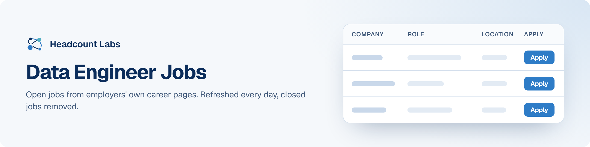

# Data Engineer Jobs

Data engineering, analytics engineering and data platform jobs at US employers.

**34 open jobs** · 3 new since the last update · 25 removed because they closed or left the employer's board · updated November 25, 2026 at 4:58 AM EST

This list is built and refreshed every day by [Headcount Labs](https://headcountlabs.com/?utm_source=github&utm_medium=job-list&utm_campaign=data-engineer-jobs), which reads jobs straight from employers' own career pages and job boards. Every job here was still listed on its source board when we last read that board, within the past 3 days, and was posted in the past 30 days. Copies of the same job are merged into one row, and jobs that close are removed at the next update.

Want this data in your own app or agent? Use the [Headcount Labs jobs API](https://headcountlabs.com/docs/?utm_source=github&utm_medium=job-list&utm_campaign=data-engineer-jobs) (free tier), the [MCP server](https://headcountlabs.com/mcp/?utm_source=github&utm_medium=job-list&utm_campaign=data-engineer-jobs) for Claude, ChatGPT and other AI assistants, or the [public dataset subsets](https://huggingface.co/HeadcountLabs) on Hugging Face (the full dataset is coming soon).

**Full dataset.** A bigger, one-off snapshot dated 2026-10-19 (all matching jobs, not only the open jobs below) is on Hugging Face: [Tech and software jobs](https://huggingface.co/datasets/HeadcountLabs/tech-jobs). It loads with `datasets.load_dataset` and is under the Open Database License (ODbL) 1.0.

**Jump to:** [Posted in the last 7 days (5)](#posted-in-the-last-7-days) · [Posted 8 to 30 days ago (29)](#posted-8-to-30-days-ago)

**Columns.** *Apply* opens the original posting on the employer's site. *Details* opens the job on Headcount Labs, with every posting we found for it. *Remote* shows what the employer states; a dash means the posting doesn't say. *Pay* is the range the employer published.

## Posted in the last 7 days

| Company | Role | Location | Remote | Pay | Posted | Apply | Details |
| --- | --- | --- | --- | --- | --- | :---: | :---: |
| **UTHealth Houston** | Enterprise Data Engineer in Information Technology | Texas Medical Center-Houston, TX | — | — | Nov 24 |  | <a href="https://headcountlabs.com/catalog/jobs/e3206a2e-fe4c-4030-b7c9-474cbebe927c?utm_source=github&utm_medium=job-list&utm_campaign=data-engineer-jobs">via Headcount Labs</a> |
| **MedVet** | Senior Data Engineer | 

14 locations
United States Chicago, IL Worthington, OH Dallas, TX San Jose, CA Newton, MA Huntersville, NC Cincinnati, OH New Orleans, LA Houston, TX Carmel, IN Atlanta, GA +2 more
 | — | $125k–$190k/yr | Nov 23 |  | <a href="https://headcountlabs.com/catalog/jobs/efb75d25-4676-4fb0-b5c2-ae92da7119bb?utm_source=github&utm_medium=job-list&utm_campaign=data-engineer-jobs">via Headcount Labs</a> |
| **Premier Trailer Leasing** | Senior Data Engineer - Snowflake &amp; dbt Cloud | Plano, TX | — | — | Nov 19 |  | <a href="https://headcountlabs.com/catalog/jobs/99d12726-582c-40ce-ac2e-6fcdf18584ab?utm_source=github&utm_medium=job-list&utm_campaign=data-engineer-jobs">via Headcount Labs</a> |
| **Jobgether** | Data Management Specialist - Data Engineer | United States | Remote | — | Nov 18 |  | <a href="https://headcountlabs.com/catalog/jobs/b7fdf433-32ef-4fc9-a24d-f64985fd9111?utm_source=github&utm_medium=job-list&utm_campaign=data-engineer-jobs">via Headcount Labs</a> |
| **Colgate-Palmolive** | Data Engineer | Piscataway, NJ | Hybrid | $97k–$137k/yr | Nov 18 |  | <a href="https://headcountlabs.com/catalog/jobs/bf687fee-f3cc-4c12-b587-3202eb9796e3?utm_source=github&utm_medium=job-list&utm_campaign=data-engineer-jobs">via Headcount Labs</a> |

## Posted 8 to 30 days ago

| Company | Role | Location | Remote | Pay | Posted | Apply | Details |
| --- | --- | --- | --- | --- | --- | :---: | :---: |
| **Jobgether** | Senior Data Engineer (Databricks) - Contractor | United States | Remote | — | Nov 17 |  | <a href="https://headcountlabs.com/catalog/jobs/3d3966be-c85b-47e7-90d2-51ee230a87f7?utm_source=github&utm_medium=job-list&utm_campaign=data-engineer-jobs">via Headcount Labs</a> |
| **Jobgether** | Lead Data Engineer, Databricks | United States | Remote | — | Nov 16 |  | <a href="https://headcountlabs.com/catalog/jobs/b647f2c2-9cd0-4ea1-a783-b9dc3b324250?utm_source=github&utm_medium=job-list&utm_campaign=data-engineer-jobs">via Headcount Labs</a> |
| **Jobgether** | Data Engineer | United States | Remote | — | Nov 16 |  | <a href="https://headcountlabs.com/catalog/jobs/7f4f367e-1050-4598-9b8e-1da0e92710b0?utm_source=github&utm_medium=job-list&utm_campaign=data-engineer-jobs">via Headcount Labs</a> |
| **SMBC** | Vice President, Senior Data Engineer | Charlotte, NC | — | $159k–$180k/yr | Nov 11 |  | <a href="https://headcountlabs.com/catalog/jobs/1a5110d9-8d5d-4b0d-8917-aafc27e76b7a?utm_source=github&utm_medium=job-list&utm_campaign=data-engineer-jobs">via Headcount Labs</a> |
| **Anduril Industries** | Production Master Data Engineer | Costa Mesa, CA | — | $132k–$175k/yr | Nov 11 |  | <a href="https://headcountlabs.com/catalog/jobs/2e9bdb12-9074-44e5-84d1-9b728f025131?utm_source=github&utm_medium=job-list&utm_campaign=data-engineer-jobs">via Headcount Labs</a> |
| **Capstone Logistics LLC** | Senior Data Engineer | Peachtree Corners, GA | — | — | Nov 10 |  | <a href="https://headcountlabs.com/catalog/jobs/6c9bd392-1d20-422c-be76-e951abea5bdb?utm_source=github&utm_medium=job-list&utm_campaign=data-engineer-jobs">via Headcount Labs</a> |
| **Stellantis** | Senior Data Engineer (Foundations) | Auburn Hills, MI | — | — | Nov 9 |  | <a href="https://headcountlabs.com/catalog/jobs/40152e33-bcf7-4240-a443-83482d6e5c88?utm_source=github&utm_medium=job-list&utm_campaign=data-engineer-jobs">via Headcount Labs</a> |
| **COGNIZANT TECH SOLUTIONS A** | AI Data Engineer | Columbus, GA | Remote | $100k–$115k/yr | Nov 6 |  | <a href="https://headcountlabs.com/catalog/jobs/5cc912ef-b96c-481e-8059-7c4841637a7c?utm_source=github&utm_medium=job-list&utm_campaign=data-engineer-jobs">via Headcount Labs</a> |
| **ActioNet** | ETL /Data Engineer | Suitland, MD | Hybrid | $148k–$181k/yr | Nov 6 |  | <a href="https://headcountlabs.com/catalog/jobs/d052bcfe-aeb2-495a-b8e8-6ca5f61375a8?utm_source=github&utm_medium=job-list&utm_campaign=data-engineer-jobs">via Headcount Labs</a> |
| **Oracle** | Senior Data Engineer- Fusion Experience | 

2 locations
Cleveland, OH United States
 | On-site | $96k–$210k/yr | Nov 5 |  | <a href="https://headcountlabs.com/catalog/jobs/06137e60-b2fe-4ad5-a455-2824b5421570?utm_source=github&utm_medium=job-list&utm_campaign=data-engineer-jobs">via Headcount Labs</a> |
| **Altamira Technologies Corp.** | Data Engineer | 

2 locations
Tampa, FL Suitland, MD
 | — | — | Nov 5 |  | <a href="https://headcountlabs.com/catalog/jobs/84f872fa-9667-4c94-8b7d-f74a5c09b8eb?utm_source=github&utm_medium=job-list&utm_campaign=data-engineer-jobs">via Headcount Labs</a> |
| **Altamira Technologies Corp.** | Senior Data Engineer | 

2 locations
Tampa, FL Suitland, MD
 | — | — | Nov 5 |  | <a href="https://headcountlabs.com/catalog/jobs/01a652fe-6bcc-4533-82a5-88622ec010d3?utm_source=github&utm_medium=job-list&utm_campaign=data-engineer-jobs">via Headcount Labs</a> |
| **Stellantis** | Data Engineer | Auburn Hills, MI | — | — | Nov 4 |  | <a href="https://headcountlabs.com/catalog/jobs/2231c4f2-3f86-44cc-bf92-183b2319a8c6?utm_source=github&utm_medium=job-list&utm_campaign=data-engineer-jobs">via Headcount Labs</a> |
| **Hartford HealthCare** | Data Engineer / ITS Data Governance | Farmington, CT | — | — | Nov 4 |  | <a href="https://headcountlabs.com/catalog/jobs/85fa663e-296a-48dd-b031-cff94c65ac55?utm_source=github&utm_medium=job-list&utm_campaign=data-engineer-jobs">via Headcount Labs</a> |
| **COGNIZANT TECH SOLUTIONS A** | Sr. AWS Data Engineer (Java, Python &amp; Generative AI) | Charlotte, NC | Hybrid | $90k–$105k/yr | Nov 4 |  | <a href="https://headcountlabs.com/catalog/jobs/d2899884-5b89-4b37-9847-f693fdf342f7?utm_source=github&utm_medium=job-list&utm_campaign=data-engineer-jobs">via Headcount Labs</a> |
| **COGNIZANT TECH SOLUTIONS A** | Technical Lead - Data Engineer | Hartford, CT | Hybrid | $68k–$109k/yr | Nov 4 |  | <a href="https://headcountlabs.com/catalog/jobs/93c9c169-c292-4d01-80ab-e511009f6e2f?utm_source=github&utm_medium=job-list&utm_campaign=data-engineer-jobs">via Headcount Labs</a> |
| **Casey's** | Associate Data Engineer | Ankeny, IA | — | $66k–$91k/yr | Nov 4 |  | <a href="https://headcountlabs.com/catalog/jobs/70b722c0-d29b-48ef-8538-2cb5976f7ebd?utm_source=github&utm_medium=job-list&utm_campaign=data-engineer-jobs">via Headcount Labs</a> |
| **Avanade Inc.** | Azure Data Engineer | Chicago, IL | — | $133k–$140k/yr | Nov 4 |  | <a href="https://headcountlabs.com/catalog/jobs/32569b4d-6c0a-44c2-bfe7-03b151058f1c?utm_source=github&utm_medium=job-list&utm_campaign=data-engineer-jobs">via Headcount Labs</a> |
| **Yoh** | Sr Data Engineer (AWS/Python/Scala) | Plano, TX | Hybrid | $52.73–$80/hr | Nov 3 |  | <a href="https://headcountlabs.com/catalog/jobs/e9bb13a5-aab4-423f-a39d-004885fd86f5?utm_source=github&utm_medium=job-list&utm_campaign=data-engineer-jobs">via Headcount Labs</a> |
| **Yoh** | Lead Data Engineer &#124; Python, PySpark, AWS, and Jenkins | Mc Lean, VA | — | $63.23–$90.33/hr | Nov 3 |  | <a href="https://headcountlabs.com/catalog/jobs/484e3be6-de8f-4665-8cb8-3d46dc99f25c?utm_source=github&utm_medium=job-list&utm_campaign=data-engineer-jobs">via Headcount Labs</a> |
| **CGI Technologies and Solutions, Inc.** | Data Engineer | Cary, NC | On-site | $92k–$161k/yr | Nov 3 |  | <a href="https://headcountlabs.com/catalog/jobs/9fb9d6e6-1798-44d0-bb2d-515a03823332?utm_source=github&utm_medium=job-list&utm_campaign=data-engineer-jobs">via Headcount Labs</a> |
| **CGI Technologies and Solutions, Inc.** | Senior Databricks Data Engineer | Miami, FL | Hybrid | $92k–$204k/yr | Nov 3 |  | <a href="https://headcountlabs.com/catalog/jobs/82698a25-3627-4e57-ae5a-e46413bc6211?utm_source=github&utm_medium=job-list&utm_campaign=data-engineer-jobs">via Headcount Labs</a> |
| **Accenture Federal Services** | Data Engineer | San Antonio, TX | — | $92k–$179k/yr | Nov 2 |  | <a href="https://headcountlabs.com/catalog/jobs/6690cc7e-23c8-46c9-9d28-354a1809d0b0?utm_source=github&utm_medium=job-list&utm_campaign=data-engineer-jobs">via Headcount Labs</a> |
| **Steampunk** | Senior Data Engineer - Databricks | McLean, VA | Remote | $125k–$165k/yr | Nov 1 |  | <a href="https://headcountlabs.com/catalog/jobs/b73baf72-e397-4aad-9f1e-ee097d8f31ba?utm_source=github&utm_medium=job-list&utm_campaign=data-engineer-jobs">via Headcount Labs</a> |
| **Knit Health** | Data Engineer II | San Francisco | Hybrid | $150k–$175k/yr | Oct 29 |  | <a href="https://headcountlabs.com/catalog/jobs/40939335-5165-41d1-bae3-6fca744e502c?utm_source=github&utm_medium=job-list&utm_campaign=data-engineer-jobs">via Headcount Labs</a> |
| **Harman** | Principal Data Engineer | Novi - Michigan | Hybrid | $125k–$184k/yr | Oct 27 |  | <a href="https://headcountlabs.com/catalog/jobs/aa23dc86-0bf2-4724-8561-5108d81b3552?utm_source=github&utm_medium=job-list&utm_campaign=data-engineer-jobs">via Headcount Labs</a> |
| **Harman** | Data Engineer | Novi - Michigan | Hybrid | $91k–$133k/yr | Oct 27 |  | <a href="https://headcountlabs.com/catalog/jobs/34b133b4-79d9-49e4-a56c-58c09344fc3b?utm_source=github&utm_medium=job-list&utm_campaign=data-engineer-jobs">via Headcount Labs</a> |
| **VTG** | SME Software / Data Engineer | Chantilly, VA | — | — | Oct 26 |  | <a href="https://headcountlabs.com/catalog/jobs/6f7c5787-7237-44ac-892f-cd18e113d3ab?utm_source=github&utm_medium=job-list&utm_campaign=data-engineer-jobs">via Headcount Labs</a> |
| **Burns&amp;McDonnell** | Lead Data Engineer - Google Cloud &amp; Azure Databricks (Kansas City) | Kansas City, MO | — | — | Oct 26 |  | <a href="https://headcountlabs.com/catalog/jobs/b7f7eb77-aeaf-47bc-850c-6acd8b94e0ef?utm_source=github&utm_medium=job-list&utm_campaign=data-engineer-jobs">via Headcount Labs</a> |

## Related data on Headcount Labs

- [Data engineer salary data from posted pay](https://headcountlabs.com/salary-data/data-engineer/)
- [Data engineer job postings dataset](https://headcountlabs.com/data/data-engineer-job-postings/)
- [US job market report: open jobs by state, top employers, pay and remote share](https://headcountlabs.com/reports/us-job-market/)

## More lists from Headcount Labs

[Software Engineering Internships](https://github.com/HeadcountLabs/software-engineering-internships) · [Data Science, AI and Machine Learning Internships](https://github.com/HeadcountLabs/data-science-ai-internships) · [Engineering Internships](https://github.com/HeadcountLabs/engineering-internships) · [Business, Finance and Marketing Internships](https://github.com/HeadcountLabs/business-finance-internships) · [Internships in the US](https://github.com/HeadcountLabs/internships) · [New Grad Software Engineer Jobs](https://github.com/HeadcountLabs/new-grad-software-engineer-jobs) · [Entry-Level and New Grad Jobs](https://github.com/HeadcountLabs/entry-level-jobs) · [Entry-Level Data Analyst Jobs](https://github.com/HeadcountLabs/entry-level-data-analyst-jobs) · [Remote Software Engineer Jobs](https://github.com/HeadcountLabs/remote-software-engineer-jobs) · [Remote Data, AI and Machine Learning Jobs](https://github.com/HeadcountLabs/remote-data-jobs) · [Remote Product Manager Jobs](https://github.com/HeadcountLabs/remote-product-manager-jobs) · [Remote Marketing Jobs](https://github.com/HeadcountLabs/remote-marketing-jobs) · [Remote Sales Jobs](https://github.com/HeadcountLabs/remote-sales-jobs) · [Remote Customer Support and Success Jobs](https://github.com/HeadcountLabs/remote-customer-support-jobs) · [Remote Healthcare Jobs](https://github.com/HeadcountLabs/remote-healthcare-jobs) · [Remote Finance and Accounting Jobs](https://github.com/HeadcountLabs/remote-finance-accounting-jobs) · [Remote Jobs in the US](https://github.com/HeadcountLabs/remote-jobs) · [AI and Machine Learning Engineer Jobs](https://github.com/HeadcountLabs/ai-ml-engineer-jobs) · [Cybersecurity Jobs](https://github.com/HeadcountLabs/cybersecurity-jobs) · [Product Manager Jobs](https://github.com/HeadcountLabs/product-manager-jobs) · [Registered Nurse Jobs](https://github.com/HeadcountLabs/registered-nurse-jobs) · [Software Jobs Paying $200k+](https://github.com/HeadcountLabs/high-paying-software-jobs) · [Tech and Software Jobs in the US](https://github.com/HeadcountLabs/tech-jobs) · [Jobs with Salary Listed in the US](https://github.com/HeadcountLabs/pay-transparency-jobs) · [San Francisco Bay Area Tech Jobs](https://github.com/HeadcountLabs/bay-area-tech-jobs) · [New York City Tech Jobs](https://github.com/HeadcountLabs/new-york-tech-jobs) · [Seattle Tech Jobs](https://github.com/HeadcountLabs/seattle-tech-jobs) · [Austin Tech Jobs](https://github.com/HeadcountLabs/austin-tech-jobs) · [Boston Tech Jobs](https://github.com/HeadcountLabs/boston-tech-jobs) · [Los Angeles Tech Jobs](https://github.com/HeadcountLabs/los-angeles-tech-jobs) · [Washington, DC Tech Jobs](https://github.com/HeadcountLabs/washington-dc-tech-jobs)

## Contributing

This README is generated, so edits to it are overwritten at the next update. If a job is closed, a link is broken or a detail is wrong, [open an issue](../../issues/new) with the link and we'll fix it in the data, which fixes it everywhere. Requests for new lists are welcome too.

## License

The list data is under the [Open Database License (ODbL) 1.0](LICENSE). Our own values in it are under the [Database Contents License (DbCL) 1.0](https://opendatacommons.org/licenses/dbcl/1-0/). Credit "Headcount Labs (https://headcountlabs.com)" when you reuse it. Job description text is the employer's own text and is not licensed by us. Takedown requests: [https://headcountlabs.com/remove/](https://headcountlabs.com/remove/). Location data includes data from OpenStreetMap contributors (ODbL) and Overture Maps. The same rows are in [`data/jobs.csv`](data/jobs.csv).

Generated by Headcount Labs from the jobs API on November 25, 2026 at 4:58 AM EST. At most 8 jobs per employer are shown in each list.
