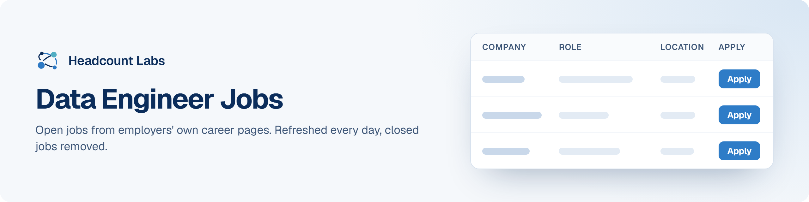

# Data Engineer Jobs

Data engineering, analytics engineering and data platform jobs at US employers.

**400 open jobs** · 299 new since the last update · 45 removed because they closed or left the employer's board · updated November 3, 2026 at 4:53 AM EST

This list is built and refreshed every day by [Headcount Labs](https://headcountlabs.com/?utm_source=github&utm_medium=job-list&utm_campaign=data-engineer-jobs), which reads jobs straight from employers' own career pages and job boards. Every job here was still listed on its source board when we last read that board, within the past 3 days, and was posted in the past 30 days. Copies of the same job are merged into one row, and jobs that close are removed at the next update.

Want this data in your own app or agent? Use the [Headcount Labs jobs API](https://headcountlabs.com/docs/?utm_source=github&utm_medium=job-list&utm_campaign=data-engineer-jobs) (free tier), the [MCP server](https://headcountlabs.com/mcp/?utm_source=github&utm_medium=job-list&utm_campaign=data-engineer-jobs) for Claude, ChatGPT and other AI assistants, or the [public dataset subsets](https://huggingface.co/HeadcountLabs) on Hugging Face (the full dataset is coming soon).

**Full dataset.** A bigger, one-off snapshot dated 2026-10-19 (all matching jobs, not only the open jobs below) is on Hugging Face: [Tech and software jobs](https://huggingface.co/datasets/HeadcountLabs/tech-jobs). It loads with `datasets.load_dataset` and is under the Open Database License (ODbL) 1.0.

**Jump to:** [Posted in the last 7 days (175)](#posted-in-the-last-7-days) · [Posted 8 to 30 days ago (225)](#posted-8-to-30-days-ago)

**Columns.** *Apply* opens the original posting on the employer's site. *Details* opens the job on Headcount Labs, with every posting we found for it. *Remote* shows what the employer states; a dash means the posting doesn't say. *Pay* is the range the employer published.

## Posted in the last 7 days

| Company | Role | Location | Remote | Pay | Posted | Apply | Details |
| --- | --- | --- | --- | --- | --- | :---: | :---: |
| **First Citizens Bank** | Data Engineer II - Data Platform (Remote-Raleigh NC, Dallas TX, Phoenix AZ) | 

4 locations
Raleigh, NC Arizona Austin, TX North Carolina
 | Remote | $111k–$135k/yr | Nov 3 |  | <a href="https://headcountlabs.com/catalog/jobs/295483df-53ec-4244-8820-6f3e68e7a1f8?utm_source=github&utm_medium=job-list&utm_campaign=data-engineer-jobs">via Headcount Labs</a> |
| **Resurgent Capital Services, LP** | Cloud Data Engineer, Business Intelligence | Cincinnati, OH | — | — | Nov 2 |  | <a href="https://headcountlabs.com/catalog/jobs/8d285787-de08-4ecb-91be-5d254a31135d?utm_source=github&utm_medium=job-list&utm_campaign=data-engineer-jobs">via Headcount Labs</a> |
| **Nomura Holdings, inc.** | Data Engineer | Philadelphia, PA | — | $115k–$160k/yr | Nov 2 |  | <a href="https://headcountlabs.com/catalog/jobs/2997d092-b765-4077-91d9-65b3e631ae9c?utm_source=github&utm_medium=job-list&utm_campaign=data-engineer-jobs">via Headcount Labs</a> |
| **E.R. Squibb &amp; Sons,L.L.C.** | Senior Manager, Data Engineer, Clinical Operations | 

2 locations
Princeton - NJ - US Princeton - NJ -
 | — | $154k–$186k/yr | Nov 2 |  | <a href="https://headcountlabs.com/catalog/jobs/aa28edb6-7cef-436d-8165-5d876b544495?utm_source=github&utm_medium=job-list&utm_campaign=data-engineer-jobs">via Headcount Labs</a> |
| **Datavail** | Senior Data Engineer | Anywhere USA | Remote | — | Nov 2 |  | <a href="https://headcountlabs.com/catalog/jobs/f79a7286-abab-4947-88bb-beedd45f126a?utm_source=github&utm_medium=job-list&utm_campaign=data-engineer-jobs">via Headcount Labs</a> |
| **Cripple Creek &amp; Victor Mining Company** | Data Engineer | United States | — | $95k–$115k/yr | Nov 2 |  | <a href="https://headcountlabs.com/catalog/jobs/77327277-4537-42c7-a512-da0e665fd182?utm_source=github&utm_medium=job-list&utm_campaign=data-engineer-jobs">via Headcount Labs</a> |
| **COGNIZANT TECH SOLUTIONS A** | Data Engineer | Irvine, CA | On-site | $64k–$94k/yr | Nov 2 |  | <a href="https://headcountlabs.com/catalog/jobs/5967d24b-ab75-4315-8d7e-ec70319f34fa?utm_source=github&utm_medium=job-list&utm_campaign=data-engineer-jobs">via Headcount Labs</a> |
| **Bright Vision Technologies** | Lead Data Engineer | Edison / Middlesex County, NJ, NJ | Remote | $115k–$165k/yr | Nov 2 |  | <a href="https://headcountlabs.com/catalog/jobs/fcb7a5c1-59a1-4257-b960-0febce2efc5f?utm_source=github&utm_medium=job-list&utm_campaign=data-engineer-jobs">via Headcount Labs</a> |
| **Bright Vision Technologies** | ML Data Engineer | Orlando — Avalon Park, FL | Remote | $100k–$150k/yr | Nov 2 |  | <a href="https://headcountlabs.com/catalog/jobs/b38eea0f-08d9-4ec7-bed4-6058f787feb4?utm_source=github&utm_medium=job-list&utm_campaign=data-engineer-jobs">via Headcount Labs</a> |
| **Bright Vision Technologies** | Real-Time Data Engineer | Frisco, TX | Remote | $135k–$160k/yr | Nov 2 |  | <a href="https://headcountlabs.com/catalog/jobs/ac810789-3325-4e76-a6e9-7149612c7cdd?utm_source=github&utm_medium=job-list&utm_campaign=data-engineer-jobs">via Headcount Labs</a> |
| **Bright Vision Technologies** | Data Engineer | Sunnyvale / South Bay, CA | Remote | $115k–$165k/yr | Nov 2 |  | <a href="https://headcountlabs.com/catalog/jobs/b934745b-00cc-48fa-8c57-c91481b35388?utm_source=github&utm_medium=job-list&utm_campaign=data-engineer-jobs">via Headcount Labs</a> |
| **Bright Vision Technologies** | Senior Data Engineer | Sunnyvale / South Bay, CA | Remote | $115k–$165k/yr | Nov 2 |  | <a href="https://headcountlabs.com/catalog/jobs/385eac2d-343d-49f9-a8f0-6452e5fecf40?utm_source=github&utm_medium=job-list&utm_campaign=data-engineer-jobs">via Headcount Labs</a> |
| **Biohub** | Senior Staff Data Engineer | 

2 locations
New York, NY Redwood City, CA
 | Hybrid | $270k–$300k/yr | Nov 2 |  | <a href="https://headcountlabs.com/catalog/jobs/841d6359-78f3-4b3c-85bb-ede73c637ab7?utm_source=github&utm_medium=job-list&utm_campaign=data-engineer-jobs">via Headcount Labs</a> |
| **Bigbear.ai** | AI/ML Data Engineer | Reston, VA | — | — | Nov 2 |  | <a href="https://headcountlabs.com/catalog/jobs/084f8ce7-72b6-486a-939b-861479bac6a5?utm_source=github&utm_medium=job-list&utm_campaign=data-engineer-jobs">via Headcount Labs</a> |
| **Atreo** | Data Engineer | United States | — | $90k–$120k/yr | Nov 2 |  | <a href="https://headcountlabs.com/catalog/jobs/701234fd-56e2-4460-9801-55cf8122b4de?utm_source=github&utm_medium=job-list&utm_campaign=data-engineer-jobs">via Headcount Labs</a> |
| **Aristocrat Technologies Inc** | Data Engineer | Austin, TX | Hybrid | — | Nov 2 |  | <a href="https://headcountlabs.com/catalog/jobs/5574b464-56ee-4da3-aede-c8ab6c9c2e16?utm_source=github&utm_medium=job-list&utm_campaign=data-engineer-jobs">via Headcount Labs</a> |
| **Anthro** | Senior Data Engineer | Alameda, CA | On-site | — | Nov 2 |  | <a href="https://headcountlabs.com/catalog/jobs/266cc06d-bef6-4523-84ba-71274b788147?utm_source=github&utm_medium=job-list&utm_campaign=data-engineer-jobs">via Headcount Labs</a> |
| **AIG PC Global Services, Inc.** | Data Engineer Lead | Parsippany, NJ | — | $125k–$135k/yr | Nov 2 |  | <a href="https://headcountlabs.com/catalog/jobs/fe1e1703-7365-4851-8c99-03d7bf6d1d5c?utm_source=github&utm_medium=job-list&utm_campaign=data-engineer-jobs">via Headcount Labs</a> |
| **Steampunk** | Data Engineer | McLean, VA | Remote | $110k–$160k/yr | Nov 1 |  | <a href="https://headcountlabs.com/catalog/jobs/c93a9780-a022-4057-83dd-78c43079a97c?utm_source=github&utm_medium=job-list&utm_campaign=data-engineer-jobs">via Headcount Labs</a> |
| **Steampunk** | Senior Data Engineer - Databricks | McLean, VA | Remote | $125k–$165k/yr | Nov 1 |  | <a href="https://headcountlabs.com/catalog/jobs/f04f37fa-6428-4d06-8b94-97d12f5be358?utm_source=github&utm_medium=job-list&utm_campaign=data-engineer-jobs">via Headcount Labs</a> |
| **Steampunk** | Senior Data Engineer | McLean, VA | Remote | $125k–$165k/yr | Nov 1 |  | <a href="https://headcountlabs.com/catalog/jobs/7e8cbcc1-0c14-4c01-829a-548fa19f14c9?utm_source=github&utm_medium=job-list&utm_campaign=data-engineer-jobs">via Headcount Labs</a> |
| **MD Anderson** | Data Engineer - Enterprise Data Engineering &amp; Analytics | Houston, TX | Remote | $106k–$160k/yr | Nov 1 |  | <a href="https://headcountlabs.com/catalog/jobs/9e986366-583c-4bdd-bfdd-5563a2cd8ef6?utm_source=github&utm_medium=job-list&utm_campaign=data-engineer-jobs">via Headcount Labs</a> |
| **Axiom** | Data Engineer, Scientific Data | South San Francisco, CA | On-site | — | Nov 1 |  | <a href="https://headcountlabs.com/catalog/jobs/c4020ca5-9311-449d-8397-73fe95558daa?utm_source=github&utm_medium=job-list&utm_campaign=data-engineer-jobs">via Headcount Labs</a> |
| **SMBC** | Data Engineer, Vice President | Charlotte, NC | — | — | Oct 31 |  | <a href="https://headcountlabs.com/catalog/jobs/93ecc31e-e288-49aa-98e2-4200fca415a8?utm_source=github&utm_medium=job-list&utm_campaign=data-engineer-jobs">via Headcount Labs</a> |
| **Schwab** | Production Support Data Engineer | 

2 locations
Southlake, TX Austin, TX
 | — | $140k–$145k/yr | Oct 31 |  | <a href="https://headcountlabs.com/catalog/jobs/a75c9c41-6539-44ca-96d6-b89801ba7f0b?utm_source=github&utm_medium=job-list&utm_campaign=data-engineer-jobs">via Headcount Labs</a> |
| **Pacific Gas And Electric Company** | Principal, Data Engineer - Reliability Data | Oakland, CA | Hybrid | — | Oct 31 |  | <a href="https://headcountlabs.com/catalog/jobs/95367036-c816-4387-a81e-bc26beaed667?utm_source=github&utm_medium=job-list&utm_campaign=data-engineer-jobs">via Headcount Labs</a> |
| **Firework** | Data Engineer Intern | San Mateo, CA | On-site | $20–$25/hr | Oct 31 |  | <a href="https://headcountlabs.com/catalog/jobs/49e6217a-eeac-48a9-8110-38113964af7e?utm_source=github&utm_medium=job-list&utm_campaign=data-engineer-jobs">via Headcount Labs</a> |
| **Capital One** | Data Engineer 5 (Senior Manager, IC) | 

3 locations
Cambridge, MA New York, NY McLean, VA
 | — | $230k–$262k/yr | Oct 31 |  | <a href="https://headcountlabs.com/catalog/jobs/1d119169-9220-4eba-921a-a8b42555ddd3?utm_source=github&utm_medium=job-list&utm_campaign=data-engineer-jobs">via Headcount Labs</a> |
| **Yoh** | Senior Azure Data Engineer | Plano, TX | Hybrid | $105k–$150k/yr | Oct 30 |  | <a href="https://headcountlabs.com/catalog/jobs/44cbe9de-a9bb-47bd-bdb4-70d8c5363ae7?utm_source=github&utm_medium=job-list&utm_campaign=data-engineer-jobs">via Headcount Labs</a> |
| **Virtual Service Operations** | Cleared AWS Modeling &amp; Simulation Data Engineer | Herndon, VA | — | $180k–$240k/yr | Oct 30 |  | <a href="https://headcountlabs.com/catalog/jobs/478b4eae-096d-46cf-acbf-ed6c77e2a640?utm_source=github&utm_medium=job-list&utm_campaign=data-engineer-jobs">via Headcount Labs</a> |
| **Virtual Service Operations** | Cleared AWS Modeling &amp; Simulation Data Engineer (Washington, DC) | Washington, DC | — | $180k–$240k/yr | Oct 30 |  | <a href="https://headcountlabs.com/catalog/jobs/ef63b9cd-0c7e-408f-825b-b36157782c15?utm_source=github&utm_medium=job-list&utm_campaign=data-engineer-jobs">via Headcount Labs</a> |
| **USF University of South Florida** | Data Engineer II | Tampa, FL | Hybrid | $80k–$103k/yr | Oct 30 |  | <a href="https://headcountlabs.com/catalog/jobs/2b8baa22-2e5a-44a4-88ef-97b32f52364e?utm_source=github&utm_medium=job-list&utm_campaign=data-engineer-jobs">via Headcount Labs</a> |
| **True Talent Solutions Partners** | Data Engineer, Data Product | New York, NY | On-site | — | Oct 30 |  | <a href="https://headcountlabs.com/catalog/jobs/fd4fe49b-68a7-4f78-a15e-f7f71465b52f?utm_source=github&utm_medium=job-list&utm_campaign=data-engineer-jobs">via Headcount Labs</a> |
| **TMS LLC** | Senior Data Engineer (GenAI / AWS) &#124; Claude Agent SDK &#124; Amazon Bedrock &#124; Python &#124; 14+ years of experience | California | Remote | — | Oct 30 |  | <a href="https://headcountlabs.com/catalog/jobs/07609b35-7a4f-416a-98b6-b04e3110a4fa?utm_source=github&utm_medium=job-list&utm_campaign=data-engineer-jobs">via Headcount Labs</a> |
| **Tiger Analytics Inc.** | Azure Data Engineer | Chicago, IL | Remote | — | Oct 30 |  | <a href="https://headcountlabs.com/catalog/jobs/d28cda49-9166-49fb-8471-9109f38d30d3?utm_source=github&utm_medium=job-list&utm_campaign=data-engineer-jobs">via Headcount Labs</a> |
| **Teal Health** | Senior Data Engineer (Contract) | 

2 locations
San Francisco, CA United States
 | Hybrid | — | Oct 30 |  | <a href="https://headcountlabs.com/catalog/jobs/5210ff8e-80b5-43a8-b2d8-2a15ec8a4e2b?utm_source=github&utm_medium=job-list&utm_campaign=data-engineer-jobs">via Headcount Labs</a> |
| **Sumitomo Mitsui Banking Corporation** | Data Engineer, Vice President | Charlotte, NC | — | — | Oct 30 |  | <a href="https://headcountlabs.com/catalog/jobs/85f30bb5-0758-4d0b-bd6a-5bb039f55cc3?utm_source=github&utm_medium=job-list&utm_campaign=data-engineer-jobs">via Headcount Labs</a> |
| **Schwab** | AI/ML Ops and Data Engineer | 

3 locations
Southlake, TX Austin, TX Phoenix, AZ
 | — | $135k–$195k/yr | Oct 30 |  | <a href="https://headcountlabs.com/catalog/jobs/9f184f69-f20e-4ce0-bfc8-4a9ac7d9c624?utm_source=github&utm_medium=job-list&utm_campaign=data-engineer-jobs">via Headcount Labs</a> |
| **Schwab** | Platform Support Data Engineer | 

2 locations
Austin, TX Southlake, TX
 | — | $55.29–$62.50/hr | Oct 30 |  | <a href="https://headcountlabs.com/catalog/jobs/9743d994-d710-4108-98be-5c1ad5bd5f1b?utm_source=github&utm_medium=job-list&utm_campaign=data-engineer-jobs">via Headcount Labs</a> |
| **Salesforce, Inc.** | Staff Data Engineer - Slack | 

2 locations
San Francisco, CA California
 | — | $197k–$314k/yr | Oct 30 |  | <a href="https://headcountlabs.com/catalog/jobs/a00567de-fc44-45d6-9f3f-ed0a3354d059?utm_source=github&utm_medium=job-list&utm_campaign=data-engineer-jobs">via Headcount Labs</a> |
| **Ryan Specialty, LLC** | Lead Azure Data Engineer | United States | — | $140k–$175k/yr | Oct 30 |  | <a href="https://headcountlabs.com/catalog/jobs/cea8e235-56f7-4617-927d-0c46e5cf2d6a?utm_source=github&utm_medium=job-list&utm_campaign=data-engineer-jobs">via Headcount Labs</a> |
| **Rosen's Diversified, Inc.** | Senior Cloud Data Engineer | Green Bay, WI | — | — | Oct 30 |  | <a href="https://headcountlabs.com/catalog/jobs/c7201319-8c22-488a-9dff-2f0d7860fea8?utm_source=github&utm_medium=job-list&utm_campaign=data-engineer-jobs">via Headcount Labs</a> |
| **Renasant Bank** | Mortgage Data Engineer | Atlanta, GA | — | — | Oct 30 |  | <a href="https://headcountlabs.com/catalog/jobs/b7783b3f-4d5a-42f9-81c0-a5ada096de8c?utm_source=github&utm_medium=job-list&utm_campaign=data-engineer-jobs">via Headcount Labs</a> |
| **RADcube - A NLogix Company** | Senior Data Engineer – AWS (META, Affiliate) | Indianapolis, IN | — | — | Oct 30 |  | <a href="https://headcountlabs.com/catalog/jobs/fe9bc802-f57a-4b73-ab16-26a1ae8bec21?utm_source=github&utm_medium=job-list&utm_campaign=data-engineer-jobs">via Headcount Labs</a> |
| **RADcube - A NLogix Company** | Data Engineer – AWS (NE Hub, Affiliate) | Indianapolis, IN | — | — | Oct 30 |  | <a href="https://headcountlabs.com/catalog/jobs/8c7e9d22-c4e8-4978-9e33-ee58e799d126?utm_source=github&utm_medium=job-list&utm_campaign=data-engineer-jobs">via Headcount Labs</a> |
| **RADcube - A NLogix Company** | Data Engineer – AWS (NURO – PRA Data) | Indianapolis, IN | — | — | Oct 30 |  | <a href="https://headcountlabs.com/catalog/jobs/80495d81-f185-4fdc-aae1-8d31f945a0a1?utm_source=github&utm_medium=job-list&utm_campaign=data-engineer-jobs">via Headcount Labs</a> |
| **Pontera** | Senior Data Engineer | New York, NY | — | $180k–$220k/yr | Oct 30 |  | <a href="https://headcountlabs.com/catalog/jobs/defc3c71-173b-4feb-aaf8-1a0cc033c35e?utm_source=github&utm_medium=job-list&utm_campaign=data-engineer-jobs">via Headcount Labs</a> |
| **Merck** | Associate Director, Pharmaceutical Data Engineer | 

3 locations
West Point, PA Leopardstown Rahway, NJ
 | — | $129k–$203k/yr | Oct 30 |  | <a href="https://headcountlabs.com/catalog/jobs/6fa93b94-dac9-4266-b2a2-36741994950f?utm_source=github&utm_medium=job-list&utm_campaign=data-engineer-jobs">via Headcount Labs</a> |
| **MATRIX SYSTEMS &amp; TECHNOLOGIES INC** | Data Engineer | Washington, DC | — | $70k–$95k/yr | Oct 30 |  | <a href="https://headcountlabs.com/catalog/jobs/8e1b8120-41ca-4531-b2f2-6c4e16581507?utm_source=github&utm_medium=job-list&utm_campaign=data-engineer-jobs">via Headcount Labs</a> |
| **IDEXX** | Principal Data Engineer | 

3 locations
Westbrook, ME Portland, ME Virtual United States
 | Hybrid | $130k/yr | Oct 30 |  | <a href="https://headcountlabs.com/catalog/jobs/ee3e1d16-e655-4fe8-9c7b-2fcc06e99ddb?utm_source=github&utm_medium=job-list&utm_campaign=data-engineer-jobs">via Headcount Labs</a> |
| **Hillwood** | Senior Data Engineer | Dallas, TX | On-site | — | Oct 30 |  | <a href="https://headcountlabs.com/catalog/jobs/ef106bdb-5882-41cd-8ebe-dd327fa7ef1f?utm_source=github&utm_medium=job-list&utm_campaign=data-engineer-jobs">via Headcount Labs</a> |
| **Hermès** | VIE - Data Engineer (H/F) - New York | New York, NY | — | — | Oct 30 |  | <a href="https://headcountlabs.com/catalog/jobs/b6a45a61-bb04-4ad2-be2e-fae9dea26e69?utm_source=github&utm_medium=job-list&utm_campaign=data-engineer-jobs">via Headcount Labs</a> |
| **Goodwin Procter LLP** | Data Engineer | 

2 locations
Boston Washington, DC
 | — | $93k–$140k/yr | Oct 30 |  | <a href="https://headcountlabs.com/catalog/jobs/88e8dcb2-c676-4b45-8daa-2e781737a78f?utm_source=github&utm_medium=job-list&utm_campaign=data-engineer-jobs">via Headcount Labs</a> |
| **Frontdoor** | Data Engineer L4 | United States | Remote | — | Oct 30 |  | <a href="https://headcountlabs.com/catalog/jobs/10d75b9d-c7cf-4163-9988-0f55340ed788?utm_source=github&utm_medium=job-list&utm_campaign=data-engineer-jobs">via Headcount Labs</a> |
| **Deseret Mutual Benefit Administrators** | Senior Data Engineer- 1 Year Position | Salt Lake City, UT | Hybrid | — | Oct 30 |  | <a href="https://headcountlabs.com/catalog/jobs/f6725b15-7533-46cf-8488-18ec14fd7b0a?utm_source=github&utm_medium=job-list&utm_campaign=data-engineer-jobs">via Headcount Labs</a> |
| **Deseret Mutual Benefit Administrators** | Senior Data Engineer - Migration &amp; Quality - 1 Year Position | Salt Lake City, UT | Hybrid | — | Oct 30 |  | <a href="https://headcountlabs.com/catalog/jobs/9d511429-04ec-4162-9153-38deeb459588?utm_source=github&utm_medium=job-list&utm_campaign=data-engineer-jobs">via Headcount Labs</a> |
| **ComEd** | Sr Data Engineer 1 | OAKBROOK TERRACE, IL | — | $105k/yr | Oct 30 |  | <a href="https://headcountlabs.com/catalog/jobs/0e1d7518-e051-48d0-a858-020fe2709404?utm_source=github&utm_medium=job-list&utm_campaign=data-engineer-jobs">via Headcount Labs</a> |
| **Comcast** | Data Engineer - AI-Enabled Capacity Analytics | 

3 locations
Philadelphia, PA Mount Laurel, NJ United States
 | — | $109k–$163k/yr | Oct 30 |  | <a href="https://headcountlabs.com/catalog/jobs/bb39dda4-cfff-47c1-9ac9-159461a2415e?utm_source=github&utm_medium=job-list&utm_campaign=data-engineer-jobs">via Headcount Labs</a> |
| **Clearbrook Group Services Inc.** | Senior Data Engineer | New York | On-site | $128k–$152k/yr | Oct 30 |  | <a href="https://headcountlabs.com/catalog/jobs/dbe8f5f9-4ee3-4e6b-9260-eff430f01621?utm_source=github&utm_medium=job-list&utm_campaign=data-engineer-jobs">via Headcount Labs</a> |
| **Charles Schwab Inc.** | Production Support Data Engineer | 

2 locations
Southlake, TX Austin, TX
 | — | $140k–$145k/yr | Oct 30 |  | <a href="https://headcountlabs.com/catalog/jobs/d1b3dbf6-6506-46c9-bdfd-4b206cfe5e29?utm_source=github&utm_medium=job-list&utm_campaign=data-engineer-jobs">via Headcount Labs</a> |
| **Charles Schwab Inc.** | Platform Support Data Engineer | 

2 locations
Austin, TX Southlake, TX
 | — | $55.29–$62.50/hr | Oct 30 |  | <a href="https://headcountlabs.com/catalog/jobs/9233f8fc-8076-4046-97ba-5db09b03043c?utm_source=github&utm_medium=job-list&utm_campaign=data-engineer-jobs">via Headcount Labs</a> |
| **Charles Schwab Inc.** | AI/ML Ops and Data Engineer | 

3 locations
Southlake, TX Austin, TX Phoenix, AZ
 | — | $135k–$195k/yr | Oct 30 |  | <a href="https://headcountlabs.com/catalog/jobs/4e202d19-aba6-4e52-bc22-964d277ebd3a?utm_source=github&utm_medium=job-list&utm_campaign=data-engineer-jobs">via Headcount Labs</a> |
| **Careington** | Principal Data Engineer | Frisco, TX | On-site | — | Oct 30 |  | <a href="https://headcountlabs.com/catalog/jobs/8a34a301-c0b6-458f-913e-767225f100e9?utm_source=github&utm_medium=job-list&utm_campaign=data-engineer-jobs">via Headcount Labs</a> |
| **Care Access** | Senior Data Engineer | United States | Remote | $120k–$160k/yr | Oct 30 |  | <a href="https://headcountlabs.com/catalog/jobs/9ff22462-622a-476d-91f9-16a6c63daafa?utm_source=github&utm_medium=job-list&utm_campaign=data-engineer-jobs">via Headcount Labs</a> |
| **Brains Workgroup, Inc.** | Python Data Engineer Cloud | Iselin, NJ | Hybrid | $80–$85/hr | Oct 30 |  | <a href="https://headcountlabs.com/catalog/jobs/3dadd1e8-bf9b-4557-8da3-5190fcd86c9b?utm_source=github&utm_medium=job-list&utm_campaign=data-engineer-jobs">via Headcount Labs</a> |
| **ASSYST, Inc.** | Senior Healthcare Data Engineer | Austin, TX | — | — | Oct 30 |  | <a href="https://headcountlabs.com/catalog/jobs/b4ed67de-0692-4d9a-9242-867c795abad1?utm_source=github&utm_medium=job-list&utm_campaign=data-engineer-jobs">via Headcount Labs</a> |
| **Anthropic** | Data Engineer | 

2 locations
San Francisco, NY Seattle, WA
 | — | $320k–$405k/yr | Oct 30 |  | <a href="https://headcountlabs.com/catalog/jobs/03e3d4cb-5942-44c0-af5c-7ceec7190c6c?utm_source=github&utm_medium=job-list&utm_campaign=data-engineer-jobs">via Headcount Labs</a> |
| **Amazon.com Services LLC** | Data Engineer II, Sales Data Services (SDS) | 

2 locations
New York, NY Seattle, WA
 | — | $145k–$197k/yr | Oct 30 |  | <a href="https://headcountlabs.com/catalog/jobs/92b82e1d-a106-40ce-9edf-2d36dbb9eb04?utm_source=github&utm_medium=job-list&utm_campaign=data-engineer-jobs">via Headcount Labs</a> |
| **Allstate Insurance Co.** | Senior Data Engineer | USA -, IL | Remote | — | Oct 30 |  | <a href="https://headcountlabs.com/catalog/jobs/07d2eb44-3b93-4ad2-8b50-f2813d25e68c?utm_source=github&utm_medium=job-list&utm_campaign=data-engineer-jobs">via Headcount Labs</a> |
| **Via Logic LLC** | Cloud Platform and Data Engineer [U.S. Citizenship Required, Public Trust Eligibility] | United States | Remote | $100k–$120k/yr | Oct 29 |  | <a href="https://headcountlabs.com/catalog/jobs/e8faedd2-ed46-404d-b1ec-69bdfc28ea38?utm_source=github&utm_medium=job-list&utm_campaign=data-engineer-jobs">via Headcount Labs</a> |
| **USA Donaldson Company Inc.** | Data Engineer Sr. | Bloomington, MN | — | $92k–$116k/yr | Oct 29 |  | <a href="https://headcountlabs.com/catalog/jobs/f7c30c6a-0d33-493a-81ea-54f90c657462?utm_source=github&utm_medium=job-list&utm_campaign=data-engineer-jobs">via Headcount Labs</a> |
| **Tiger Analytics Inc.** | Senior Data Engineer (Azure) | Diamond Bar, CA | On-site | — | Oct 29 |  | <a href="https://headcountlabs.com/catalog/jobs/69cdb616-838d-4454-bf10-e07ee93abd80?utm_source=github&utm_medium=job-list&utm_campaign=data-engineer-jobs">via Headcount Labs</a> |
| **Steampunk** | Data Engineer - Databricks | McLean, VA | Remote | $125k–$160k/yr | Oct 29 |  | <a href="https://headcountlabs.com/catalog/jobs/9a85ce1c-abf8-4c7e-820b-34a92e5dc1cc?utm_source=github&utm_medium=job-list&utm_campaign=data-engineer-jobs">via Headcount Labs</a> |
| **Rearc** | Senior Data Engineer | United States | Remote | $155k–$190k/yr | Oct 29 |  | <a href="https://headcountlabs.com/catalog/jobs/e3b19cd9-7ad1-478f-b43c-edbeddec96b9?utm_source=github&utm_medium=job-list&utm_campaign=data-engineer-jobs">via Headcount Labs</a> |
| **RADcube - A NLogix Company** | Data Engineer – Databricks (IBU Consumer) | Indianapolis, IN | — | — | Oct 29 |  | <a href="https://headcountlabs.com/catalog/jobs/f8e333bf-1b88-4c2a-9fbf-d58c5320a547?utm_source=github&utm_medium=job-list&utm_campaign=data-engineer-jobs">via Headcount Labs</a> |
| **RADcube - A NLogix Company** | Data Engineer – AWS (LARA + ELA + Advanced AI Data Ingestion) | Indianapolis, IN | — | — | Oct 29 |  | <a href="https://headcountlabs.com/catalog/jobs/b8d985b7-da59-448e-8695-c25958d41a2d?utm_source=github&utm_medium=job-list&utm_campaign=data-engineer-jobs">via Headcount Labs</a> |
| **RADcube - A NLogix Company** | Data Engineer – AWS (Data Observability) | Indianapolis, IN | — | — | Oct 29 |  | <a href="https://headcountlabs.com/catalog/jobs/5910ae26-dfa8-4119-a3e1-82788fd99723?utm_source=github&utm_medium=job-list&utm_campaign=data-engineer-jobs">via Headcount Labs</a> |
| **Pinnacle Group** | Senior Data Science Analyst/ Data Engineer | Richmond, VA | Hybrid | $56–$61/hr | Oct 29 |  | <a href="https://headcountlabs.com/catalog/jobs/b7792a74-8345-4361-86c5-948e552d7c98?utm_source=github&utm_medium=job-list&utm_campaign=data-engineer-jobs">via Headcount Labs</a> |
| **Persistent Systems** | Data Engineer | New York, NY | — | $133k–$166k/yr | Oct 29 |  | <a href="https://headcountlabs.com/catalog/jobs/00790fd4-4116-494a-8a38-0f5f98c2eadc?utm_source=github&utm_medium=job-list&utm_campaign=data-engineer-jobs">via Headcount Labs</a> |
| **Peraton** | Data Engineer | 

2 locations
Fort Meade, MD Annapolis Junction, MD
 | — | $135k–$216k/yr | Oct 29 |  | <a href="https://headcountlabs.com/catalog/jobs/0f701861-45b2-4d7c-8369-732972fca4e1?utm_source=github&utm_medium=job-list&utm_campaign=data-engineer-jobs">via Headcount Labs</a> |
| **Panthera Grid Partners, LLC** | Performance Data Engineer | Houston, TX | — | — | Oct 29 |  | <a href="https://headcountlabs.com/catalog/jobs/245429b5-a5bd-4404-8777-e19634e0da12?utm_source=github&utm_medium=job-list&utm_campaign=data-engineer-jobs">via Headcount Labs</a> |
| **Northrop Grumman** | Principal Data Engineer/Sr. Principal Data Engineer | 

2 locations
Palmdale, CA El Segundo, CA
 | — | $114k–$171k/yr | Oct 29 |  | <a href="https://headcountlabs.com/catalog/jobs/aee90b60-687d-427b-98ae-54bcc7826b01?utm_source=github&utm_medium=job-list&utm_campaign=data-engineer-jobs">via Headcount Labs</a> |
| **Military Spouse Jobs &amp; VetJobs** | ETL Data Engineer - Multiple Levels (Cleared) - Chantilly, VA | Chantilly, VA | — | — | Oct 29 |  | <a href="https://headcountlabs.com/catalog/jobs/df85f0e9-dcb1-440b-af1d-a6153abba79d?utm_source=github&utm_medium=job-list&utm_campaign=data-engineer-jobs">via Headcount Labs</a> |
| **Mercedes-Benz USA, LLC** | Prinicipal, Data Engineer | Atlanta, GA | — | — | Oct 29 |  | <a href="https://headcountlabs.com/catalog/jobs/d666d51a-ea37-421d-af0f-9e69bf865966?utm_source=github&utm_medium=job-list&utm_campaign=data-engineer-jobs">via Headcount Labs</a> |
| **Mercedes-Benz Research &amp; Development North America, Inc.** | Data Engineer, ADAS Fleet Analytics | San Jose, CA | — | $118k–$148k/yr | Oct 29 |  | <a href="https://headcountlabs.com/catalog/jobs/5de466e8-2fa2-4b4f-8ff0-d2d5d030f19d?utm_source=github&utm_medium=job-list&utm_campaign=data-engineer-jobs">via Headcount Labs</a> |
| **Lovelytics** | Architect, Data Engineer (SAP + Databricks) | Arlington, VA, Chicago, IL | Remote | $150k–$215k/yr | Oct 29 |  | <a href="https://headcountlabs.com/catalog/jobs/b947f4a7-c581-4b06-8912-b6b377c78444?utm_source=github&utm_medium=job-list&utm_campaign=data-engineer-jobs">via Headcount Labs</a> |
| **Knit Health** | Data Engineer II | San Francisco | Hybrid | $150k–$175k/yr | Oct 29 |  | <a href="https://headcountlabs.com/catalog/jobs/40939335-5165-41d1-bae3-6fca744e502c?utm_source=github&utm_medium=job-list&utm_campaign=data-engineer-jobs">via Headcount Labs</a> |
| **InductiveHealth** | Data Engineer | United States | Remote | $130k–$145k/yr | Oct 29 |  | <a href="https://headcountlabs.com/catalog/jobs/11ba0e7d-39d6-4bcd-84a3-9e8cbcc0869e?utm_source=github&utm_medium=job-list&utm_campaign=data-engineer-jobs">via Headcount Labs</a> |
| **Greenshades Software** | Data Engineer I | Jacksonville, FL | Remote | — | Oct 29 |  | <a href="https://headcountlabs.com/catalog/jobs/c1f30350-a891-4f44-b77b-75c044992a91?utm_source=github&utm_medium=job-list&utm_campaign=data-engineer-jobs">via Headcount Labs</a> |
| **FlightSafety International** | Lead Data Engineer | Columbus, OH | On-site | — | Oct 29 |  | <a href="https://headcountlabs.com/catalog/jobs/93c5a73b-96a9-4f96-8b21-febdd187a407?utm_source=github&utm_medium=job-list&utm_campaign=data-engineer-jobs">via Headcount Labs</a> |
| **Empower** | Lead Data Engineer | Greenwood Village, CO | Remote | $132k–$191k/yr | Oct 29 |  | <a href="https://headcountlabs.com/catalog/jobs/efea55af-e77d-47d7-be41-59021804120e?utm_source=github&utm_medium=job-list&utm_campaign=data-engineer-jobs">via Headcount Labs</a> |
| **Cricut** | Senior Data Engineer | South Jordan, UT | On-site | — | Oct 29 |  | <a href="https://headcountlabs.com/catalog/jobs/1999d7ea-ae54-43a0-a024-2293f8514451?utm_source=github&utm_medium=job-list&utm_campaign=data-engineer-jobs">via Headcount Labs</a> |
| **Chenega Corporation** | Mid-Level Data Engineer | Springfield, VA | — | — | Oct 29 |  | <a href="https://headcountlabs.com/catalog/jobs/6022a339-adc6-4466-bdad-70c0cfa15e25?utm_source=github&utm_medium=job-list&utm_campaign=data-engineer-jobs">via Headcount Labs</a> |
| **CENTURION CONSULTING GROUP, LLC** | Sr. Data Engineer | Arlington, VA | — | $130k–$170k/yr | Oct 29 |  | <a href="https://headcountlabs.com/catalog/jobs/1177659b-3624-4a74-bdc9-8894837dcc57?utm_source=github&utm_medium=job-list&utm_campaign=data-engineer-jobs">via Headcount Labs</a> |
| **Cargill** | Senior Data Engineer | ATLANTA, GA | — | — | Oct 29 |  | <a href="https://headcountlabs.com/catalog/jobs/aad7064d-f08f-4ab7-be39-ca9e3e99cd6a?utm_source=github&utm_medium=job-list&utm_campaign=data-engineer-jobs">via Headcount Labs</a> |
| **Cargill** | Sr. Data Engineer | 

3 locations
Atlanta&#124;Wayzata ATLANTA, GA Wayzata, MN
 | — | — | Oct 29 |  | <a href="https://headcountlabs.com/catalog/jobs/5b59d4d2-8b66-45df-8605-3b26e50d423b?utm_source=github&utm_medium=job-list&utm_campaign=data-engineer-jobs">via Headcount Labs</a> |
| **Capital One** | Data Engineer 4 (Manager, IC) | 

3 locations
Cambridge, MA McLean, VA Richmond, VA
 | — | $197k–$225k/yr | Oct 29 |  | <a href="https://headcountlabs.com/catalog/jobs/21dd9641-8236-4aec-85ab-47070d27d4fe?utm_source=github&utm_medium=job-list&utm_campaign=data-engineer-jobs">via Headcount Labs</a> |
| **Capital One** | Data Engineer 5 | 

6 locations
McLean, VA Richmond, VA New York, NY Chicago, IL Plano, TX Cambridge, MA
 | — | $209k–$238k/yr | Oct 29 |  | <a href="https://headcountlabs.com/catalog/jobs/04dde021-4118-4290-8a12-e55467d18eab?utm_source=github&utm_medium=job-list&utm_campaign=data-engineer-jobs">via Headcount Labs</a> |
| **Bright Vision Technologies** | Streaming Data Engineer | — Artesia / Cerritos, LA | Remote | $78k–$105k/yr | Oct 29 |  | <a href="https://headcountlabs.com/catalog/jobs/d4db978f-0cd5-4893-9813-60fc26da4cc8?utm_source=github&utm_medium=job-list&utm_campaign=data-engineer-jobs">via Headcount Labs</a> |
| **BluePath Labs** | Data Engineer Manager - Onsite, Washington, DC | Washington, DC | On-site | $105k–$142k/yr | Oct 29 |  | <a href="https://headcountlabs.com/catalog/jobs/9031964c-baab-4490-b84c-d2a1e145085d?utm_source=github&utm_medium=job-list&utm_campaign=data-engineer-jobs">via Headcount Labs</a> |
| **BluePath Labs** | Data Engineer (Multiple Openings) - Onsite, Washington, DC | Washington, DC | On-site | $80k–$109k/yr | Oct 29 |  | <a href="https://headcountlabs.com/catalog/jobs/06f39291-fe37-4954-a734-3b171ed1d4f4?utm_source=github&utm_medium=job-list&utm_campaign=data-engineer-jobs">via Headcount Labs</a> |
| **BJs Wholesale Club** | Lead Digital Data Engineer (Databricks) | BJ's Club Support Center Marlborough, MA | Hybrid | $128k–$164k/yr | Oct 29 |  | <a href="https://headcountlabs.com/catalog/jobs/86c7fc1a-d2e2-4808-9dc0-784beebbdf2b?utm_source=github&utm_medium=job-list&utm_campaign=data-engineer-jobs">via Headcount Labs</a> |
| **Attain Finance** | Principal Data Engineer | United States | Remote | $170k–$190k/yr | Oct 29 |  | <a href="https://headcountlabs.com/catalog/jobs/67487bfe-1336-4a41-a7c6-a62f314f3348?utm_source=github&utm_medium=job-list&utm_campaign=data-engineer-jobs">via Headcount Labs</a> |
| **Amazon.com Services LLC** | Data Engineer, WW Ops Finance S&amp;A | Bellevue, WA | — | $132k–$179k/yr | Oct 29 |  | <a href="https://headcountlabs.com/catalog/jobs/c2253247-4c4e-44a6-b63e-88cfc43c722f?utm_source=github&utm_medium=job-list&utm_campaign=data-engineer-jobs">via Headcount Labs</a> |
| **Amazon Development Center U.S., Inc.** | Data Engineer II, AWS Analytics Engineering | Seattle, WA | — | $132k–$179k/yr | Oct 29 |  | <a href="https://headcountlabs.com/catalog/jobs/89f0ec47-1ab7-4c5c-ab5a-2372b9fa0254?utm_source=github&utm_medium=job-list&utm_campaign=data-engineer-jobs">via Headcount Labs</a> |
| **84.51°** | Senior Data Engineer (P1754) (P1752) | 

2 locations
Cincinnati, OH Chicago, IL
 | — | $121k–$169k/yr | Oct 29 |  | <a href="https://headcountlabs.com/catalog/jobs/d06d5a61-bde5-491c-9af3-891705bba60b?utm_source=github&utm_medium=job-list&utm_campaign=data-engineer-jobs">via Headcount Labs</a> |
| **84.51°** | Lead Data Engineer | 

2 locations
Cincinnati, OH Chicago, IL
 | — | $125k–$207k/yr | Oct 29 |  | <a href="https://headcountlabs.com/catalog/jobs/a2ca2547-bd2b-4157-bae0-7685a64298a4?utm_source=github&utm_medium=job-list&utm_campaign=data-engineer-jobs">via Headcount Labs</a> |
| **2025 D.R. Horton, Inc** | Senior Data Engineer | Arlington, TX | — | — | Oct 29 |  | <a href="https://headcountlabs.com/catalog/jobs/a8a736e9-8d39-429d-ac47-35e128d74dc9?utm_source=github&utm_medium=job-list&utm_campaign=data-engineer-jobs">via Headcount Labs</a> |
| **1 Fair Isaac Corporation** | Software Engineering – Data Engineer (Python &amp; Cloud Databases) | United States | Remote | $84k–$132k/yr | Oct 29 |  | <a href="https://headcountlabs.com/catalog/jobs/f1bd230d-a48d-47e9-8fa1-5e406674dd3d?utm_source=github&utm_medium=job-list&utm_campaign=data-engineer-jobs">via Headcount Labs</a> |
| **VoltaGrid** | Data Engineer | Houston, TX | — | — | Oct 28 |  | <a href="https://headcountlabs.com/catalog/jobs/cdee9e91-b873-473c-82c4-914bf507a01f?utm_source=github&utm_medium=job-list&utm_campaign=data-engineer-jobs">via Headcount Labs</a> |
| **The Boeing Company** | Entry-Level F-15 Flight Test Data Engineer | Eglin AFB, FL | On-site | $71k–$97k/yr | Oct 28 |  | <a href="https://headcountlabs.com/catalog/jobs/f7c50ae1-66ef-4bab-9c4b-6a922136f4aa?utm_source=github&utm_medium=job-list&utm_campaign=data-engineer-jobs">via Headcount Labs</a> |
| **Solerity** | Senior Data Engineer (Teradata/ETL) (Secret Clearance Required) | United States | Remote | $115k–$125k/yr | Oct 28 |  | <a href="https://headcountlabs.com/catalog/jobs/76c30af6-e124-4a3b-9713-a5bdea8e752a?utm_source=github&utm_medium=job-list&utm_campaign=data-engineer-jobs">via Headcount Labs</a> |
| **SMX** | Cleared Hybrid Data Engineer (5781) | Hanover, MD | Hybrid | $103k–$172k/yr | Oct 28 |  | <a href="https://headcountlabs.com/catalog/jobs/571d41dc-59d1-43b3-b800-f171ce768973?utm_source=github&utm_medium=job-list&utm_campaign=data-engineer-jobs">via Headcount Labs</a> |
| **SMX** | Cleared Data Engineer (5786) | United States | — | $115k–$187k/yr | Oct 28 |  | <a href="https://headcountlabs.com/catalog/jobs/d0e7eaa6-be7b-4cab-8ce7-eca51491e781?utm_source=github&utm_medium=job-list&utm_campaign=data-engineer-jobs">via Headcount Labs</a> |
| **Pinnacle Group** | AWS Data Engineer | McLean, VA | Hybrid | $70–$75/hr | Oct 28 |  | <a href="https://headcountlabs.com/catalog/jobs/9b8ee084-44d5-4d8c-bcee-a72dedf6a3ad?utm_source=github&utm_medium=job-list&utm_campaign=data-engineer-jobs">via Headcount Labs</a> |
| **PG&amp;E Corporation** | Data Engineer, Expert | Oakland, CA | Hybrid | $140k–$190k/yr | Oct 28 |  | <a href="https://headcountlabs.com/catalog/jobs/e353806e-3934-4305-8045-6f219edbe6f9?utm_source=github&utm_medium=job-list&utm_campaign=data-engineer-jobs">via Headcount Labs</a> |
| **Paramount** | Senior Data Engineer | 

4 locations
Los Angeles, CA Fort Lauderdale, FL New York, NY Burbank, CA
 | — | $110k–$175k/yr | Oct 28 |  | <a href="https://headcountlabs.com/catalog/jobs/05f90b49-ad36-4c5f-bee5-e2520a4e3049?utm_source=github&utm_medium=job-list&utm_campaign=data-engineer-jobs">via Headcount Labs</a> |
| **Pacific Gas And Electric Company** | Data Engineer, Expert | Oakland, CA | Hybrid | $140k–$190k/yr | Oct 28 |  | <a href="https://headcountlabs.com/catalog/jobs/b34e7df0-05df-4c33-899f-09cf1b448ade?utm_source=github&utm_medium=job-list&utm_campaign=data-engineer-jobs">via Headcount Labs</a> |
| **Notion** | Data Engineer, Product | San Francisco, CA | — | — | Oct 28 |  | <a href="https://headcountlabs.com/catalog/jobs/ce3cbbcb-ba1c-425f-92bb-67ed2bc54e18?utm_source=github&utm_medium=job-list&utm_campaign=data-engineer-jobs">via Headcount Labs</a> |
| **Monolithic Power Systems Inc.** | IT Data Engineer and System Admin | San Jose, CA | On-site | $130k–$150k/yr | Oct 28 |  | <a href="https://headcountlabs.com/catalog/jobs/d6355b7d-9c6c-4d66-8af6-6a69883322ca?utm_source=github&utm_medium=job-list&utm_campaign=data-engineer-jobs">via Headcount Labs</a> |
| **MedVet** | Senior Data Engineer | United States | — | $125k–$190k/yr | Oct 28 |  | <a href="https://headcountlabs.com/catalog/jobs/efb75d25-4676-4fb0-b5c2-ae92da7119bb?utm_source=github&utm_medium=job-list&utm_campaign=data-engineer-jobs">via Headcount Labs</a> |
| **madVR Labs** | Senior Data Engineer | United States | Remote | $195k–$259k/yr | Oct 28 |  | <a href="https://headcountlabs.com/catalog/jobs/1c6a0eb4-e47f-4e1a-97b0-ffcad8df8f23?utm_source=github&utm_medium=job-list&utm_campaign=data-engineer-jobs">via Headcount Labs</a> |
| **Jobgether** | Databricks Data Engineer and Scientist | United States | Remote | — | Oct 28 |  | <a href="https://headcountlabs.com/catalog/jobs/a955b87d-58ea-4363-825f-0cefab1785d0?utm_source=github&utm_medium=job-list&utm_campaign=data-engineer-jobs">via Headcount Labs</a> |
| **Intercontinental Exchange Holdings, Inc.** | Data Engineer | New York, NY | — | $80k–$120k/yr | Oct 28 |  | <a href="https://headcountlabs.com/catalog/jobs/3bcf890e-a7de-402e-82a0-63014754bc5d?utm_source=github&utm_medium=job-list&utm_campaign=data-engineer-jobs">via Headcount Labs</a> |
| **Integrity Technology** | Software Data Engineer Mid-Level | Laurel, MD | — | $140k–$195k/yr | Oct 28 |  | <a href="https://headcountlabs.com/catalog/jobs/702bd376-24d1-43dd-870c-aa33ec678430?utm_source=github&utm_medium=job-list&utm_campaign=data-engineer-jobs">via Headcount Labs</a> |
| **IAA** | Senior Staff Data Engineer | Westchester, IL | Hybrid | $143k–$178k/yr | Oct 28 |  | <a href="https://headcountlabs.com/catalog/jobs/2072ac7c-f454-408d-b4c2-160f003c8540?utm_source=github&utm_medium=job-list&utm_campaign=data-engineer-jobs">via Headcount Labs</a> |
| **Guardian Pharmacy Services Management, LLC** | Senior Data Engineer | Atlanta, GA | — | — | Oct 28 |  | <a href="https://headcountlabs.com/catalog/jobs/9a87fe80-8adf-48d6-ac37-d4fe8a5fad3b?utm_source=github&utm_medium=job-list&utm_campaign=data-engineer-jobs">via Headcount Labs</a> |
| **Greystar Management Services, LLC** | Senior Data Engineer, AI &amp; Data Platform | 

2 locations
South Carolina United States
 | Remote | $115k–$135k/yr | Oct 28 |  | <a href="https://headcountlabs.com/catalog/jobs/63f91068-f299-4f02-a2b9-3aeab4bba658?utm_source=github&utm_medium=job-list&utm_campaign=data-engineer-jobs">via Headcount Labs</a> |
| **First American** | Senior Data Engineer (Remote) | 

4 locations
Fort Mill, SC Home, FL Home, GA Home, TX
 | Remote | $122k–$131k/yr | Oct 28 |  | <a href="https://headcountlabs.com/catalog/jobs/1c9ab98b-f226-4295-ae7e-728e33a2be7b?utm_source=github&utm_medium=job-list&utm_campaign=data-engineer-jobs">via Headcount Labs</a> |
| **Edmunds GovTech** | Data Engineer | Northfield, NJ | Remote | $60k–$75k/yr | Oct 28 |  | <a href="https://headcountlabs.com/catalog/jobs/5ff28de6-629c-464b-ba09-a8d16d4ab5e3?utm_source=github&utm_medium=job-list&utm_campaign=data-engineer-jobs">via Headcount Labs</a> |
| **Current Opportunities with Rockline Industries &amp; Iatric Manufacturing** | Sr. Business Analyst - Data Engineer | Sheboygan, WI | Remote | — | Oct 28 |  | <a href="https://headcountlabs.com/catalog/jobs/4c5ed39a-71c6-4884-89bf-7889bda210b7?utm_source=github&utm_medium=job-list&utm_campaign=data-engineer-jobs">via Headcount Labs</a> |
| **CoSourcing Partners** | GCP Data Engineer | Chicago, IL | — | — | Oct 28 |  | <a href="https://headcountlabs.com/catalog/jobs/eb668226-da20-45fe-b3cd-386c1bf7f30a?utm_source=github&utm_medium=job-list&utm_campaign=data-engineer-jobs">via Headcount Labs</a> |
| **Clera** | Founding Data Engineer, Pricing and Comps | New York, NY | Remote | — | Oct 28 |  | <a href="https://headcountlabs.com/catalog/jobs/389223c8-965e-45d4-9db2-c98d3bdc03cd?utm_source=github&utm_medium=job-list&utm_campaign=data-engineer-jobs">via Headcount Labs</a> |
| **Classlink Inc** | Agentic Data Engineer, IC2 | United States | Remote | — | Oct 28 |  | <a href="https://headcountlabs.com/catalog/jobs/ab77bf19-9797-419f-892c-ed518b13f5b8?utm_source=github&utm_medium=job-list&utm_campaign=data-engineer-jobs">via Headcount Labs</a> |
| **Celigo** | Data Engineer | United States | — | $130k–$150k/yr | Oct 28 |  | <a href="https://headcountlabs.com/catalog/jobs/c6b03ae7-1eae-4f3e-959f-e7d9322eea9a?utm_source=github&utm_medium=job-list&utm_campaign=data-engineer-jobs">via Headcount Labs</a> |
| **Bright Vision Technologies** | AI Data Engineer | 

2 locations
East Brunswick, NJ Aurora, IL
 | Remote | $100k–$150k/yr | Oct 28 |  | <a href="https://headcountlabs.com/catalog/jobs/391dac24-3568-42aa-a95e-09a359f1bdb2?utm_source=github&utm_medium=job-list&utm_campaign=data-engineer-jobs">via Headcount Labs</a> |
| **Black Cape** | Extraordinary Data Engineer (Knowledge Graph Specialist) | Bethesda, MD | On-site | — | Oct 28 |  | <a href="https://headcountlabs.com/catalog/jobs/d5a42318-4dac-448a-b240-814d304247fe?utm_source=github&utm_medium=job-list&utm_campaign=data-engineer-jobs">via Headcount Labs</a> |
| **Black Cape** | Fantastic Data Engineer | Pentagon, VA | On-site | — | Oct 28 |  | <a href="https://headcountlabs.com/catalog/jobs/264e3f0a-f3e3-4cef-b639-cf484c479ae0?utm_source=github&utm_medium=job-list&utm_campaign=data-engineer-jobs">via Headcount Labs</a> |
| **Bigbear.ai** | Junior Data Engineer | Norfolk, VA | — | — | Oct 28 |  | <a href="https://headcountlabs.com/catalog/jobs/42d1c108-6f89-418b-8ee0-f6bb1b7bc01a?utm_source=github&utm_medium=job-list&utm_campaign=data-engineer-jobs">via Headcount Labs</a> |
| **Amazon.com Services LLC** | Data Engineer, Global Logistics Product Analytics Team | Bellevue, WA | — | $101k–$160k/yr | Oct 28 |  | <a href="https://headcountlabs.com/catalog/jobs/f8d30186-c984-4ae2-9b9e-935024d66337?utm_source=github&utm_medium=job-list&utm_campaign=data-engineer-jobs">via Headcount Labs</a> |
| **Amazon Data Services, Inc.** | Senior Data Engineer, AWS Infrastructure Supply Chain Automation | Seattle, WA | — | $155k–$209k/yr | Oct 28 |  | <a href="https://headcountlabs.com/catalog/jobs/f0095039-373c-4c3b-9b97-f56c364592a3?utm_source=github&utm_medium=job-list&utm_campaign=data-engineer-jobs">via Headcount Labs</a> |
| **95-2566122 First American Title Insurance Co** | Senior Data Engineer (Remote) | 

2 locations
Fort Mill, SC South Carolina
 | Remote | $122k–$131k/yr | Oct 28 |  | <a href="https://headcountlabs.com/catalog/jobs/b9bae0ee-dbc8-4eba-94f1-ed00c114432b?utm_source=github&utm_medium=job-list&utm_campaign=data-engineer-jobs">via Headcount Labs</a> |
| **2025 D.R. Horton, Inc** | Principal Data Engineer | Arlington, TX | — | — | Oct 28 |  | <a href="https://headcountlabs.com/catalog/jobs/3d5da080-7690-45c5-801d-46f13e98d564?utm_source=github&utm_medium=job-list&utm_campaign=data-engineer-jobs">via Headcount Labs</a> |
| **Xcel Energy Services Inc** | Data Engineer | 

2 locations
Denver, CO Minneapolis, MN
 | Hybrid | $98k–$139k/yr | Oct 27 |  | <a href="https://headcountlabs.com/catalog/jobs/a142e9a3-1c7b-498c-b907-802dfb5e3691?utm_source=github&utm_medium=job-list&utm_campaign=data-engineer-jobs">via Headcount Labs</a> |
| **Vuori, Inc** | Principal Data Engineer | Carlsbad, CA | Remote | $181k–$242k/yr | Oct 27 |  | <a href="https://headcountlabs.com/catalog/jobs/87331e9f-a539-4de8-bd6d-12082a25c19b?utm_source=github&utm_medium=job-list&utm_campaign=data-engineer-jobs">via Headcount Labs</a> |
| **Vesalius Therapeutics** | Principal Data Engineer | Cambridge, MA | — | $179k–$236k/yr | Oct 27 |  | <a href="https://headcountlabs.com/catalog/jobs/aa867fd5-10a6-410a-909b-8665028c3d7f?utm_source=github&utm_medium=job-list&utm_campaign=data-engineer-jobs">via Headcount Labs</a> |
| **SPHINX LLC** | Data Engineer/Scientist | Springfield, VA | On-site | — | Oct 27 |  | <a href="https://headcountlabs.com/catalog/jobs/2758896c-e603-4aaf-96ab-6085f1f61a2c?utm_source=github&utm_medium=job-list&utm_campaign=data-engineer-jobs">via Headcount Labs</a> |
| **Schwab** | Data Engineer | 

2 locations
Southlake, TX Austin, TX
 | — | $112k–$150k/yr | Oct 27 |  | <a href="https://headcountlabs.com/catalog/jobs/2bafd492-90f7-4988-9fa8-756f042486b6?utm_source=github&utm_medium=job-list&utm_campaign=data-engineer-jobs">via Headcount Labs</a> |
| **Rearc** | Lead Data Engineer | United States | Remote | $180k–$220k/yr | Oct 27 |  | <a href="https://headcountlabs.com/catalog/jobs/409ad6e1-2500-4628-bfb0-a36409d78a3a?utm_source=github&utm_medium=job-list&utm_campaign=data-engineer-jobs">via Headcount Labs</a> |
| **Reailize** | Senior Data Engineer - Contract | 

6 locations
Brookhaven, GA Bothell, WA Alpharetta, GA Plano, TX Middletown, NJ Bellevue, WA
 | On-site | — | Oct 27 |  | <a href="https://headcountlabs.com/catalog/jobs/238ac2a8-46bf-48de-9af1-beca6f175e25?utm_source=github&utm_medium=job-list&utm_campaign=data-engineer-jobs">via Headcount Labs</a> |
| **Palmetto Clean Technology** | Staff Data Engineer | United States | Remote | — | Oct 27 |  | <a href="https://headcountlabs.com/catalog/jobs/dbfb7101-edff-47a7-bb2d-6393e383a452?utm_source=github&utm_medium=job-list&utm_campaign=data-engineer-jobs">via Headcount Labs</a> |
| **NextEra Energy** | Lead Data Engineer | Juno Beach, FL | — | — | Oct 27 |  | <a href="https://headcountlabs.com/catalog/jobs/1ada4ff8-0dca-4996-bffc-02b091f620f5?utm_source=github&utm_medium=job-list&utm_campaign=data-engineer-jobs">via Headcount Labs</a> |
| **MSTS** | Principal Data Engineer (Prin Applications Analyst) | North Las Vegas, NV | On-site | $119k–$181k/yr | Oct 27 |  | <a href="https://headcountlabs.com/catalog/jobs/74ba2dad-2b52-43e6-b590-1238b156953d?utm_source=github&utm_medium=job-list&utm_campaign=data-engineer-jobs">via Headcount Labs</a> |
| **Lyric** | Senior Data Engineer | 

2 locations
Boston, MA United States
 | Remote | $125k–$188k/yr | Oct 27 |  | <a href="https://headcountlabs.com/catalog/jobs/4c4c208c-f0c9-4197-9444-fb15938ce249?utm_source=github&utm_medium=job-list&utm_campaign=data-engineer-jobs">via Headcount Labs</a> |
| **Lexical Intelligence** | Data Engineer / Backend Developer | Bethesda, MD | Hybrid | $125k–$145k/yr | Oct 27 |  | <a href="https://headcountlabs.com/catalog/jobs/85e585d7-123d-4f6f-bd74-540efc3be16d?utm_source=github&utm_medium=job-list&utm_campaign=data-engineer-jobs">via Headcount Labs</a> |
| **Lazard** | Data Engineer | 

2 locations
United States New York, NY
 | Hybrid | $170k–$200k/yr | Oct 27 |  | <a href="https://headcountlabs.com/catalog/jobs/e2bb325a-5ede-4f14-863a-e1eb9a1a8cd8?utm_source=github&utm_medium=job-list&utm_campaign=data-engineer-jobs">via Headcount Labs</a> |
| **Jobgether** | Lead Data Engineer | United States | Remote | $155k–$175k/yr | Oct 27 |  | <a href="https://headcountlabs.com/catalog/jobs/15a1008a-b87a-474a-98dc-01f024ce4c4c?utm_source=github&utm_medium=job-list&utm_campaign=data-engineer-jobs">via Headcount Labs</a> |
| **Insulet Corporation** | Forward Deployed Data Engineer - Hybrid (Acton, MA or San Diego, CA) | 

2 locations
Acton, MA San Diego, CA
 | Hybrid | $144k–$216k/yr | Oct 27 |  | <a href="https://headcountlabs.com/catalog/jobs/13d063d4-f598-4233-8a24-1a1372975965?utm_source=github&utm_medium=job-list&utm_campaign=data-engineer-jobs">via Headcount Labs</a> |
| **HL002 Hamilton Lane Advisors, LLC** | Senior Data Engineer | Conshohocken, PA | Remote | — | Oct 27 |  | <a href="https://headcountlabs.com/catalog/jobs/17d8a6a3-0c62-435c-9a1a-81d3f10eff3d?utm_source=github&utm_medium=job-list&utm_campaign=data-engineer-jobs">via Headcount Labs</a> |
| **HII** | RF/Electronic Warfare/ Mission Data Engineer (Engineer Electrical 4) | Warner Robins, GA | — | $127k–$155k/yr | Oct 27 |  | <a href="https://headcountlabs.com/catalog/jobs/4001ddb3-db19-40f8-bb6f-528a4c7c8f56?utm_source=github&utm_medium=job-list&utm_campaign=data-engineer-jobs">via Headcount Labs</a> |
| **Flagship Pioneering, Inc.** | Principal Data Engineer | Cambridge | — | $179k–$236k/yr | Oct 27 |  | <a href="https://headcountlabs.com/catalog/jobs/1bcd928d-6b96-46bc-9fa5-5d2541ec701e?utm_source=github&utm_medium=job-list&utm_campaign=data-engineer-jobs">via Headcount Labs</a> |
| **First Citizens Bank** | Data Engineer I - Data Platform (Remote-Raleigh NC, Dallas TX, Phoenix AZ) | 

4 locations
Phoenix, AZ Arizona North Carolina Austin, TX
 | Remote | $87k–$100k/yr | Oct 27 |  | <a href="https://headcountlabs.com/catalog/jobs/c7f071a0-3472-4ca4-941e-29a516501b96?utm_source=github&utm_medium=job-list&utm_campaign=data-engineer-jobs">via Headcount Labs</a> |
| **E&amp;M Technologies, Inc.** | Data Engineer | Alexandria, VA | — | — | Oct 27 |  | <a href="https://headcountlabs.com/catalog/jobs/6881238f-b521-4137-9737-5c37a0ecd150?utm_source=github&utm_medium=job-list&utm_campaign=data-engineer-jobs">via Headcount Labs</a> |
| **CleanSlate Technology Group** | Associate Data Engineer | Austin, TX | — | — | Oct 27 |  | <a href="https://headcountlabs.com/catalog/jobs/aa8409d5-f5c5-4026-ba16-fd967bb8318e?utm_source=github&utm_medium=job-list&utm_campaign=data-engineer-jobs">via Headcount Labs</a> |
| **Chatham Financial Romania S.R.L.** | Data Engineer | Kennett Square | — | — | Oct 27 |  | <a href="https://headcountlabs.com/catalog/jobs/b6fb26e8-5155-4d37-9bcb-a3c2da68944b?utm_source=github&utm_medium=job-list&utm_campaign=data-engineer-jobs">via Headcount Labs</a> |
| **Chartmetric** | Data Engineer | 

2 locations
New York, NY San Mateo, CA
 | On-site | — | Oct 27 |  | <a href="https://headcountlabs.com/catalog/jobs/7e58da06-85cb-41dd-98d8-8a88b6eda2e3?utm_source=github&utm_medium=job-list&utm_campaign=data-engineer-jobs">via Headcount Labs</a> |
| **Charles Schwab Inc.** | Data Engineer | 

2 locations
Southlake, TX Austin, TX
 | — | $112k–$150k/yr | Oct 27 |  | <a href="https://headcountlabs.com/catalog/jobs/792e9150-0d7b-43b8-94c0-6a2b9dbbb662?utm_source=github&utm_medium=job-list&utm_campaign=data-engineer-jobs">via Headcount Labs</a> |
| **Capital One** | Data Engineer 5 (Cloud Operations Resilience Engineering) (MEG) | 

5 locations
Richmond, VA McLean, VA New York, NY Plano, TX Riverwoods, IL
 | — | $230k–$262k/yr | Oct 27 |  | <a href="https://headcountlabs.com/catalog/jobs/cb9206c8-2d2e-4137-ac33-7d5397960d75?utm_source=github&utm_medium=job-list&utm_campaign=data-engineer-jobs">via Headcount Labs</a> |
| **Capital One** | Data Engineer 4 (Cloud Operations Resilience Engineering) (MEG) | 

5 locations
Plano, TX McLean, VA New York, NY Richmond, VA Riverwoods, IL
 | — | $197k–$225k/yr | Oct 27 |  | <a href="https://headcountlabs.com/catalog/jobs/4e9782c9-ccdb-4b6c-9db1-b06fa681d073?utm_source=github&utm_medium=job-list&utm_campaign=data-engineer-jobs">via Headcount Labs</a> |
| **Bright Vision Technologies** | Machine Learning Data Engineer | — Artesia / Cerritos, LA | Remote | $80k–$100k/yr | Oct 27 |  | <a href="https://headcountlabs.com/catalog/jobs/f4064e30-49fb-49a5-a4ff-7cf861c9f029?utm_source=github&utm_medium=job-list&utm_campaign=data-engineer-jobs">via Headcount Labs</a> |
| **Boston Beer Corporation** | Sr. BI Data Engineer | Boston, MA | Hybrid | $120k–$187k/yr | Oct 27 |  | <a href="https://headcountlabs.com/catalog/jobs/ed1d58db-22ba-494d-ba35-d1056cd35c68?utm_source=github&utm_medium=job-list&utm_campaign=data-engineer-jobs">via Headcount Labs</a> |
| **Archipelago Companies** | OluKai, melin, Roark (Tradewind Services) Lead Data Engineer | Irvine, CA | On-site | $160k–$198k/yr | Oct 27 |  | <a href="https://headcountlabs.com/catalog/jobs/70794e50-aef0-4107-af38-b2a004dfa2a9?utm_source=github&utm_medium=job-list&utm_campaign=data-engineer-jobs">via Headcount Labs</a> |
| **Amazon.com Services LLC** | Data Engineer II, DSP Analytics | Bellevue, WA | — | $132k–$179k/yr | Oct 27 |  | <a href="https://headcountlabs.com/catalog/jobs/b5d54ce9-390f-4977-a3b3-5c1e417dd4cc?utm_source=github&utm_medium=job-list&utm_campaign=data-engineer-jobs">via Headcount Labs</a> |
| **ActioNet** | ETL /Data Engineer | Suitland, MD | Hybrid | — | Oct 27 |  | <a href="https://headcountlabs.com/catalog/jobs/d052bcfe-aeb2-495a-b8e8-6ca5f61375a8?utm_source=github&utm_medium=job-list&utm_campaign=data-engineer-jobs">via Headcount Labs</a> |
| **AAFES** | Data Engineer | AAFES Headquarters, TX | — | — | Oct 27 |  | <a href="https://headcountlabs.com/catalog/jobs/5642be04-bed7-4315-ad62-7f8fd83ec073?utm_source=github&utm_medium=job-list&utm_campaign=data-engineer-jobs">via Headcount Labs</a> |

## Posted 8 to 30 days ago

| Company | Role | Location | Remote | Pay | Posted | Apply | Details |
| --- | --- | --- | --- | --- | --- | :---: | :---: |
| **VTG** | SME Software / Data Engineer | Chantilly, VA | — | — | Oct 26 |  | <a href="https://headcountlabs.com/catalog/jobs/6f7c5787-7237-44ac-892f-cd18e113d3ab?utm_source=github&utm_medium=job-list&utm_campaign=data-engineer-jobs">via Headcount Labs</a> |
| **UFG** | Sr Data Engineer | United States | Remote | $103k–$136k/yr | Oct 26 |  | <a href="https://headcountlabs.com/catalog/jobs/783c21ea-1b0a-4471-ab93-c6d46b1584e1?utm_source=github&utm_medium=job-list&utm_campaign=data-engineer-jobs">via Headcount Labs</a> |
| **TISTA Science and Technology Corporation** | Data Engineer / Migration Specialist | United States | Remote | $111k–$126k/yr | Oct 26 |  | <a href="https://headcountlabs.com/catalog/jobs/e0aa43ad-784a-4a4b-81c7-77a7b7c8e444?utm_source=github&utm_medium=job-list&utm_campaign=data-engineer-jobs">via Headcount Labs</a> |
| **The Hanover Insurance Group** | Intern - Data Engineer | Worcester, MA | On-site | — | Oct 26 |  | <a href="https://headcountlabs.com/catalog/jobs/a0128685-378b-49ce-b1c3-9477bbe60463?utm_source=github&utm_medium=job-list&utm_campaign=data-engineer-jobs">via Headcount Labs</a> |
| **TelevisaUnivision Management Co.** | Principal Data Engineer | Miami, FL | — | — | Oct 26 |  | <a href="https://headcountlabs.com/catalog/jobs/89ca1dc7-c936-43fa-938d-c5b8c8e95e89?utm_source=github&utm_medium=job-list&utm_campaign=data-engineer-jobs">via Headcount Labs</a> |
| **TelevisaUnivision Management Co.** | Senior Data Engineer | Miami, FL | — | — | Oct 26 |  | <a href="https://headcountlabs.com/catalog/jobs/879d265e-347d-4074-9fcb-7df8335a1614?utm_source=github&utm_medium=job-list&utm_campaign=data-engineer-jobs">via Headcount Labs</a> |
| **T. Rowe Price** | Sr. AI Data Engineer/Architect | Baltimore, MD | — | $121k–$206k/yr | Oct 26 |  | <a href="https://headcountlabs.com/catalog/jobs/1b91368a-7cf5-4ab1-bea8-f843b5a3f5eb?utm_source=github&utm_medium=job-list&utm_campaign=data-engineer-jobs">via Headcount Labs</a> |
| **Sumitomo Mitsui Banking Corporation** | Data Engineer | 

2 locations
Charlotte, NC New York, NY
 | — | — | Oct 26 |  | <a href="https://headcountlabs.com/catalog/jobs/4f5f98bc-fbb3-4ddf-b7f0-07514c12d03d?utm_source=github&utm_medium=job-list&utm_campaign=data-engineer-jobs">via Headcount Labs</a> |
| **Stuut** | Data Engineer | 

2 locations
San Francisco, CA New York City, NY
 | On-site | $150k–$200k/yr | Oct 26 |  | <a href="https://headcountlabs.com/catalog/jobs/900ad907-473c-414b-b0ad-40acdffabf32?utm_source=github&utm_medium=job-list&utm_campaign=data-engineer-jobs">via Headcount Labs</a> |
| **Sedgwick Claims Management Services Inc.** | Sr. Data Engineer | Telecommuter, TX | — | $155k–$200k/yr | Oct 26 |  | <a href="https://headcountlabs.com/catalog/jobs/0da89f05-b24f-443c-b823-1144a1da194a?utm_source=github&utm_medium=job-list&utm_campaign=data-engineer-jobs">via Headcount Labs</a> |
| **Publicis Groupe Holdings B.V** | Public Sector- Data Engineer (Manager) | Arlington, VA | — | $120k–$170k/yr | Oct 26 |  | <a href="https://headcountlabs.com/catalog/jobs/8505f59e-01e7-4df5-9140-da20eb12df30?utm_source=github&utm_medium=job-list&utm_campaign=data-engineer-jobs">via Headcount Labs</a> |
| **Paul, Weiss, Rifkind, Wharton &amp; Garrison LLP** | Senior Data Engineer | New York | — | — | Oct 26 |  | <a href="https://headcountlabs.com/catalog/jobs/f832d5ca-23fb-49be-8afd-ed8b94cc2600?utm_source=github&utm_medium=job-list&utm_campaign=data-engineer-jobs">via Headcount Labs</a> |
| **Merastar Insurance Company** | Senior Data Engineer | 

6 locations
Chicago, IL Birmingham, AL Charlotte, NC Dallas, TX Downers Grove, IL Jacksonville, FL
 | Hybrid | $99k–$165k/yr | Oct 26 |  | <a href="https://headcountlabs.com/catalog/jobs/757eb05c-59d7-4bf7-86c2-0657b3d0ce92?utm_source=github&utm_medium=job-list&utm_campaign=data-engineer-jobs">via Headcount Labs</a> |
| **McDonald** | Data Engineer III | 

2 locations
United States Chicago, IL
 | — | $138k–$173k/yr | Oct 26 |  | <a href="https://headcountlabs.com/catalog/jobs/fe360a8e-d316-46cb-a251-d5c79d43d041?utm_source=github&utm_medium=job-list&utm_campaign=data-engineer-jobs">via Headcount Labs</a> |
| **Lunon** | Forward Deployed Data Engineer | United States | Remote | $180k–$210k/yr | Oct 26 |  | <a href="https://headcountlabs.com/catalog/jobs/95cb6158-a409-45f9-8e77-0190e8a74b19?utm_source=github&utm_medium=job-list&utm_campaign=data-engineer-jobs">via Headcount Labs</a> |
| **Indianapolis Colts** | Data Engineer | Indianapolis, IN | On-site | — | Oct 26 |  | <a href="https://headcountlabs.com/catalog/jobs/338ebe4c-0f0d-44fb-974e-f17a20f14452?utm_source=github&utm_medium=job-list&utm_campaign=data-engineer-jobs">via Headcount Labs</a> |
| **Gonzaba Medical Group** | Data Engineer (On-site) | San Antonio, TX | On-site | — | Oct 26 |  | <a href="https://headcountlabs.com/catalog/jobs/b96c645b-ebc2-4e78-9200-73d243b671fe?utm_source=github&utm_medium=job-list&utm_campaign=data-engineer-jobs">via Headcount Labs</a> |
| **Exol** | Senior Data Engineer | United States | Remote | — | Oct 26 |  | <a href="https://headcountlabs.com/catalog/jobs/7def4f86-64c0-4665-aeae-64f870d9dd7c?utm_source=github&utm_medium=job-list&utm_campaign=data-engineer-jobs">via Headcount Labs</a> |
| **Curant Health Inc.** | Data Engineer | Smyrna, GA | On-site | — | Oct 26 |  | <a href="https://headcountlabs.com/catalog/jobs/1b9ee0a2-ca2f-4757-a38c-b11b5b32a8b1?utm_source=github&utm_medium=job-list&utm_campaign=data-engineer-jobs">via Headcount Labs</a> |
| **Critical Solutions** | Data Engineer (w/ active Secret) | Norfolk, VA | On-site | $87k–$112k/yr | Oct 26 |  | <a href="https://headcountlabs.com/catalog/jobs/f859e073-279c-443b-a805-37b1f3c952d3?utm_source=github&utm_medium=job-list&utm_campaign=data-engineer-jobs">via Headcount Labs</a> |
| **Cintel Inc** | Data Engineer (SME) | Huntsville, AL | On-site | — | Oct 26 |  | <a href="https://headcountlabs.com/catalog/jobs/f3ce6af0-d146-4cce-ae8b-3929667c668e?utm_source=github&utm_medium=job-list&utm_campaign=data-engineer-jobs">via Headcount Labs</a> |
| **Centene Management Company LLC** | Lead Data Engineer | United States | Remote | $103k–$190k/yr | Oct 26 |  | <a href="https://headcountlabs.com/catalog/jobs/3be75740-67fa-49a9-91d7-fd5875c8a24b?utm_source=github&utm_medium=job-list&utm_campaign=data-engineer-jobs">via Headcount Labs</a> |
| **Capital One** | Data Engineer 4 - ERM Transformation | 

3 locations
Richmond, VA McLean, VA New York, NY
 | — | $197k–$225k/yr | Oct 26 |  | <a href="https://headcountlabs.com/catalog/jobs/18ee2dff-16b4-43d3-bc7b-93e9fdbf151c?utm_source=github&utm_medium=job-list&utm_campaign=data-engineer-jobs">via Headcount Labs</a> |
| **Burns&amp;McDonnell** | Lead Data Engineer - Google Cloud &amp; Azure Databricks (Kansas City) | Kansas City, MO | — | — | Oct 26 |  | <a href="https://headcountlabs.com/catalog/jobs/b7f7eb77-aeaf-47bc-850c-6acd8b94e0ef?utm_source=github&utm_medium=job-list&utm_campaign=data-engineer-jobs">via Headcount Labs</a> |
| **Brown &amp; Brown, Inc** | Data Engineer | Plano, TX | — | — | Oct 26 |  | <a href="https://headcountlabs.com/catalog/jobs/d8588134-dacc-487d-9445-054155936493?utm_source=github&utm_medium=job-list&utm_campaign=data-engineer-jobs">via Headcount Labs</a> |
| **Brown &amp; Brown, Inc** | Lead Data Engineer | Plano, TX | — | — | Oct 26 |  | <a href="https://headcountlabs.com/catalog/jobs/5ca85dc7-1d94-4b06-ac23-63c539069bcd?utm_source=github&utm_medium=job-list&utm_campaign=data-engineer-jobs">via Headcount Labs</a> |
| **Branch** | Data Engineer | United States | Remote | $135k–$145k/yr | Oct 26 |  | <a href="https://headcountlabs.com/catalog/jobs/068e6542-a312-4c7d-aa57-6c7b971ed451?utm_source=github&utm_medium=job-list&utm_campaign=data-engineer-jobs">via Headcount Labs</a> |
| **American Express** | Data Engineer III | 

3 locations
Dallas, TX Austin, TX Phoenix, AZ
 | Remote | $104k–$175k/yr | Oct 26 |  | <a href="https://headcountlabs.com/catalog/jobs/f630ba88-6c1b-4a0c-ab67-a5c4dca95d10?utm_source=github&utm_medium=job-list&utm_campaign=data-engineer-jobs">via Headcount Labs</a> |
| **American Express** | Sr Data Engineer - Financial Data Engineering | Phoenix, AZ | Hybrid | $123k–$215k/yr | Oct 26 |  | <a href="https://headcountlabs.com/catalog/jobs/671778e2-2552-4977-ace6-882dc7b04d07?utm_source=github&utm_medium=job-list&utm_campaign=data-engineer-jobs">via Headcount Labs</a> |
| **Sumitomo Mitsui Banking Corporation** | Senior Data Engineer | Charlotte, NC | — | — | Oct 25 |  | <a href="https://headcountlabs.com/catalog/jobs/37426f38-38a5-4e40-9666-feacd5156bf7?utm_source=github&utm_medium=job-list&utm_campaign=data-engineer-jobs">via Headcount Labs</a> |
| **J.E. Dunn Construction Group Inc P** | IT Data Engineer | Kansas City, MO | — | — | Oct 25 |  | <a href="https://headcountlabs.com/catalog/jobs/523078ac-a8f6-4c79-96f4-d6b3370d88ec?utm_source=github&utm_medium=job-list&utm_campaign=data-engineer-jobs">via Headcount Labs</a> |
| **Staples Inc.** | Senior Data Engineer, Supply Chain &amp; AI - Onsite Framingham, MA | Framingham, MA | On-site | $118k–$162k/yr | Oct 24 |  | <a href="https://headcountlabs.com/catalog/jobs/f8165a74-4d27-412e-b105-1cc4a0c17142?utm_source=github&utm_medium=job-list&utm_campaign=data-engineer-jobs">via Headcount Labs</a> |
| **Staples Business** | Senior Data Engineer, Supply Chain &amp; AI - Onsite Framingham, MA | Framingham, MA | On-site | — | Oct 24 |  | <a href="https://headcountlabs.com/catalog/jobs/8f8840ea-8883-4107-bf2d-4fd3564da07f?utm_source=github&utm_medium=job-list&utm_campaign=data-engineer-jobs">via Headcount Labs</a> |
| **Lincoln Financial** | Senior Data Engineer, AI Data Products | Radnor, PA | Hybrid | — | Oct 24 |  | <a href="https://headcountlabs.com/catalog/jobs/a4251e93-eb8c-4fa0-ae0d-f0249d545738?utm_source=github&utm_medium=job-list&utm_campaign=data-engineer-jobs">via Headcount Labs</a> |
| **Lincoln Financial** | Associate Data Engineer, AI Data Products | Radnor, PA | Hybrid | — | Oct 24 |  | <a href="https://headcountlabs.com/catalog/jobs/a2e89063-a10d-4ab3-a5a9-4922740f40fa?utm_source=github&utm_medium=job-list&utm_campaign=data-engineer-jobs">via Headcount Labs</a> |
| **Lincoln Financial** | Sr. Associate Data Engineer, AI Data Products | Radnor, PA | Hybrid | — | Oct 24 |  | <a href="https://headcountlabs.com/catalog/jobs/9bc2a104-f087-4844-a59b-d13bb37c19ed?utm_source=github&utm_medium=job-list&utm_campaign=data-engineer-jobs">via Headcount Labs</a> |
| **AssistRx, LLC** | Data Engineer II | Florida | Remote | $111k–$139k/yr | Oct 24 |  | <a href="https://headcountlabs.com/catalog/jobs/196e2447-dea5-43da-940e-6c48c85dde5c?utm_source=github&utm_medium=job-list&utm_campaign=data-engineer-jobs">via Headcount Labs</a> |
| **Amazon.com Services LLC** | Data Engineer II, NASC Data Engineering | Bellevue, WA | — | $132k–$179k/yr | Oct 24 |  | <a href="https://headcountlabs.com/catalog/jobs/59978e67-c6d7-4f87-a853-1f08124fbd6d?utm_source=github&utm_medium=job-list&utm_campaign=data-engineer-jobs">via Headcount Labs</a> |
| **Unlock Health** | Data Engineer | 

3 locations
Chicago, IL Nashville, TN New York, NY
 | Remote | — | Oct 23 |  | <a href="https://headcountlabs.com/catalog/jobs/ceee4d14-0980-45e5-a4b9-fa83a5c69605?utm_source=github&utm_medium=job-list&utm_campaign=data-engineer-jobs">via Headcount Labs</a> |
| **Tandem Theory** | Sr. Data Engineer | DALLAS, TX | Remote | — | Oct 23 |  | <a href="https://headcountlabs.com/catalog/jobs/3f4643e0-7da5-4255-8703-710610b6ee56?utm_source=github&utm_medium=job-list&utm_campaign=data-engineer-jobs">via Headcount Labs</a> |
| **SoFi** | Senior Data Engineer | Cottonwood Heights, UT | — | — | Oct 23 |  | <a href="https://headcountlabs.com/catalog/jobs/8e268b57-d95e-4fdd-8a67-ad1735280b1e?utm_source=github&utm_medium=job-list&utm_campaign=data-engineer-jobs">via Headcount Labs</a> |
| **Prologis Management LLC** | Senior Semantic Data Engineer | 

10 locations
San Francisco, CA Atlanta, GA Chicago, IL Columbus, OH Dallas, TX Denver, CO Nashville, TN New York, NY Phoenix, AZ Seattle, WA
 | — | $130k–$178k/yr | Oct 23 |  | <a href="https://headcountlabs.com/catalog/jobs/9d3d5749-24db-4dd6-af06-8ac585bb14ee?utm_source=github&utm_medium=job-list&utm_campaign=data-engineer-jobs">via Headcount Labs</a> |
| **ProgenyHealth LLC** | Data Engineer | United States | Remote | — | Oct 23 |  | <a href="https://headcountlabs.com/catalog/jobs/da988e02-093e-4626-be1c-1c062e7ae08a?utm_source=github&utm_medium=job-list&utm_campaign=data-engineer-jobs">via Headcount Labs</a> |
| **Pivotal Solutions, Inc.** | DevOps/Data Engineer | Fargo, ND | — | — | Oct 23 |  | <a href="https://headcountlabs.com/catalog/jobs/965e77b7-8225-44b3-9b20-efe554f7a70e?utm_source=github&utm_medium=job-list&utm_campaign=data-engineer-jobs">via Headcount Labs</a> |
| **Peraton** | Senior Data Engineer | Annapolis Junction, MD | — | $176k–$282k/yr | Oct 23 |  | <a href="https://headcountlabs.com/catalog/jobs/fb7cd29a-8224-48de-864a-254f3017950c?utm_source=github&utm_medium=job-list&utm_campaign=data-engineer-jobs">via Headcount Labs</a> |
| **OSI Systems, Inc** | Test and Data Engineer | Torrance, CA | — | $90k–$110k/yr | Oct 23 |  | <a href="https://headcountlabs.com/catalog/jobs/8547a19c-2a69-4b98-9d1c-88dc6142a885?utm_source=github&utm_medium=job-list&utm_campaign=data-engineer-jobs">via Headcount Labs</a> |
| **ONEAMERICA ASSET MANAGEMENT, LLC** | Data Engineer | Indianapolis, IN | Hybrid | — | Oct 23 |  | <a href="https://headcountlabs.com/catalog/jobs/4e1cff8f-7e40-47d0-bb26-9add736c5362?utm_source=github&utm_medium=job-list&utm_campaign=data-engineer-jobs">via Headcount Labs</a> |
| **Nerdery** | Senior Data Engineer | United States | Remote | $130k–$170k/yr | Oct 23 |  | <a href="https://headcountlabs.com/catalog/jobs/26011ea1-a7fd-464f-9765-64022a34036b?utm_source=github&utm_medium=job-list&utm_campaign=data-engineer-jobs">via Headcount Labs</a> |
| **NBME** | Senior Data Engineer (Customer Data Products) | Philadelphia, PA | — | $127k–$160k/yr | Oct 23 |  | <a href="https://headcountlabs.com/catalog/jobs/21816a90-4a9d-4330-86d6-e4b934a46176?utm_source=github&utm_medium=job-list&utm_campaign=data-engineer-jobs">via Headcount Labs</a> |
| **NBME** | Data Engineer III | Philadelphia, PA | — | $112k–$140k/yr | Oct 23 |  | <a href="https://headcountlabs.com/catalog/jobs/4ac4c150-d799-4a0b-a9ef-6ee8a6e3545e?utm_source=github&utm_medium=job-list&utm_campaign=data-engineer-jobs">via Headcount Labs</a> |
| **Micron Technology, Inc.** | Senior AI Automation Data Engineer | Boise, ID | On-site | — | Oct 23 |  | <a href="https://headcountlabs.com/catalog/jobs/42e8a9bc-9e74-4350-8003-6f54d63d9f17?utm_source=github&utm_medium=job-list&utm_campaign=data-engineer-jobs">via Headcount Labs</a> |
| **Mercedes-Benz Financial Services USA LLC** | Cloud Data Engineer | Fort Worth, TX | — | — | Oct 23 |  | <a href="https://headcountlabs.com/catalog/jobs/2324fdcb-7cfd-44cc-875f-00da3fb07390?utm_source=github&utm_medium=job-list&utm_campaign=data-engineer-jobs">via Headcount Labs</a> |
| **Mayo Clinic** | Senior Data Engineer - Hybrid | Rochester, MN | Hybrid | $141k–$205k/yr | Oct 23 |  | <a href="https://headcountlabs.com/catalog/jobs/81c3c927-cc49-424d-8e13-fcbd51551639?utm_source=github&utm_medium=job-list&utm_campaign=data-engineer-jobs">via Headcount Labs</a> |
| **Mayo Career Site US** | Senior Data Engineer - Hybrid | Rochester, MN | Hybrid | $141k–$205k/yr | Oct 23 |  | <a href="https://headcountlabs.com/catalog/jobs/e190f5f9-db61-4337-8b2f-bd3f2e2d0f44?utm_source=github&utm_medium=job-list&utm_campaign=data-engineer-jobs">via Headcount Labs</a> |
| **InterMed** | AI Data Engineer | South Portland, ME | — | — | Oct 23 |  | <a href="https://headcountlabs.com/catalog/jobs/ee995626-5717-49d8-8b93-c02c4b338aac?utm_source=github&utm_medium=job-list&utm_campaign=data-engineer-jobs">via Headcount Labs</a> |
| **INTEGRATION APPLIANCE, INC.** | Data Engineer | Charlotte, NC | Hybrid | — | Oct 23 |  | <a href="https://headcountlabs.com/catalog/jobs/fc285af6-07a6-4674-8e84-50fca3fdb166?utm_source=github&utm_medium=job-list&utm_campaign=data-engineer-jobs">via Headcount Labs</a> |
| **Infinite Computer Solutions** | Data Engineer | 

3 locations
Georgia Texas Ohio
 | — | — | Oct 23 |  | <a href="https://headcountlabs.com/catalog/jobs/1beb7270-ee11-48fa-96e8-b278fbbc9cd3?utm_source=github&utm_medium=job-list&utm_campaign=data-engineer-jobs">via Headcount Labs</a> |
| **Indiana University Health** | Developer-Information Services III - Data Engineer | Indianapolis, IN | On-site | — | Oct 23 |  | <a href="https://headcountlabs.com/catalog/jobs/807f8a45-f4c1-4ca2-8997-ae60cb6324ab?utm_source=github&utm_medium=job-list&utm_campaign=data-engineer-jobs">via Headcount Labs</a> |
| **Hylant Group, Inc.** | Senior Data Engineer | 

20 locations
Toledo, OH Ohio Elkhart Jacksonville, FL Orlando, FL Alpharetta, GA Atlanta, GA Chicago, IL Bloomington, IN Fort Wayne, IN Indianapolis, IN Ann Arbor, MI +8 more
 | Hybrid | — | Oct 23 |  | <a href="https://headcountlabs.com/catalog/jobs/b1c265bb-53d6-44ea-95f6-346292d3f760?utm_source=github&utm_medium=job-list&utm_campaign=data-engineer-jobs">via Headcount Labs</a> |
| **HII** | DSCA DoW Mid/Senior Data Engineer (Software Development Analyst) - 29573 | Arlington, VA | Remote | $90k–$120k/yr | Oct 23 |  | <a href="https://headcountlabs.com/catalog/jobs/ad126923-f4e9-453a-984f-9c52a3371ddf?utm_source=github&utm_medium=job-list&utm_campaign=data-engineer-jobs">via Headcount Labs</a> |
| **HarperCollins Publishers** | Data Engineer (remote US) | United States | Remote | $120k–$130k/yr | Oct 23 |  | <a href="https://headcountlabs.com/catalog/jobs/2564d7a8-854d-46b6-b99f-dee6c2982132?utm_source=github&utm_medium=job-list&utm_campaign=data-engineer-jobs">via Headcount Labs</a> |
| **Franklin Templeton** | Data Engineer | 

2 locations
Baltimore, MD Stamford, CT
 | — | $128k–$166k/yr | Oct 23 |  | <a href="https://headcountlabs.com/catalog/jobs/04743555-da6e-4ef8-ae81-3b2f731e2456?utm_source=github&utm_medium=job-list&utm_campaign=data-engineer-jobs">via Headcount Labs</a> |
| **Floyd's Boiling Springs Chapel** | Data Engineer Senior | Houston, TX | On-site | — | Oct 23 |  | <a href="https://headcountlabs.com/catalog/jobs/bc398c44-8ee9-4a89-b3b9-2c48bd97ca9f?utm_source=github&utm_medium=job-list&utm_campaign=data-engineer-jobs">via Headcount Labs</a> |
| **Fictiv** | Senior Data Engineer | Schaumburg, IL | — | $167k–$202k/yr | Oct 23 |  | <a href="https://headcountlabs.com/catalog/jobs/364193f5-f0c1-4188-859c-f32bc42a91c6?utm_source=github&utm_medium=job-list&utm_campaign=data-engineer-jobs">via Headcount Labs</a> |
| **EY** | Data Engineer and Analytics Platform Manager - Assistant Director | 

5 locations
Boston, MA Miami, NY Toledo, WA Jackson, KS New Orleans, OK
 | — | $149k–$254k/yr | Oct 23 |  | <a href="https://headcountlabs.com/catalog/jobs/63a3f0e5-0ad2-4689-9501-fa0664bd472d?utm_source=github&utm_medium=job-list&utm_campaign=data-engineer-jobs">via Headcount Labs</a> |
| **CSpring** | Senior Data Engineer (ETL / Python Developer) | Springfield, IL | Remote | — | Oct 23 |  | <a href="https://headcountlabs.com/catalog/jobs/e7027273-b322-4793-b74f-6b65ce3b8832?utm_source=github&utm_medium=job-list&utm_campaign=data-engineer-jobs">via Headcount Labs</a> |
| **Capital One** | Data Engineer 4 - Payment Networks | 

2 locations
New York, NY McLean, VA
 | — | $215k–$246k/yr | Oct 23 |  | <a href="https://headcountlabs.com/catalog/jobs/bc6a27f6-8be8-44b3-a0d6-79abaf6db9bd?utm_source=github&utm_medium=job-list&utm_campaign=data-engineer-jobs">via Headcount Labs</a> |
| **Capital One** | Data Engineer 4 - Nexus Products | 

2 locations
McLean, VA New York, NY
 | — | $215k–$246k/yr | Oct 23 |  | <a href="https://headcountlabs.com/catalog/jobs/aa637795-3942-48c9-b9ba-3946f7be1a1a?utm_source=github&utm_medium=job-list&utm_campaign=data-engineer-jobs">via Headcount Labs</a> |
| **Anduril Industries** | Product Data Engineer | Waltham, MA | — | $117k–$154k/yr | Oct 23 |  | <a href="https://headcountlabs.com/catalog/jobs/0736b0d0-f52e-49b4-a4dd-fe7d92963abf?utm_source=github&utm_medium=job-list&utm_campaign=data-engineer-jobs">via Headcount Labs</a> |
| **American Express** | Senior Data Engineer - Amex Ads, Offers, and Dining Technology | 

2 locations
New York, NY Chicago, IL
 | Hybrid | $123k–$215k/yr | Oct 23 |  | <a href="https://headcountlabs.com/catalog/jobs/72843aac-eaf0-43e6-8422-97c9bf6f061e?utm_source=github&utm_medium=job-list&utm_campaign=data-engineer-jobs">via Headcount Labs</a> |
| **Amazon.com Services LLC** | Data Engineer, Workforce Solutions - Talent Mobility | Bellevue, WA | — | $132k–$179k/yr | Oct 23 |  | <a href="https://headcountlabs.com/catalog/jobs/8ae81bca-c758-4404-b141-3af6d22c0750?utm_source=github&utm_medium=job-list&utm_campaign=data-engineer-jobs">via Headcount Labs</a> |
| **Ahold Delhaize USA** | Data Engineer III | 

2 locations
Quincy, MA Salisbury, NC
 | — | $125k–$188k/yr | Oct 23 |  | <a href="https://headcountlabs.com/catalog/jobs/2e6bf4e2-1214-4607-8a31-fb598dab102a?utm_source=github&utm_medium=job-list&utm_campaign=data-engineer-jobs">via Headcount Labs</a> |
| **Ahold Delhaize USA** | Data Engineer II | 

2 locations
Salisbury, NC Quincy, MA
 | — | $101k–$152k/yr | Oct 23 |  | <a href="https://headcountlabs.com/catalog/jobs/277a6492-94d3-4549-a90d-e889018c277a?utm_source=github&utm_medium=job-list&utm_campaign=data-engineer-jobs">via Headcount Labs</a> |
| **Administrative Openings** | AI Data Engineer | South Portland, ME | — | — | Oct 23 |  | <a href="https://headcountlabs.com/catalog/jobs/5e37c928-4f80-4720-b717-c9a97c2157ff?utm_source=github&utm_medium=job-list&utm_campaign=data-engineer-jobs">via Headcount Labs</a> |
| **Zifo** | Senior Data Engineer | United States | Remote | — | Oct 22 |  | <a href="https://headcountlabs.com/catalog/jobs/40378c6c-8a1a-42ae-977d-f21657b0f23b?utm_source=github&utm_medium=job-list&utm_campaign=data-engineer-jobs">via Headcount Labs</a> |
| **Wayve** | Principal Data Engineer, Data Quality &amp; Datasets Pipelines | Sunnyvale | — | $290k–$340k/yr | Oct 22 |  | <a href="https://headcountlabs.com/catalog/jobs/c4bf8e95-75ed-483d-bc39-e79696903b0a?utm_source=github&utm_medium=job-list&utm_campaign=data-engineer-jobs">via Headcount Labs</a> |
| **UniFirst Corporation** | Senior Data Engineer | Wilmington, MA | Hybrid | $109k–$152k/yr | Oct 22 |  | <a href="https://headcountlabs.com/catalog/jobs/0bb82800-74f1-4291-b876-07cf01b525ce?utm_source=github&utm_medium=job-list&utm_campaign=data-engineer-jobs">via Headcount Labs</a> |
| **Teradyne** | Principal Cloud Data Engineer (Teradyne, North Reading, MA) | North Reading, MA | — | $180k–$288k/yr | Oct 22 |  | <a href="https://headcountlabs.com/catalog/jobs/3f354393-d6b8-4596-8cff-a91d6bc6e527?utm_source=github&utm_medium=job-list&utm_campaign=data-engineer-jobs">via Headcount Labs</a> |
| **Sumitomo Mitsui Banking Corporation** | CCAR Data Engineer, Associate | Charlotte, NC | — | — | Oct 22 |  | <a href="https://headcountlabs.com/catalog/jobs/e46a8f22-fa7e-4a0e-afb9-720b01440d23?utm_source=github&utm_medium=job-list&utm_campaign=data-engineer-jobs">via Headcount Labs</a> |
| **Sirius XM** | Senior Staff Data Engineer | 

17 locations
California Ohio Oregon Texas Colorado Florida Georgia Illinois Indiana Massachusetts Nevada New Jersey +5 more
 | Remote | $127k–$215k/yr | Oct 22 |  | <a href="https://headcountlabs.com/catalog/jobs/9f038b96-8485-4e1f-9af4-bac68fdc5505?utm_source=github&utm_medium=job-list&utm_campaign=data-engineer-jobs">via Headcount Labs</a> |
| **Simple Solutions** | Sr. Data Engineer (GenAI &amp; AWS) Remote/Hybrid with Travel | Jacksonville, FL | Hybrid | — | Oct 22 |  | <a href="https://headcountlabs.com/catalog/jobs/da39e7fa-b7e4-48f3-be7b-58cc32501be9?utm_source=github&utm_medium=job-list&utm_campaign=data-engineer-jobs">via Headcount Labs</a> |
| **Serhant** | Principal Data Engineer | United States | Remote | — | Oct 22 |  | <a href="https://headcountlabs.com/catalog/jobs/336893ab-b67a-4727-b007-c8a9b09d469a?utm_source=github&utm_medium=job-list&utm_campaign=data-engineer-jobs">via Headcount Labs</a> |
| **Royal Electric** | Data Engineer | Dallas, TX | On-site | — | Oct 22 |  | <a href="https://headcountlabs.com/catalog/jobs/5a391d9f-78d7-4811-a670-d8fdcda902ea?utm_source=github&utm_medium=job-list&utm_campaign=data-engineer-jobs">via Headcount Labs</a> |
| **Redhorse Corporation** | Lead Data Engineer | United States | Remote | $170k–$190k/yr | Oct 22 |  | <a href="https://headcountlabs.com/catalog/jobs/2f72ce72-f93d-4a03-ac56-13cb3211fe08?utm_source=github&utm_medium=job-list&utm_campaign=data-engineer-jobs">via Headcount Labs</a> |
| **PowerPlan, Inc** | AI Data Engineer | Atlanta, GA | Hybrid | — | Oct 22 |  | <a href="https://headcountlabs.com/catalog/jobs/75e24301-289c-43c5-828c-81ab7edcae08?utm_source=github&utm_medium=job-list&utm_campaign=data-engineer-jobs">via Headcount Labs</a> |
| **New Mexico Gas Co - Peoples Gas - Tampa Electric** | Enterprise Analytics Data Engineer | Tampa, FL | — | — | Oct 22 |  | <a href="https://headcountlabs.com/catalog/jobs/d14d630e-f74e-4c36-9fb9-69bec2c7e9ba?utm_source=github&utm_medium=job-list&utm_campaign=data-engineer-jobs">via Headcount Labs</a> |
| **McAfee** | Data Engineer | Frisco, TX | Hybrid | — | Oct 22 |  | <a href="https://headcountlabs.com/catalog/jobs/c45b31f1-fa2f-4080-9d19-1b7d1a5294da?utm_source=github&utm_medium=job-list&utm_campaign=data-engineer-jobs">via Headcount Labs</a> |
| **Mayo Career Site US** | Senior Data Engineer | Rochester, MN | Hybrid | $141k–$205k/yr | Oct 22 |  | <a href="https://headcountlabs.com/catalog/jobs/23ebc446-3a4b-4098-9824-04131ed40721?utm_source=github&utm_medium=job-list&utm_campaign=data-engineer-jobs">via Headcount Labs</a> |
| **KinderCare Education LLC** | Senior Data Engineer - Remote Opportunity | Oregon | Remote | — | Oct 22 |  | <a href="https://headcountlabs.com/catalog/jobs/e0d197c5-87ac-49b8-8057-473a59cc7c4c?utm_source=github&utm_medium=job-list&utm_campaign=data-engineer-jobs">via Headcount Labs</a> |
| **Indeed** | Data Engineer II | United States | Remote | $99k–$149k/yr | Oct 22 |  | <a href="https://headcountlabs.com/catalog/jobs/571e32ca-91c0-438c-bfdd-d772e6978b6c?utm_source=github&utm_medium=job-list&utm_campaign=data-engineer-jobs">via Headcount Labs</a> |
| **Headway** | Senior Data Engineer | 

3 locations
New York City San Francisco, CA Seattle, WA
 | Hybrid | $180k–$225k/yr | Oct 22 |  | <a href="https://headcountlabs.com/catalog/jobs/748f9cc2-4d44-410c-aed6-7c3e3430cd26?utm_source=github&utm_medium=job-list&utm_campaign=data-engineer-jobs">via Headcount Labs</a> |
| **First Citizens Bank** | Data Engineer II - Remote (Raleigh, NC, Dallas, TX, Phoenix, AZ) | 

2 locations
Raleigh, NC North Carolina
 | Remote | — | Oct 22 |  | <a href="https://headcountlabs.com/catalog/jobs/d7aa0940-cdf0-4a84-aa04-e23b81e25b96?utm_source=github&utm_medium=job-list&utm_campaign=data-engineer-jobs">via Headcount Labs</a> |
| **E&amp;M Technologies, Inc.** | Senior Data Engineer | Augusta, GA | — | — | Oct 22 |  | <a href="https://headcountlabs.com/catalog/jobs/ba17ac04-0015-47f8-902b-fe108006006e?utm_source=github&utm_medium=job-list&utm_campaign=data-engineer-jobs">via Headcount Labs</a> |
| **Dawar Consulting, Inc.** | Senior Data Engineer &amp; BI Developer (Hybrid) | San Mateo, CA | Hybrid | $90–$98/hr | Oct 22 |  | <a href="https://headcountlabs.com/catalog/jobs/68da394e-39bb-4fe1-a192-6dd38fd3df0d?utm_source=github&utm_medium=job-list&utm_campaign=data-engineer-jobs">via Headcount Labs</a> |
| **Cohere** | Senior Staff Data Engineer | 

6 locations
Toronto San Francisco, CA United States New York, NY Ottawa Montreal
 | Hybrid | $300k–$350k/yr | Oct 22 |  | <a href="https://headcountlabs.com/catalog/jobs/11da2ef6-14f1-4365-8dc7-947d6f177d55?utm_source=github&utm_medium=job-list&utm_campaign=data-engineer-jobs">via Headcount Labs</a> |
| **BRMi** | Real Estate Lending Data Engineer | 

2 locations
Vienna, VA Pensacola, FL
 | — | $120k–$154k/yr | Oct 22 |  | <a href="https://headcountlabs.com/catalog/jobs/6606a353-65bb-4f77-9afa-be31c9a815ae?utm_source=github&utm_medium=job-list&utm_campaign=data-engineer-jobs">via Headcount Labs</a> |
| **ASPCA** | Senior Enterprise Data Engineer | United States | Remote | $138k–$143k/yr | Oct 22 |  | <a href="https://headcountlabs.com/catalog/jobs/4ecf4e88-251b-4580-9a3a-0d83b544a8a7?utm_source=github&utm_medium=job-list&utm_campaign=data-engineer-jobs">via Headcount Labs</a> |
| **Advanced Micro Devices, Inc** | Staff Data Engineer | 

2 locations
Santa Clara, CA Austin, TX
 | — | — | Oct 22 |  | <a href="https://headcountlabs.com/catalog/jobs/1ab78ed6-4136-4a71-826e-2c8864fe16f6?utm_source=github&utm_medium=job-list&utm_campaign=data-engineer-jobs">via Headcount Labs</a> |
| **Absolute Business Solutions Corp** | Data Engineer | Virginia | On-site | $120k–$225k/yr | Oct 22 |  | <a href="https://headcountlabs.com/catalog/jobs/6ddcc187-7853-481b-af2b-703a70d449d8?utm_source=github&utm_medium=job-list&utm_campaign=data-engineer-jobs">via Headcount Labs</a> |
| **AARP** | Data Engineer | United States | — | — | Oct 22 |  | <a href="https://headcountlabs.com/catalog/jobs/8d5eb3e3-74a4-4748-9209-b183694aeaa0?utm_source=github&utm_medium=job-list&utm_campaign=data-engineer-jobs">via Headcount Labs</a> |
| **World Wide Technology** | Data Engineer (Security Clearance Required) | Washington, DC | — | $12k–$135k/yr | Oct 21 |  | <a href="https://headcountlabs.com/catalog/jobs/16aaf526-57be-4595-8aca-de829a49873b?utm_source=github&utm_medium=job-list&utm_campaign=data-engineer-jobs">via Headcount Labs</a> |
| **Warner Bros. Discovery** | Senior Staff Data Engineer (Advertising Technology - AWS experience required) | 

2 locations
United States Atlanta, GA
 | Hybrid | $144k–$268k/yr | Oct 21 |  | <a href="https://headcountlabs.com/catalog/jobs/e045a2f3-a503-4082-a7f9-d793a0d89b89?utm_source=github&utm_medium=job-list&utm_campaign=data-engineer-jobs">via Headcount Labs</a> |
| **Tiger Analytics Inc.** | Lead Data Engineer - AWS | Dallas, TX | Remote | — | Oct 21 |  | <a href="https://headcountlabs.com/catalog/jobs/96f96a0a-900b-437c-8825-e01862b22b12?utm_source=github&utm_medium=job-list&utm_campaign=data-engineer-jobs">via Headcount Labs</a> |
| **The Coca-Cola Company** | Senior Data Engineer - Streaming | Atlanta, GA | — | $152k–$178k/yr | Oct 21 |  | <a href="https://headcountlabs.com/catalog/jobs/c2efdaf9-edf3-4873-bfed-c6c2af78360e?utm_source=github&utm_medium=job-list&utm_campaign=data-engineer-jobs">via Headcount Labs</a> |
| **Technomics** | Cyber Risk Data Engineer/Analyst | Virginia | Remote | $70k–$115k/yr | Oct 21 |  | <a href="https://headcountlabs.com/catalog/jobs/98b7be67-6f9d-4eb7-8240-4b0e45dd0e48?utm_source=github&utm_medium=job-list&utm_campaign=data-engineer-jobs">via Headcount Labs</a> |
| **Talan** | Senior Data Engineer – Energy Trading &amp; Cloud Data Solutions | Houston | — | — | Oct 21 |  | <a href="https://headcountlabs.com/catalog/jobs/4ab2956b-9df6-45ed-978e-19160a581c11?utm_source=github&utm_medium=job-list&utm_campaign=data-engineer-jobs">via Headcount Labs</a> |
| **stanleyreid** | Data Engineer- up to $220K - FS Poly | McLean, VA | — | $220k/yr | Oct 21 |  | <a href="https://headcountlabs.com/catalog/jobs/443064ae-ae6b-4c06-8a62-bf675b4d5cfd?utm_source=github&utm_medium=job-list&utm_campaign=data-engineer-jobs">via Headcount Labs</a> |
| **SpaceX** | Data Engineer (Starlink Mobile) | Redmond, WA | — | $125k–$165k/yr | Oct 21 |  | <a href="https://headcountlabs.com/catalog/jobs/c33ef83b-b21d-4be7-b6fc-4410b9a6dbfa?utm_source=github&utm_medium=job-list&utm_campaign=data-engineer-jobs">via Headcount Labs</a> |
| **Saint Francis Hospital, Inc.** | Analytics Data Engineer | United States | — | — | Oct 21 |  | <a href="https://headcountlabs.com/catalog/jobs/5beceaba-5824-4ad2-8b77-1e5dbe3921a3?utm_source=github&utm_medium=job-list&utm_campaign=data-engineer-jobs">via Headcount Labs</a> |
| **SailPoint Technologies, Inc.** | Senior Data Engineer | United States | — | $109k–$183k/yr | Oct 21 |  | <a href="https://headcountlabs.com/catalog/jobs/6661f17c-0ff2-4268-815b-0f034fec6326?utm_source=github&utm_medium=job-list&utm_campaign=data-engineer-jobs">via Headcount Labs</a> |
| **RxSense** | Senior Data Engineer | United States | Remote | $145k–$165k/yr | Oct 21 |  | <a href="https://headcountlabs.com/catalog/jobs/351a1ee8-afec-4af6-bf17-6e8d312e5e23?utm_source=github&utm_medium=job-list&utm_campaign=data-engineer-jobs">via Headcount Labs</a> |
| **Revv** | Senior / Staff Data Engineer | United States | Hybrid | $170k–$190k/yr | Oct 21 |  | <a href="https://headcountlabs.com/catalog/jobs/f595ef8d-def6-4bd3-b082-63c227493bbd?utm_source=github&utm_medium=job-list&utm_campaign=data-engineer-jobs">via Headcount Labs</a> |
| **Realtor.com** | Data Engineer, Sr | Austin, TX | — | — | Oct 21 |  | <a href="https://headcountlabs.com/catalog/jobs/3344e641-2507-42f7-af2b-aa44a5adde37?utm_source=github&utm_medium=job-list&utm_campaign=data-engineer-jobs">via Headcount Labs</a> |
| **McGraw Hill LLC.** | Sr Data Engineer | United States | Remote | $135k–$160k/yr | Oct 21 |  | <a href="https://headcountlabs.com/catalog/jobs/5b9dd7ba-35ac-4fec-b4c9-e293a1ba0127?utm_source=github&utm_medium=job-list&utm_campaign=data-engineer-jobs">via Headcount Labs</a> |
| **Lewis Energy Group** | Data Engineer II | San Antonio, TX | On-site | — | Oct 21 |  | <a href="https://headcountlabs.com/catalog/jobs/71e985ba-91a8-4be1-bc43-f0f7ede07168?utm_source=github&utm_medium=job-list&utm_campaign=data-engineer-jobs">via Headcount Labs</a> |
| **K Health** | Data Engineer | New York, NY | Hybrid | $150k–$175k/yr | Oct 21 |  | <a href="https://headcountlabs.com/catalog/jobs/2e815752-6350-43c9-ac5c-71b60a72cd60?utm_source=github&utm_medium=job-list&utm_campaign=data-engineer-jobs">via Headcount Labs</a> |
| **Integral** | Data Engineer – AI &amp; Machine Learning | Tysons Corner, VA | Remote | $150k–$200k/yr | Oct 21 |  | <a href="https://headcountlabs.com/catalog/jobs/e73992a3-5206-4b24-9fd9-04546ac154d7?utm_source=github&utm_medium=job-list&utm_campaign=data-engineer-jobs">via Headcount Labs</a> |
| **Huntington** | Data Engineer Lead | Columbus, OH | Remote | — | Oct 21 |  | <a href="https://headcountlabs.com/catalog/jobs/85c43d0c-9a11-4baf-989d-e356df1b365a?utm_source=github&utm_medium=job-list&utm_campaign=data-engineer-jobs">via Headcount Labs</a> |
| **Hagerty Management, LLC** | Data Engineer II | United States | — | — | Oct 21 |  | <a href="https://headcountlabs.com/catalog/jobs/4cce0547-feed-414d-b4d0-d53360ea887b?utm_source=github&utm_medium=job-list&utm_campaign=data-engineer-jobs">via Headcount Labs</a> |
| **Grubhub Holdings Inc.** | Staff Data Engineer | United States | — | $208k–$225k/yr | Oct 21 |  | <a href="https://headcountlabs.com/catalog/jobs/f023bad0-571a-480e-98b5-0928e5645319?utm_source=github&utm_medium=job-list&utm_campaign=data-engineer-jobs">via Headcount Labs</a> |
| **Gallatin** | Senior Data Engineer (Data Platform) | 

4 locations
El Segundo, CA Washington, DC San Francisco, CA Austin, TX
 | On-site | $80k–$120k/yr | Oct 21 |  | <a href="https://headcountlabs.com/catalog/jobs/e49e8f33-bc63-4c71-824e-ec10f028c005?utm_source=github&utm_medium=job-list&utm_campaign=data-engineer-jobs">via Headcount Labs</a> |
| **CREA, LLC** | VP, Senior Data Engineer | United States | — | $130k–$160k/yr | Oct 21 |  | <a href="https://headcountlabs.com/catalog/jobs/52efe01e-e674-49e9-9ddf-99f31a95c622?utm_source=github&utm_medium=job-list&utm_campaign=data-engineer-jobs">via Headcount Labs</a> |
| **CommunityCare** | Business Intelligence - Data Engineer 133-2016 | Tulsa, OK | On-site | — | Oct 21 |  | <a href="https://headcountlabs.com/catalog/jobs/d249e56b-cccf-4f64-93a1-88564c5be43a?utm_source=github&utm_medium=job-list&utm_campaign=data-engineer-jobs">via Headcount Labs</a> |
| **Cetera Financial Group** | Senior Data Engineer | Dallas, TX | On-site | — | Oct 21 |  | <a href="https://headcountlabs.com/catalog/jobs/c8abb0de-5e97-4775-99dd-7339e30a3bda?utm_source=github&utm_medium=job-list&utm_campaign=data-engineer-jobs">via Headcount Labs</a> |
| **Casper Sleep** | Data Engineer | Richmond, VA | Hybrid | $115k–$130k/yr | Oct 21 |  | <a href="https://headcountlabs.com/catalog/jobs/639190ba-e978-42c4-9ef9-c4e4fd5a4140?utm_source=github&utm_medium=job-list&utm_campaign=data-engineer-jobs">via Headcount Labs</a> |
| **ANSWERS IN GENESIS GROUP** | Senior BI/Data Engineer | Erlanger, KY | — | — | Oct 21 |  | <a href="https://headcountlabs.com/catalog/jobs/70ceab07-7d7c-447a-81ff-11ebd4bc32fa?utm_source=github&utm_medium=job-list&utm_campaign=data-engineer-jobs">via Headcount Labs</a> |
| **Amazon.com Services LLC** | Data Engineer II - AMZ26680.2 | Dallas, TX | — | — | Oct 21 |  | <a href="https://headcountlabs.com/catalog/jobs/70dc2ba7-57cd-4f5e-ba63-dddb3dd27978?utm_source=github&utm_medium=job-list&utm_campaign=data-engineer-jobs">via Headcount Labs</a> |
| **Amazon.com Services LLC** | Data Engineer II, GMAC FP&amp;A | 

2 locations
Seattle, WA New York, NY
 | — | $145k–$197k/yr | Oct 21 |  | <a href="https://headcountlabs.com/catalog/jobs/42b12cdb-9bbb-46fb-afdb-d35cd3dc8c7b?utm_source=github&utm_medium=job-list&utm_campaign=data-engineer-jobs">via Headcount Labs</a> |
| **Accenture Federal Services** | AI and Data Engineer | Tampa, FL | — | $89k–$170k/yr | Oct 21 |  | <a href="https://headcountlabs.com/catalog/jobs/f1474079-fcc8-4e7e-855a-c46799862314?utm_source=github&utm_medium=job-list&utm_campaign=data-engineer-jobs">via Headcount Labs</a> |
| **AbsoluteCare** | Lead Data Engineer | 

2 locations
Baltimore, MD United States
 | Remote | $120k–$130k/yr | Oct 21 |  | <a href="https://headcountlabs.com/catalog/jobs/8c5993b0-6924-45a2-9a8d-32b41659712e?utm_source=github&utm_medium=job-list&utm_campaign=data-engineer-jobs">via Headcount Labs</a> |
| **Vericast** | Senior Data Engineer | San Antonio, TX | Remote | $130k–$150k/yr | Oct 20 |  | <a href="https://headcountlabs.com/catalog/jobs/675de478-61c1-4e5c-a9a2-ed8c49db26f9?utm_source=github&utm_medium=job-list&utm_campaign=data-engineer-jobs">via Headcount Labs</a> |
| **Vantage Risk Companies** | AVP, Data Engineer | 

8 locations
Chicago, IL Norwalk, CT New York, NY Atlanta, GA West Hartford, CT Boston, MA Washington, DC United States
 | Hybrid | $175k–$210k/yr | Oct 20 |  | <a href="https://headcountlabs.com/catalog/jobs/d202d4d2-fc70-4eaa-87ab-d5f42a251574?utm_source=github&utm_medium=job-list&utm_campaign=data-engineer-jobs">via Headcount Labs</a> |
| **Trucordia** | Data Engineer | Lindon, UT | Hybrid | — | Oct 20 |  | <a href="https://headcountlabs.com/catalog/jobs/436ef72b-6cc2-4e0f-b6d8-a893c72f20a0?utm_source=github&utm_medium=job-list&utm_campaign=data-engineer-jobs">via Headcount Labs</a> |
| **TRIGO Group** | Aerospace Senior Quality Data Technician/Analyst-Data Engineer | Redmond, WA | — | $60–$70/hr | Oct 20 |  | <a href="https://headcountlabs.com/catalog/jobs/680c2750-bdd1-4256-883d-ff4011b17c71?utm_source=github&utm_medium=job-list&utm_campaign=data-engineer-jobs">via Headcount Labs</a> |
| **TOMORROW HIRE** | Data Engineer - Active TS/SCI with CI Polygraph (CIP) | McLean, VA | On-site | — | Oct 20 |  | <a href="https://headcountlabs.com/catalog/jobs/a4f2b638-ef08-450c-803e-a5f833e62968?utm_source=github&utm_medium=job-list&utm_campaign=data-engineer-jobs">via Headcount Labs</a> |
| **TEXAS MUNICIPAL RETIREMENT SYSTEM** | Data Engineer (SR) | Austin, TX | — | $130k–$170k/yr | Oct 20 |  | <a href="https://headcountlabs.com/catalog/jobs/96fe9c30-bf5e-43ab-9761-09145c8290ea?utm_source=github&utm_medium=job-list&utm_campaign=data-engineer-jobs">via Headcount Labs</a> |
| **tastytrade** | Data Engineer | Chicago, IL | — | $130k–$150k/yr | Oct 20 |  | <a href="https://headcountlabs.com/catalog/jobs/cd53eaa5-8e09-4f53-b319-e55430d5f4d3?utm_source=github&utm_medium=job-list&utm_campaign=data-engineer-jobs">via Headcount Labs</a> |
| **tasty*live** | Data Engineer | Chicago, IL | — | $130k–$150k/yr | Oct 20 |  | <a href="https://headcountlabs.com/catalog/jobs/2406c0e6-1bd3-45cc-8574-70b5bf0fae0f?utm_source=github&utm_medium=job-list&utm_campaign=data-engineer-jobs">via Headcount Labs</a> |
| **Qventus** | Senior Data Engineer | United States | Remote | $130k–$150k/yr | Oct 20 |  | <a href="https://headcountlabs.com/catalog/jobs/86f430bd-5b97-4453-a0a1-01c6a326036f?utm_source=github&utm_medium=job-list&utm_campaign=data-engineer-jobs">via Headcount Labs</a> |
| **Montefiore** | Data Engineer - Research Informatics (JR229580) | Yonkers, NY | — | $128k–$160k/yr | Oct 20 |  | <a href="https://headcountlabs.com/catalog/jobs/2a2d8d47-4e06-4b5f-9f7c-cbedd25134e3?utm_source=github&utm_medium=job-list&utm_campaign=data-engineer-jobs">via Headcount Labs</a> |
| **ISI Enterprises** | Data Engineer (AI &amp; Automation) | Reston, VA | Remote | $130k–$150k/yr | Oct 20 |  | <a href="https://headcountlabs.com/catalog/jobs/28e00195-b25a-4968-a7d7-9a86434a2102?utm_source=github&utm_medium=job-list&utm_campaign=data-engineer-jobs">via Headcount Labs</a> |
| **FanDuel** | Data Engineer | Atlanta, GA | Hybrid | $116k–$152k/yr | Oct 20 |  | <a href="https://headcountlabs.com/catalog/jobs/743c195d-2c0e-42d3-9a55-ca1efdc2d6a6?utm_source=github&utm_medium=job-list&utm_campaign=data-engineer-jobs">via Headcount Labs</a> |
| **BuzzClan LLC** | Sr. Data Engineer – Power Automate RPA | Dallas, TX | — | — | Oct 20 |  | <a href="https://headcountlabs.com/catalog/jobs/6fb2b6c3-ae6d-4090-beeb-6df1bfaa2f54?utm_source=github&utm_medium=job-list&utm_campaign=data-engineer-jobs">via Headcount Labs</a> |
| **Alter Domus** | Data Engineer | Chicago | — | $88k–$145k/yr | Oct 20 |  | <a href="https://headcountlabs.com/catalog/jobs/b9f635f2-506e-4881-8c8d-45d03676baae?utm_source=github&utm_medium=job-list&utm_campaign=data-engineer-jobs">via Headcount Labs</a> |
| **West Monroe** | Senior Data Engineer | 

8 locations
New York, NY Chicago Dallas Los Angeles Minneapolis San Francisco Seattle Washington, D.C.
 | — | $126k–$148k/yr | Oct 19 |  | <a href="https://headcountlabs.com/catalog/jobs/f016c91a-c3e8-415e-9fa5-e1307b230ff7?utm_source=github&utm_medium=job-list&utm_campaign=data-engineer-jobs">via Headcount Labs</a> |
| **Wealth.com** | Sr Data Engineer | New York, NY | Hybrid | $190k–$210k/yr | Oct 19 |  | <a href="https://headcountlabs.com/catalog/jobs/6fd284da-7bc5-44bf-97c7-b06b3c85fc38?utm_source=github&utm_medium=job-list&utm_campaign=data-engineer-jobs">via Headcount Labs</a> |
| **Trading Technologies** | Data Engineer | New York, NY | Hybrid | $94k–$115k/yr | Oct 19 |  | <a href="https://headcountlabs.com/catalog/jobs/5610dfce-bb8a-401d-b0b9-9dbf38be3c55?utm_source=github&utm_medium=job-list&utm_campaign=data-engineer-jobs">via Headcount Labs</a> |
| **StorageMart &#124; MMS** | Data Engineer II | Columbia, MO | On-site | $100k–$120k/yr | Oct 19 |  | <a href="https://headcountlabs.com/catalog/jobs/019afcdf-565c-48f3-a5f4-c0058f9e9c62?utm_source=github&utm_medium=job-list&utm_campaign=data-engineer-jobs">via Headcount Labs</a> |
| **State Street** | Data Engineer - Cloud &amp; Analytics, Officer - State Street Investment Management | 

2 locations
Boston, MA Quincy, MA
 | — | $70k–$119k/yr | Oct 19 |  | <a href="https://headcountlabs.com/catalog/jobs/2478d9b7-85d2-4d54-9b73-e08efa7f2f26?utm_source=github&utm_medium=job-list&utm_campaign=data-engineer-jobs">via Headcount Labs</a> |
| **State Farm** | Lead Data Engineer (AWS) | 

4 locations
Tempe, AZ Bloomington, IL Richardson, TX Dunwoody, GA
 | — | — | Oct 19 |  | <a href="https://headcountlabs.com/catalog/jobs/8e9f336b-d47e-4898-b164-1259bbea75d2?utm_source=github&utm_medium=job-list&utm_campaign=data-engineer-jobs">via Headcount Labs</a> |
| **SHEIN** | Senior Data Engineer I | San Diego, CA | — | $123k–$178k/yr | Oct 19 |  | <a href="https://headcountlabs.com/catalog/jobs/b0741285-b987-4eaa-bdf5-4ff721b2001b?utm_source=github&utm_medium=job-list&utm_campaign=data-engineer-jobs">via Headcount Labs</a> |
| **REDICA Systems** | Senior Data Engineer | Pleasanton, CA | Remote | — | Oct 19 |  | <a href="https://headcountlabs.com/catalog/jobs/8ceeaa28-39ce-4f0e-aa31-903d1e06a296?utm_source=github&utm_medium=job-list&utm_campaign=data-engineer-jobs">via Headcount Labs</a> |
| **Premier Trailer Leasing** | Senior Data Engineer - Snowflake &amp; dbt Cloud | Plano, TX | — | — | Oct 19 |  | <a href="https://headcountlabs.com/catalog/jobs/99d12726-582c-40ce-ac2e-6fcdf18584ab?utm_source=github&utm_medium=job-list&utm_campaign=data-engineer-jobs">via Headcount Labs</a> |
| **Pinehurst Surgical Clinic PA** | Data Engineer [On-site - Pinehurst, NC] | Pinehurst, NC | On-site | — | Oct 19 |  | <a href="https://headcountlabs.com/catalog/jobs/a5d6b2fb-afc5-453e-be5a-4474747a09b9?utm_source=github&utm_medium=job-list&utm_campaign=data-engineer-jobs">via Headcount Labs</a> |
| **Pharming Group N.V.** | Data Engineer | Warren, NJ | Hybrid | $115k–$155k/yr | Oct 19 |  | <a href="https://headcountlabs.com/catalog/jobs/a418a7de-9ada-4a47-b62f-ba41d6bb9cc4?utm_source=github&utm_medium=job-list&utm_campaign=data-engineer-jobs">via Headcount Labs</a> |
| **Moxie** | Staff Data Engineer | United States | Remote | $162k–$209k/yr | Oct 19 |  | <a href="https://headcountlabs.com/catalog/jobs/1dc13f85-5140-48b4-a694-cdb16755016c?utm_source=github&utm_medium=job-list&utm_campaign=data-engineer-jobs">via Headcount Labs</a> |
| **LyvWell Apartments LLC** | Senior Data Engineer | Charleston, SC | — | — | Oct 19 |  | <a href="https://headcountlabs.com/catalog/jobs/ffad83ed-8054-4615-a68f-f55091aede73?utm_source=github&utm_medium=job-list&utm_campaign=data-engineer-jobs">via Headcount Labs</a> |
| **Lids** | Sr. Data Engineer | Dearborn, MI | On-site | — | Oct 19 |  | <a href="https://headcountlabs.com/catalog/jobs/b4ae9c30-14d1-4db1-92d8-6a45934c80f0?utm_source=github&utm_medium=job-list&utm_campaign=data-engineer-jobs">via Headcount Labs</a> |
| **Gainesville Regional Utilities** | Data Engineer | Gainesville, FL | — | — | Oct 19 |  | <a href="https://headcountlabs.com/catalog/jobs/01198fd6-fe55-4879-b928-ff3dddb9863a?utm_source=github&utm_medium=job-list&utm_campaign=data-engineer-jobs">via Headcount Labs</a> |
| **Foundation EGI** | Mechanical Data Engineer (Mechanical + Data Engineering Required) 3 Month Contract Role | Boston, MA | Remote | — | Oct 19 |  | <a href="https://headcountlabs.com/catalog/jobs/b37ff48b-c5d4-4b18-bf23-756264b14a2e?utm_source=github&utm_medium=job-list&utm_campaign=data-engineer-jobs">via Headcount Labs</a> |
| **FlightSafety International** | Data Engineer Internship - Summer 2027 | Columbus, OH | On-site | — | Oct 19 |  | <a href="https://headcountlabs.com/catalog/jobs/56afc5f4-4ceb-4a90-9ce0-b8847aa41afe?utm_source=github&utm_medium=job-list&utm_campaign=data-engineer-jobs">via Headcount Labs</a> |
| **Firehouse Subs** | Analyst, Data Engineer, Firehouse Subs | Jacksonville, FL | — | — | Oct 19 |  | <a href="https://headcountlabs.com/catalog/jobs/b1ff6e52-3274-425b-ab06-1c5a9f01bd0e?utm_source=github&utm_medium=job-list&utm_campaign=data-engineer-jobs">via Headcount Labs</a> |
| **Fast Switch** | Data Engineer | United States | — | — | Oct 19 |  | <a href="https://headcountlabs.com/catalog/jobs/83d87a33-a123-4c3a-b83e-64aa44e905cb?utm_source=github&utm_medium=job-list&utm_campaign=data-engineer-jobs">via Headcount Labs</a> |
| **Exact Sciences Corp** | Principal Data Engineer | United States | — | $129k–$259k/yr | Oct 19 |  | <a href="https://headcountlabs.com/catalog/jobs/f1990d38-e7f2-4245-bce0-7505b661c919?utm_source=github&utm_medium=job-list&utm_campaign=data-engineer-jobs">via Headcount Labs</a> |
| **Easter Seals Southern California, Inc.** | Data Engineer | Irvine, CA | — | $87k–$110k/yr | Oct 19 |  | <a href="https://headcountlabs.com/catalog/jobs/2e99a2a8-ebc6-4d7e-aae8-c5ed9bb05282?utm_source=github&utm_medium=job-list&utm_campaign=data-engineer-jobs">via Headcount Labs</a> |
| **Dow Jones** | Staff Data Engineer | NEW YORK, NY | — | — | Oct 19 |  | <a href="https://headcountlabs.com/catalog/jobs/54d23189-c3a9-47c4-9129-8433a3fbb53c?utm_source=github&utm_medium=job-list&utm_campaign=data-engineer-jobs">via Headcount Labs</a> |
| **CommunityCare** | Business Intelligence - Data Engineer 133-2021 | Tulsa, OK | On-site | — | Oct 19 |  | <a href="https://headcountlabs.com/catalog/jobs/e4dd6948-f596-4526-b643-9e25f4772835?utm_source=github&utm_medium=job-list&utm_campaign=data-engineer-jobs">via Headcount Labs</a> |
| **Citi** | Data Engineer | 

5 locations
Jersey City, NJ Tampa, FL New York, NY Irving, TX United States
 | Hybrid | $142k–$213k/yr | Oct 19 |  | <a href="https://headcountlabs.com/catalog/jobs/c932d433-dbf9-4430-bcf4-0f64a1bbd530?utm_source=github&utm_medium=job-list&utm_campaign=data-engineer-jobs">via Headcount Labs</a> |
| **aKube Inc** | Senior Databricks Data Engineer - 1659 | Draper, UT | — | $130k–$140k/yr | Oct 19 |  | <a href="https://headcountlabs.com/catalog/jobs/0b3f420b-72dd-4afa-90ea-a848a31b4f6b?utm_source=github&utm_medium=job-list&utm_campaign=data-engineer-jobs">via Headcount Labs</a> |
| **3Core Systems , Inc** | Azure Data Engineer with Fabric | Deerfield Beach, FL | — | — | Oct 19 |  | <a href="https://headcountlabs.com/catalog/jobs/7ca11416-56e9-4887-8bab-56de9a50ea2b?utm_source=github&utm_medium=job-list&utm_campaign=data-engineer-jobs">via Headcount Labs</a> |
| **Shield AI** | Data Engineer, Finance (R6329) | San Diego, CA | On-site | $97k–$140k/yr | Oct 18 |  | <a href="https://headcountlabs.com/catalog/jobs/cdb530fa-3ca3-4989-acae-c09a1724fbfd?utm_source=github&utm_medium=job-list&utm_campaign=data-engineer-jobs">via Headcount Labs</a> |
| **Collectiv** | Data Engineer (Azure, Fabric, Databricks) | Chicago, IL | Remote | — | Oct 17 |  | <a href="https://headcountlabs.com/catalog/jobs/7c59fd6f-b29c-4979-ad76-c6b1b24961c4?utm_source=github&utm_medium=job-list&utm_campaign=data-engineer-jobs">via Headcount Labs</a> |
| **ZoomInfo Technologies LLC** | Principal Data Engineer | United States | Remote | $172k–$270k/yr | Oct 16 |  | <a href="https://headcountlabs.com/catalog/jobs/f2ecd46a-8333-4ee2-8fe8-d23bc52ad993?utm_source=github&utm_medium=job-list&utm_campaign=data-engineer-jobs">via Headcount Labs</a> |
| **Zel Technologies** | Junior Data Engineer | Charlottesville, VA | — | $100k–$107k/yr | Oct 16 |  | <a href="https://headcountlabs.com/catalog/jobs/f4acba99-18aa-472c-b375-37b74372452d?utm_source=github&utm_medium=job-list&utm_campaign=data-engineer-jobs">via Headcount Labs</a> |
| **Symple Lending** | Data Engineer | Tampa, FL | Hybrid | — | Oct 16 |  | <a href="https://headcountlabs.com/catalog/jobs/ba0d2136-8086-4d5a-b4e9-5877c1e55d84?utm_source=github&utm_medium=job-list&utm_campaign=data-engineer-jobs">via Headcount Labs</a> |
| **Spatial Front, Inc** | Sr. Data Engineer | United States | — | $130k–$150k/yr | Oct 16 |  | <a href="https://headcountlabs.com/catalog/jobs/93b59478-967e-4ab1-a1e0-81ce2cf05dd9?utm_source=github&utm_medium=job-list&utm_campaign=data-engineer-jobs">via Headcount Labs</a> |
| **SiloSmashers** | Senior Data Engineer | Arlington, VA | — | $140k–$154k/yr | Oct 16 |  | <a href="https://headcountlabs.com/catalog/jobs/e9ff33cf-bc0c-4b44-91fb-319f5a152beb?utm_source=github&utm_medium=job-list&utm_campaign=data-engineer-jobs">via Headcount Labs</a> |
| **SiloSmashers** | Data Engineer | Arlington, VA | — | $125k–$140k/yr | Oct 16 |  | <a href="https://headcountlabs.com/catalog/jobs/c86da2de-55ac-4387-919d-fe18beb5ce40?utm_source=github&utm_medium=job-list&utm_campaign=data-engineer-jobs">via Headcount Labs</a> |
| **Quantiphi, Inc.** | Data Engineer - Senior - USA | United States | Remote | — | Oct 16 |  | <a href="https://headcountlabs.com/catalog/jobs/9789c7b8-c647-4503-8030-922bc3e379f2?utm_source=github&utm_medium=job-list&utm_campaign=data-engineer-jobs">via Headcount Labs</a> |
| **Prolaio** | Sr. Data Engineer | Chicago, IL | — | $150k/yr | Oct 16 |  | <a href="https://headcountlabs.com/catalog/jobs/aede7b64-a178-4f52-a5a5-1f8015e542ee?utm_source=github&utm_medium=job-list&utm_campaign=data-engineer-jobs">via Headcount Labs</a> |
| **Planet** | Senior Data Engineer, GMS Data Team | Arlington, VA | Hybrid | $143k–$178k/yr | Oct 16 |  | <a href="https://headcountlabs.com/catalog/jobs/77277b24-7f4b-40f1-8d26-a9c937f712b1?utm_source=github&utm_medium=job-list&utm_campaign=data-engineer-jobs">via Headcount Labs</a> |
| **Paramount** | Data Engineer Self Service Analytics and Real Time Data Platforms | 

2 locations
Burbank, CA San Francisco, CA
 | — | $98k–$148k/yr | Oct 16 |  | <a href="https://headcountlabs.com/catalog/jobs/e0117faa-f9ef-4bbe-9db9-d81d245f2cff?utm_source=github&utm_medium=job-list&utm_campaign=data-engineer-jobs">via Headcount Labs</a> |
| **Norfolk Southern Corp.** | Lead Data Engineer (Databricks, Big Data) | Atlanta, GA | — | — | Oct 16 |  | <a href="https://headcountlabs.com/catalog/jobs/b1a566ed-7f0a-4e41-86d3-32f0832a5b45?utm_source=github&utm_medium=job-list&utm_campaign=data-engineer-jobs">via Headcount Labs</a> |
| **New Hampshire Mutual Bancorp** | Data Engineer | Concord, NH | Hybrid | $78k–$108k/yr | Oct 16 |  | <a href="https://headcountlabs.com/catalog/jobs/c9281f0b-43be-4f00-8d6b-396676f8985e?utm_source=github&utm_medium=job-list&utm_campaign=data-engineer-jobs">via Headcount Labs</a> |
| **NBCUniversal** | Sr. Data Engineer | New York, NY | Hybrid | $115k–$145k/yr | Oct 16 |  | <a href="https://headcountlabs.com/catalog/jobs/66bc0fbc-a81e-4889-aadc-060515d099e6?utm_source=github&utm_medium=job-list&utm_campaign=data-engineer-jobs">via Headcount Labs</a> |
| **Monaco** | Data Engineer | San Francisco, CA | On-site | $200k–$400k/yr | Oct 16 |  | <a href="https://headcountlabs.com/catalog/jobs/d2ab32f9-1e22-4134-a646-d38042acc4c7?utm_source=github&utm_medium=job-list&utm_campaign=data-engineer-jobs">via Headcount Labs</a> |
| **Marco Technologies LLC** | Master Data Engineer | United States | Remote | $81k–$125k/yr | Oct 16 |  | <a href="https://headcountlabs.com/catalog/jobs/5e577f3b-93bb-4a1a-8f95-54e693bbca4b?utm_source=github&utm_medium=job-list&utm_campaign=data-engineer-jobs">via Headcount Labs</a> |
| **Insurance Institute for Business &amp; Home Safety** | Data Engineer, AI Support | Richburg, SC | Hybrid | — | Oct 16 |  | <a href="https://headcountlabs.com/catalog/jobs/bcdbe612-8e87-481b-a670-32a08a29b72c?utm_source=github&utm_medium=job-list&utm_campaign=data-engineer-jobs">via Headcount Labs</a> |
| **Horace Mann** | Data Engineer II | United States | Remote | $77k–$106k/yr | Oct 16 |  | <a href="https://headcountlabs.com/catalog/jobs/2e458f4f-da4b-4db8-b72b-b27c27f3d95d?utm_source=github&utm_medium=job-list&utm_campaign=data-engineer-jobs">via Headcount Labs</a> |
| **HEALTH UNION LLC** | Senior Data Engineer | Philadelphia, PA | Hybrid | $95k–$131k/yr | Oct 16 |  | <a href="https://headcountlabs.com/catalog/jobs/33895271-94cd-4432-a71f-69a3493a9072?utm_source=github&utm_medium=job-list&utm_campaign=data-engineer-jobs">via Headcount Labs</a> |
| **GM Financial** | Data Engineer | Arlington, TX | Hybrid | — | Oct 16 |  | <a href="https://headcountlabs.com/catalog/jobs/c521cb82-29d3-47c0-95cc-1bf5a6aee5d4?utm_source=github&utm_medium=job-list&utm_campaign=data-engineer-jobs">via Headcount Labs</a> |
| **FedWriters, Inc.** | Data Engineer | Arlington, VA | — | $49.64/hr | Oct 16 |  | <a href="https://headcountlabs.com/catalog/jobs/4b8c5707-bf2e-4fd3-b97b-2bfb29c7f810?utm_source=github&utm_medium=job-list&utm_campaign=data-engineer-jobs">via Headcount Labs</a> |
| **Fantom Corporation** | Senior Data Engineer | Chantilly, VA | Hybrid | — | Oct 16 |  | <a href="https://headcountlabs.com/catalog/jobs/16671d8f-92eb-41fb-a9ec-0ba957b3d8d7?utm_source=github&utm_medium=job-list&utm_campaign=data-engineer-jobs">via Headcount Labs</a> |
| **Chick-fil-A, Inc.** | Sr. Lead Data Engineer | Atlanta, GA | — | — | Oct 16 |  | <a href="https://headcountlabs.com/catalog/jobs/62e668b4-91af-4a7a-9a89-2773ea228031?utm_source=github&utm_medium=job-list&utm_campaign=data-engineer-jobs">via Headcount Labs</a> |
| **Careers at KKR** | Associate, Data Engineer | New York, NY | — | $145k–$165k/yr | Oct 16 |  | <a href="https://headcountlabs.com/catalog/jobs/992dcd3e-0f80-4c15-b3fe-b9170af9be63?utm_source=github&utm_medium=job-list&utm_campaign=data-engineer-jobs">via Headcount Labs</a> |
| **Buildertrend Solutions, Inc.** | Senior Data Engineer - Data Platform | Omaha, NE | Remote | $130k–$160k/yr | Oct 16 |  | <a href="https://headcountlabs.com/catalog/jobs/dbaaf3c9-32c8-42ca-a239-8e81d3b5e9a0?utm_source=github&utm_medium=job-list&utm_campaign=data-engineer-jobs">via Headcount Labs</a> |
| **Berkshire Hathaway GUARD Insurance Companies** | Data Engineer | 

4 locations
Plano, TX Scottsdale, AZ New York, NY Wilkes Barre, PA
 | — | $100k–$140k/yr | Oct 16 |  | <a href="https://headcountlabs.com/catalog/jobs/969a2191-d888-4844-8705-a5b337bfc859?utm_source=github&utm_medium=job-list&utm_campaign=data-engineer-jobs">via Headcount Labs</a> |
| **Atlas Air** | Data Engineer | 

2 locations
Erlanger, KY Miami, FL
 | — | $74k–$100k/yr | Oct 16 |  | <a href="https://headcountlabs.com/catalog/jobs/cc71859a-1ad3-4725-b458-1aa197e2edf1?utm_source=github&utm_medium=job-list&utm_campaign=data-engineer-jobs">via Headcount Labs</a> |
| **Airbnb** | Staff Data Engineer, Tech Foundations | San Francisco, CA | — | — | Oct 16 |  | <a href="https://headcountlabs.com/catalog/jobs/fe4b4138-13ae-48d1-b201-ab402b75254b?utm_source=github&utm_medium=job-list&utm_campaign=data-engineer-jobs">via Headcount Labs</a> |
| **Virtual Service Operations** | AWS Data Engineer | United States | On-site | $220k–$260k/yr | Oct 15 |  | <a href="https://headcountlabs.com/catalog/jobs/20a0cf6d-3c63-4058-9baf-4584ce61d666?utm_source=github&utm_medium=job-list&utm_campaign=data-engineer-jobs">via Headcount Labs</a> |
| **Venture Global LNG Inc** | Data Engineer | Arlington, VA | — | $150k–$155k/yr | Oct 15 |  | <a href="https://headcountlabs.com/catalog/jobs/9dbe27bc-1569-4b4f-80a6-9d5a9e5413e2?utm_source=github&utm_medium=job-list&utm_campaign=data-engineer-jobs">via Headcount Labs</a> |
| **Tyson Shared Services, Inc.** | Senior IT Data Engineer (Onsite) | Springdale, AR | On-site | — | Oct 15 |  | <a href="https://headcountlabs.com/catalog/jobs/069318c9-33e9-4d05-a13e-6140809bebb7?utm_source=github&utm_medium=job-list&utm_campaign=data-engineer-jobs">via Headcount Labs</a> |
| **The Hanover Insurance Group** | Senior Data Engineer (REMOTE OR MA BASED) | Worcester, MA | Remote | — | Oct 15 |  | <a href="https://headcountlabs.com/catalog/jobs/9a24e977-9f6c-401c-bcfd-c9c5a15e1cd3?utm_source=github&utm_medium=job-list&utm_campaign=data-engineer-jobs">via Headcount Labs</a> |
| **Spoiler Alert** | Senior Data Engineer | United States | Remote | $140k–$175k/yr | Oct 15 |  | <a href="https://headcountlabs.com/catalog/jobs/56e6ecdb-d20d-440f-a6ac-faebe73ad433?utm_source=github&utm_medium=job-list&utm_campaign=data-engineer-jobs">via Headcount Labs</a> |
| **Peraton** | Senior Software Data Engineer | Laurel, MD | — | $176k–$282k/yr | Oct 15 |  | <a href="https://headcountlabs.com/catalog/jobs/bfc7134c-fd6d-4ad7-b1c7-7a9b1c8bfe08?utm_source=github&utm_medium=job-list&utm_campaign=data-engineer-jobs">via Headcount Labs</a> |
| **Mayo Clinic** | Senior Data Engineer - API Platform Engineer - CDH | Rochester, MN | Remote | $141k–$205k/yr | Oct 15 |  | <a href="https://headcountlabs.com/catalog/jobs/afd56201-4f17-4400-b865-8caa6fb0d6f2?utm_source=github&utm_medium=job-list&utm_campaign=data-engineer-jobs">via Headcount Labs</a> |
| **Mayo Clinic** | Data Engineer - API Platform Engineer | Rochester, MN | Remote | $102k–$143k/yr | Oct 15 |  | <a href="https://headcountlabs.com/catalog/jobs/546655f5-808e-455e-948a-ab521cf29832?utm_source=github&utm_medium=job-list&utm_campaign=data-engineer-jobs">via Headcount Labs</a> |
| **Mayo Career Site US** | Data Engineer - API Platform Engineer | Rochester, MN | — | $102k–$143k/yr | Oct 15 |  | <a href="https://headcountlabs.com/catalog/jobs/f7cb7895-f57d-4bf9-98d8-c4049089efb6?utm_source=github&utm_medium=job-list&utm_campaign=data-engineer-jobs">via Headcount Labs</a> |
| **Mayo Career Site US** | Senior Data Engineer - API Platform Engineer - CDH | Rochester, MN | — | $141k–$205k/yr | Oct 15 |  | <a href="https://headcountlabs.com/catalog/jobs/17dcce2a-a3ca-4787-b466-ae6a52b45bbd?utm_source=github&utm_medium=job-list&utm_campaign=data-engineer-jobs">via Headcount Labs</a> |
| **LPL Financial Corp** | VP, Principal Data Engineer | 

2 locations
United States New York
 | — | $160k–$267k/yr | Oct 15 |  | <a href="https://headcountlabs.com/catalog/jobs/6073c920-530d-4f5a-a4e7-c0406db38046?utm_source=github&utm_medium=job-list&utm_campaign=data-engineer-jobs">via Headcount Labs</a> |
| **LPL Financial** | VP, Principal Data Engineer | 

2 locations
Fort Mill, SC New York, NY
 | — | $160k–$267k/yr | Oct 15 |  | <a href="https://headcountlabs.com/catalog/jobs/e085e7df-6e43-46ed-ac52-09c5cf98c851?utm_source=github&utm_medium=job-list&utm_campaign=data-engineer-jobs">via Headcount Labs</a> |
| **L3HHCM20** | Principal, Data Engineer | 

2 locations
Tallahassee, FL Melbourne, FL
 | — | $153k–$284k/yr | Oct 15 |  | <a href="https://headcountlabs.com/catalog/jobs/713e4fd4-b056-4297-a486-b9d25abe6287?utm_source=github&utm_medium=job-list&utm_campaign=data-engineer-jobs">via Headcount Labs</a> |
| **Johns Hopkins University** | Sightline Data Engineer I (Sightline Information Technology) - #Staff | 

2 locations
Baltimore, MD Mount, WA
 | — | $88k–$154k/yr | Oct 15 |  | <a href="https://headcountlabs.com/catalog/jobs/49c73743-ca93-4e1b-a58b-e19dd0216efc?utm_source=github&utm_medium=job-list&utm_campaign=data-engineer-jobs">via Headcount Labs</a> |
| **Intuit** | Senior Software Data Engineer - Quickbooks Capital and Lending | Mountain View, CA | — | $171k–$232k/yr | Oct 15 |  | <a href="https://headcountlabs.com/catalog/jobs/92b0b231-b3b7-4f0b-a8fb-cf52e1365948?utm_source=github&utm_medium=job-list&utm_campaign=data-engineer-jobs">via Headcount Labs</a> |
| **Infinitive Inc** | Consultant, Data Engineer | McLean, VA | Hybrid | $75k–$120k/yr | Oct 15 |  | <a href="https://headcountlabs.com/catalog/jobs/b79c518f-faed-45c4-8b4f-42875cd469f2?utm_source=github&utm_medium=job-list&utm_campaign=data-engineer-jobs">via Headcount Labs</a> |
| **Horizon3** | Federal Senior Data Engineer | United States | Remote | — | Oct 15 |  | <a href="https://headcountlabs.com/catalog/jobs/cf7342ab-9919-4387-8dce-fa87ec654467?utm_source=github&utm_medium=job-list&utm_campaign=data-engineer-jobs">via Headcount Labs</a> |
| **Guidehouse** | Databricks Data Engineer | Virginia | Remote | $113k–$188k/yr | Oct 15 |  | <a href="https://headcountlabs.com/catalog/jobs/5881d21c-bb01-4238-b5df-fd203c4d1510?utm_source=github&utm_medium=job-list&utm_campaign=data-engineer-jobs">via Headcount Labs</a> |
| **Garner Health** | Data Engineer II | New York City, NY | Hybrid | $138k–$160k/yr | Oct 15 |  | <a href="https://headcountlabs.com/catalog/jobs/080f737a-3798-4c4e-bff8-354173151de7?utm_source=github&utm_medium=job-list&utm_campaign=data-engineer-jobs">via Headcount Labs</a> |
| **Full Visibility LLC** | Jr Data Engineer | Huntsville, AL | — | $50k–$95k/yr | Oct 15 |  | <a href="https://headcountlabs.com/catalog/jobs/4c085dd3-5c1d-4d49-b78f-8c8445da4078?utm_source=github&utm_medium=job-list&utm_campaign=data-engineer-jobs">via Headcount Labs</a> |
| **DATAECONOMY** | Data Engineer III | Dublin, OH | — | — | Oct 15 |  | <a href="https://headcountlabs.com/catalog/jobs/21b49325-e069-4b21-bd9e-f0c29c5b1c85?utm_source=github&utm_medium=job-list&utm_campaign=data-engineer-jobs">via Headcount Labs</a> |
| **City of New York** | Data Engineer | New York City, NY | — | $120k–$180k/yr | Oct 15 |  | <a href="https://headcountlabs.com/catalog/jobs/6b26a65e-c97b-4666-b43f-2372e2a6d528?utm_source=github&utm_medium=job-list&utm_campaign=data-engineer-jobs">via Headcount Labs</a> |
| **ALTEN Technology USA** | Data Engineer | Dallas, TX | Remote | $130k–$150k/yr | Oct 15 |  | <a href="https://headcountlabs.com/catalog/jobs/533bee2d-5b82-469f-be6c-d15324922d09?utm_source=github&utm_medium=job-list&utm_campaign=data-engineer-jobs">via Headcount Labs</a> |
| **Waste Connections US, Inc** | Data Engineer | Corporate Offices WCI | — | — | Oct 14 |  | <a href="https://headcountlabs.com/catalog/jobs/45496177-9088-44a1-846e-d87e56743c6f?utm_source=github&utm_medium=job-list&utm_campaign=data-engineer-jobs">via Headcount Labs</a> |
| **Tiger Analytics Inc.** | Senior Data Engineer | 

2 locations
Dallas, TX Jersey City, NJ
 | Remote | — | Oct 14 |  | <a href="https://headcountlabs.com/catalog/jobs/2d354ffd-e34c-43d5-9a1d-e1e2a0dc8c42?utm_source=github&utm_medium=job-list&utm_campaign=data-engineer-jobs">via Headcount Labs</a> |
| **The Farmer's Dog** | Data Engineer 2 | New York, NY | On-site | $130k–$145k/yr | Oct 14 |  | <a href="https://headcountlabs.com/catalog/jobs/cebc6335-d68a-4fb8-8ebb-7fd5425dea10?utm_source=github&utm_medium=job-list&utm_campaign=data-engineer-jobs">via Headcount Labs</a> |

## Related data on Headcount Labs

- [Data engineer salary data from posted pay](https://headcountlabs.com/salary-data/data-engineer/)
- [Data engineer job postings dataset](https://headcountlabs.com/data/data-engineer-job-postings/)
- [US job market report: open jobs by state, top employers, pay and remote share](https://headcountlabs.com/reports/us-job-market/)

## More lists from Headcount Labs

[Software Engineering Internships](https://github.com/HeadcountLabs/software-engineering-internships) · [Data Science, AI and Machine Learning Internships](https://github.com/HeadcountLabs/data-science-ai-internships) · [Engineering Internships](https://github.com/HeadcountLabs/engineering-internships) · [Business, Finance and Marketing Internships](https://github.com/HeadcountLabs/business-finance-internships) · [Internships in the US](https://github.com/HeadcountLabs/internships) · [New Grad Software Engineer Jobs](https://github.com/HeadcountLabs/new-grad-software-engineer-jobs) · [Entry-Level and New Grad Jobs](https://github.com/HeadcountLabs/entry-level-jobs) · [Entry-Level Data Analyst Jobs](https://github.com/HeadcountLabs/entry-level-data-analyst-jobs) · [Remote Software Engineer Jobs](https://github.com/HeadcountLabs/remote-software-engineer-jobs) · [Remote Data, AI and Machine Learning Jobs](https://github.com/HeadcountLabs/remote-data-jobs) · [Remote Product Manager Jobs](https://github.com/HeadcountLabs/remote-product-manager-jobs) · [Remote Marketing Jobs](https://github.com/HeadcountLabs/remote-marketing-jobs) · [Remote Sales Jobs](https://github.com/HeadcountLabs/remote-sales-jobs) · [Remote Customer Support and Success Jobs](https://github.com/HeadcountLabs/remote-customer-support-jobs) · [Remote Healthcare Jobs](https://github.com/HeadcountLabs/remote-healthcare-jobs) · [Remote Finance and Accounting Jobs](https://github.com/HeadcountLabs/remote-finance-accounting-jobs) · [Remote Jobs in the US](https://github.com/HeadcountLabs/remote-jobs) · [AI and Machine Learning Engineer Jobs](https://github.com/HeadcountLabs/ai-ml-engineer-jobs) · [Cybersecurity Jobs](https://github.com/HeadcountLabs/cybersecurity-jobs) · [Product Manager Jobs](https://github.com/HeadcountLabs/product-manager-jobs) · [Registered Nurse Jobs](https://github.com/HeadcountLabs/registered-nurse-jobs) · [Software Jobs Paying $200k+](https://github.com/HeadcountLabs/high-paying-software-jobs) · [Tech and Software Jobs in the US](https://github.com/HeadcountLabs/tech-jobs) · [Jobs with Salary Listed in the US](https://github.com/HeadcountLabs/pay-transparency-jobs) · [San Francisco Bay Area Tech Jobs](https://github.com/HeadcountLabs/bay-area-tech-jobs) · [New York City Tech Jobs](https://github.com/HeadcountLabs/new-york-tech-jobs) · [Seattle Tech Jobs](https://github.com/HeadcountLabs/seattle-tech-jobs) · [Austin Tech Jobs](https://github.com/HeadcountLabs/austin-tech-jobs) · [Boston Tech Jobs](https://github.com/HeadcountLabs/boston-tech-jobs) · [Los Angeles Tech Jobs](https://github.com/HeadcountLabs/los-angeles-tech-jobs) · [Washington, DC Tech Jobs](https://github.com/HeadcountLabs/washington-dc-tech-jobs)

## Contributing

This README is generated, so edits to it are overwritten at the next update. If a job is closed, a link is broken or a detail is wrong, [open an issue](../../issues/new) with the link and we'll fix it in the data, which fixes it everywhere. Requests for new lists are welcome too.

## License

The list data is under the [Open Database License (ODbL) 1.0](LICENSE). Our own values in it are under the [Database Contents License (DbCL) 1.0](https://opendatacommons.org/licenses/dbcl/1-0/). Credit "Headcount Labs (https://headcountlabs.com)" when you reuse it. Job description text is the employer's own text and is not licensed by us. Takedown requests: [https://headcountlabs.com/remove/](https://headcountlabs.com/remove/). Location data includes data from OpenStreetMap contributors (ODbL) and Overture Maps. The same rows are in [`data/jobs.csv`](data/jobs.csv).

Generated by Headcount Labs from the jobs API on November 3, 2026 at 4:53 AM EST. At most 8 jobs per employer are shown in each list.
